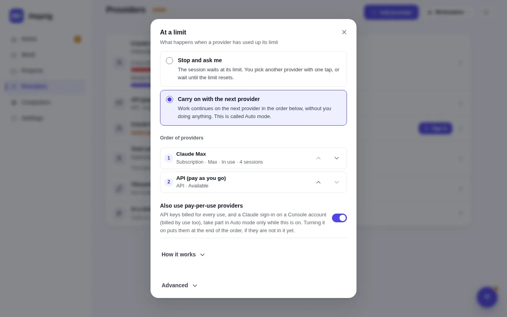
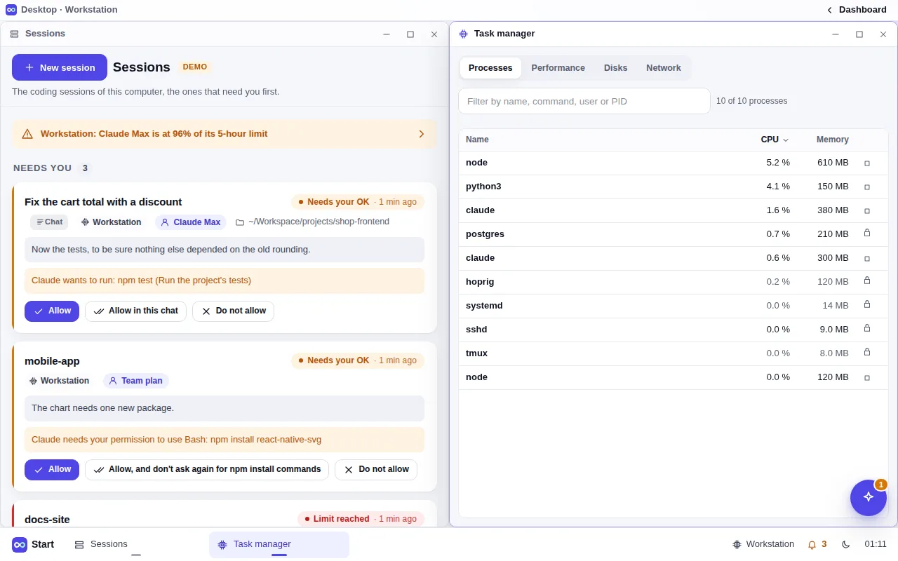
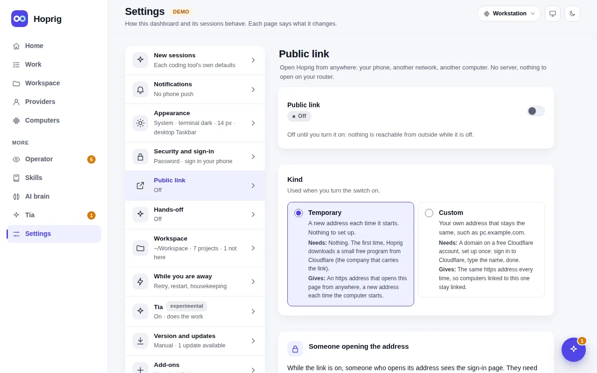
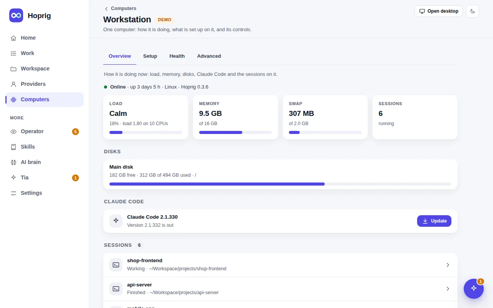
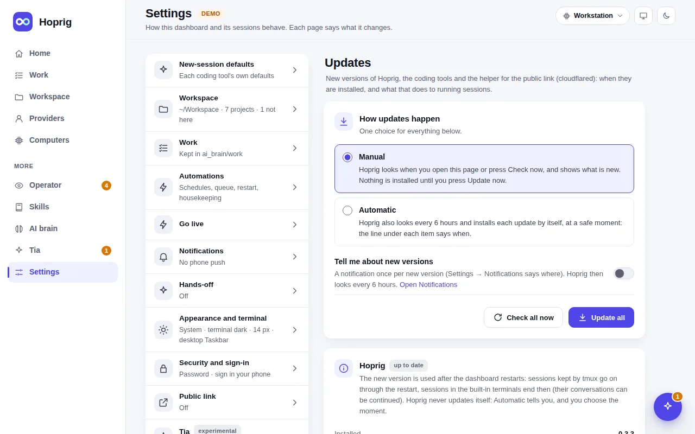
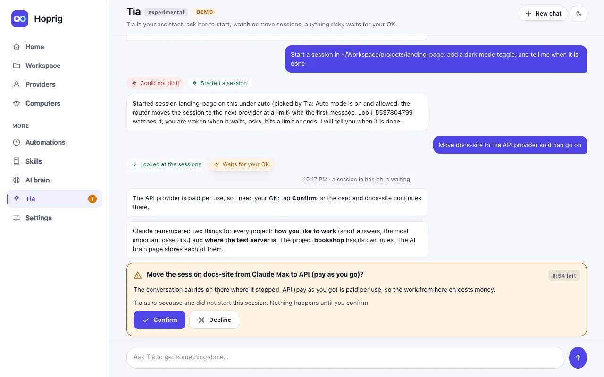

<p align="center">
  
</p>

<h1 align="center">Hoprig</h1>

<p align="center">
  <b>Code with Claude Code and OpenCode from any device: a chat for every project, on every computer you own,<br>
  that carries on with another provider when one reaches its usage limit. One dashboard, self-hosted, built for a phone too.</b>
</p>

<p align="center">
  <a href="LICENSE"></a>
  <a href="https://github.com/allswebtech/hoprig/actions/workflows/test.yml"></a>
  
</p>

```sh
curl -fsSL https://raw.githubusercontent.com/allswebtech/hoprig/main/install.sh | sh
```

<p align="center">
  
</p>

## What it does

- **A chat is the way to code.** One tap on a project opens a chat with its coding tool: Claude Code, or
  OpenCode as a second one. Replies as they are written, each change as a diff, Allow and Deny buttons, the
  to-do list, agents and background tasks. The real terminal is one tap away and keeps the conversation.
- **One AI brain for both tools.** The same working rules, skills and memory, kept in one git repository and
  linked into each coding tool.
- **Sessions carry on at a usage limit.** Subscriptions, API keys and gateways are all "providers". A session
  belongs to its folder, not to a provider: one tap moves it to another provider, or Auto mode does it for you.
- **A code editor in the page**: VS Code's editor core with Explorer, Search and Source Control.
- **A desktop in the browser**: windows for a computer's terminal, files, editor, processes, services and logs.
- **From anywhere**: one switch makes the dashboard reachable from the internet, with no server of your own.
- **Several computers in one place**: home PC, office PC, servers. Computers behind a router connect out by
  themselves.
- **Tia**, an assistant that does the work through the dashboard's own routes; what costs money or changes your
  computer comes to you as a card first. Off until you turn her on.
- **Updates** of Hoprig, the coding tools and the tunnel helper on one page, Manual by default.
- **A computer ready for coding**: git, Node.js, Python, the GitHub CLI, your projects and skills that fit them,
  installed by one guided run. What is already there is left alone.

Linux and macOS today. Windows is not ready: its code is written, and the first test runs on Windows do not pass
yet. Not affiliated with Anthropic or with OpenCode's makers; "Claude" and "Claude Code" are Anthropic's.

## Install

```sh
curl -fsSL https://raw.githubusercontent.com/allswebtech/hoprig/main/install.sh | sh
```

It installs what is missing (Node.js and Claude Code, after asking once), then runs `hoprig setup`, which ends
with a QR code: scan it and your phone is signed in to the dashboard. Until everything is set up, Home shows a
Get started checklist.

<p align="center">
  
</p>

Just want to look? `hoprig demo` opens the dashboard with sample data: no coding tool and no account needed.
Everything else: [docs/INSTALL.md](docs/INSTALL.md). Check a computer at any time with `hoprig doctor`. The
command is `hoprig`, or `hop` for short.

## Code in a chat

<p align="center">
  
</p>

**New session** on Home (or a project's **New session**) opens a chat in the project you pick, with the
provider, mode, model and effort of the last chat there (the first time: **Settings → New-session defaults**).
From a terminal on that computer, `hop chat [folder]` prints the chat's address and opens it in the browser.

- **What you see**: the reply as it is written, thinking, each tool call on one line with its diff, the to-do
  list, subagents as a tree under the call that started them, background tasks with their progress.
- **What you control**: the permission mode, the model, the effort and ultracode are chips over the message box
  and change without a restart. A message typed while it works is queued, and can be taken back. **Stop** ends
  the turn; background tasks go on until you stop them. `/` lists the commands and skills, `@` the folder's
  files; a picture can be pasted or dropped in. The status line says what runs now, the branch, the cost, the
  context used and the plan's limits where the provider reports them.
- **Its OKs**: **Allow**, **Allow in this chat** (stops the asking for that kind of call until the chat closes;
  nothing is written to a settings file) and **Do not allow**, in the chat and on its card on Home. In the mode
  "Run anything without asking" it never asks; a question to you, a plan to approve and what your own
  settings insist on still come to you, and a "deny" rule of your settings stays denied in every mode.
- **One place at a time**: **Open in terminal** takes the conversation to a real terminal, and **Open as chat**
  in a terminal session's menu brings it back. A conversation runs in one process only: a chat, a terminal session,
  or `hop` typed by hand in any terminal of that computer. The second one is refused in one sentence that says where
  the conversation runs and what to do; in a chat, **Continue here** stops that terminal and goes on in the chat.
  **Files** and **Changes** in the folder chip open the editor.

<p align="center">
  
  &nbsp;
  
  &nbsp;
  
</p>

### Two coding tools: Claude Code and OpenCode

Claude Code can do everything here. **OpenCode** is the second coding tool: a chat or a terminal session, the
providers that fit it, the shared AI brain and updates. Turn it on in **Settings → Coding tools**: **Install**
puts it into Hoprig's own tools folder at the version this Hoprig is tested with (never globally), and its own
self-update and its makers' free cloud models are switched off. New session then asks which coding tool to
use; each project opens in the coding tool its last chat used. In a terminal: `hop opencode [provider]`.

OpenCode runs only on a provider that speaks its API: an API key or a gateway, never a Claude subscription (a
subscription's sign-in is for Claude Code only, always). Auto mode, plan usage and Tia's own thinking are Claude
Code's only.

<p align="center">
  
</p>

### One brain for both

`hop workspace link` (or **Link** on the AI brain page) makes every coding tool that is on read the same
global rules, skills and memory from your AI brain, a git repository of your own:

| | Rules | Skills | Memory |
|---|---|---|---|
| Claude Code | `~/.claude/CLAUDE.md` → the brain | `~/.claude/skills` → the brain | its home memory → the brain |
| OpenCode | its global `AGENTS.md` → the brain's rules file | `~/.agents/skills` → the brain | none of its own: the shared rules tell it where each project's memory is |

Nothing is overwritten: a file or folder that is already there is merged into the brain and kept as a dated
backup. Details: [docs/WORKSPACE.md](docs/WORKSPACE.md).

## Hit a usage limit? Continue the same session on another provider

<p align="center">
  
</p>

A provider is a small file of settings (a profile): a Claude subscription, an API key or a gateway. Claude Code
keeps a session as a file named after its folder, and takes its provider from the environment it starts in, so
the same conversation can be continued under any provider.

```sh
hop                 # choose a provider, then start Claude Code
hop add             # add a provider: a Claude subscription, an API key, or a gateway
hop work -c         # continue this folder's last session on the provider "work"
```

At a limit, a chat or a session says so and offers the other providers: one tap and the same conversation goes on
there (a chat's provider chip, or **Move to another provider** in a session's menu, does the same at any time).
When Claude Code exits in a terminal, Hoprig asks whether to continue on another provider.

A provider that uses Claude Code's own sign-in can also go on with another Claude account of yours, as `/login`
does: **Sign in with another Claude account**, on the limit card, on Home and on **Providers**. You sign in in the
browser (from a phone: a link and a code); until that is complete the account of now stays. The provider's own
page shows who is signed in and has **Sign out**. A new account has its own limits, so the provider's limit mark
goes when the account changes. See [Is this allowed?](#is-this-allowed)

<p align="center">
  
</p>

### Auto mode (Claude Code)

```sh
hop auto order sub api      # your subscription first, then an API key
hop auto on                 # off at first: an API key costs money
hop auto                    # start a session in Auto mode
```

In the dashboard: **Providers**, then under **When a provider reaches its limit** choose **Carry on with the next
provider** and put the providers in order. A chat or a session on the provider "Auto" then talks to a small
router on your own computer: your subscription answers as long as it can, and the moment it reaches its limit
the same request is answered by the next provider, with no error on screen and nothing to type. When the
subscription is free again, requests go back to it.

<p align="center">
  
</p>

Good to know:

- The first request after a move re-reads the whole conversation on the new provider. On an API key that is paid
  at full price; `/compact` first keeps it small.
- When the next provider in the order is another subscription, Claude Code is restarted as that subscription (a
  few seconds) instead. See [Is this allowed?](#is-this-allowed)
- Claude Code's own Remote Control does not work through a router or with an API key; the Hoprig dashboard is the
  remote for those sessions.

## The code editor

<p align="center">
  
</p>

**Open code** on a project, a repository, a chat's folder chip or a session's menu opens the folder in VS Code's
editor core (Monaco), inside the page and behind its sign-in, also for another computer's folders. **Explorer**
(new, rename, delete), **Search** in files and **Source Control** (the changes side by side, stage, unstage,
discard, commit, the log); **N changes** on a project goes straight there. Ctrl+S, Ctrl+P, Ctrl+Shift+F and Ctrl+G
work as in VS Code. A save never overwrites a file that changed on disk without asking. On a phone one pane shows
at a time, with **Plain text editing** where the code editor cannot be typed into. Text size, tab size and word
wrap are in **Settings → Editor**; the colours follow the page.

## The desktop

<p align="center">
  
</p>

On a wide screen, the **Desktop mode** button at the top right of every page (or **Open desktop** on a computer's
page) opens that computer as a desktop in the browser: windows that move, resize, snap to halves and quarters
(also Alt+Shift with an arrow), minimise and maximise, a right-click menu, and the layout kept per computer. Its
apps are the computer's own: **Sessions**, **Terminal**, **Files** (move, copy, a trash folder, upload, download,
archives), **Editor**, **Task manager** (processes, performance, disks, network), **Services** (start, stop,
restart with the administrator password) and **Logs**. **Settings → Appearance** chooses the style: **Taskbar**
(the default) or **Dock**. **Dashboard** at the top right goes back. On a small screen the desktop is a grid of the
same apps, each opening as a page.

## From anywhere: the public link

<p align="center">
  
</p>

**Settings → Public link** (or `hop public on`) makes this dashboard reachable from anywhere through a Cloudflare
tunnel: no server of your own and nothing opened on your router. It is off until you turn it on, and it is one
switch with two kinds, never both at once:

- **Temporary**: a new `https://….trycloudflare.com` address each time it starts; nothing to set up.
- **Custom**: your own address that stays the same, on a domain in a free Cloudflare account (set up once on the
  page).

The tunnel helper installs itself the first time. Turning the link on needs a strong dashboard password (the page
asks for one in place), and a visitor sees only the sign-in page. A link that was on comes back after a restart
(a Temporary one with a new address, which the page shows and sends to your notifications).
`hop public on --temporary | --custom`, `hop public off`, `hop public status`.

## Several computers in one place

<p align="center">
  
</p>

| Your situation | What to do |
|---|---|
| One computer, phone on the same Wi-Fi | `hoprig setup`, scan the QR |
| Two or more computers on one network | On one of them: **Computers → Add a computer**, then pick how it is reached. No server |
| Computers at home, a server on the internet | `hoprig setup --hub` on the server; `hoprig join https://your-hub <code>` on each computer |
| Computers at home, no server, you are elsewhere | the public link on the main one; on the others: **Computers → Link to my main Hoprig** ([how](docs/COMPUTERS.md#from-anywhere-the-public-link)). With Temporary, the link ends when its address changes, so computers that should stay linked need Custom or a server |
| Servers only | one is the hub; add the others by their SSH name |

Every other computer keeps one connection out to the main one, so nothing has to be opened on a router. A hub is
small: about 80 MB of memory, measured with 20 computers and 20 open terminals. Guides:
[docs/COMPUTERS.md](docs/COMPUTERS.md), [docs/HUB.md](docs/HUB.md).

**One gateway for every computer.** **Providers → Gateways on your computers** lists every gateway (such as
TRouteAI) on every linked computer. **Use here** makes it a provider of this computer in one step. A gateway can
be shared through its computer's dashboard: the other computer gets a key of its own, the gateway keeps its own
key and stays on 127.0.0.1, and a key a linked computer made ends when that computer's token is revoked.

<p align="center">
  
</p>

## A fresh computer, ready for coding

<p align="center">
  
</p>

```sh
hop pc status                 # what this computer has, what is missing, what needs attention
hop pc setup                  # install what is missing: one confirmation, then it does it
hop project new shop          # a new project, or:
hop project clone acme/shop   # an existing one, with all its code repositories and its AI memory
hop skills suggest            # skills that fit this project; you read each one before it is added
```

In the dashboard: **Computers**, open the computer, **Setup**. Everything there runs in the page: **Set up this
computer**, a check's **Fix**, a recipe, the commit name, the GitHub sign-in (with a one-time code) and Claude
Code's own sign-in. When a step needs the administrator password, the page asks for it once; it goes to `sudo`
only, is never saved, and is masked in the output.

- **Projects**: one folder holds the rules (`AGENTS.md`, and `CLAUDE.md` for Claude Code), the AI memory and the
  docs, with the code repositories under `code/`. The memory lives in the project's git repository, so it follows
  you to every computer. The projects are under **Workspace**, each with its own page: its sessions, repositories
  and skills. Guide: [docs/PC-SETUP.md](docs/PC-SETUP.md).
- **Skills**: suggestions come from what the project is made of. Before anything is installed you see every file
  and a scan for risky lines; updates show the difference. Guide: [docs/SKILLS.md](docs/SKILLS.md).
- **Working rules**: a starting set, such as the right model and effort for the task and "done means proven".

<p align="center">
  
</p>

### The workspace and the AI brain

One folder tree, the same on every computer:

```
~/Workspace/
├── ai_brain/              shared AI knowledge: the rules every coding tool gets, skills, memory, notes
├── projects/<project>/    one project: its rules, its AI memory and docs, and code/<repo>/ for each repository
├── credentials/           keys and passwords for local work: never in git
├── development/           toolchains and SDKs
├── git/   database/postgresql/   backups/
```

```sh
hop workspace status        # every folder: there or not, and what it is for
hop workspace setup         # create only what is missing; nothing that exists is changed
hop workspace link          # let your coding tools read the same rules, skills and memory from the brain
```

**A fresh computer gets all of it from git.** `hop workspace map` writes one file in the brain that lists every git
repository of the workspace (addresses only, never a token). On the next computer, `hop workspace restore <address
of your brain>` clones the brain and everything its map names, where it belongs; `hop workspace sync` keeps every
repository in step (fast-forward only; pushing only with `--push`). The **AI brain** page shows, read-only, what
the AI knows on a computer, and never anything in folders named `no-ai`, `ignore` or `ai-ignore-dir`,
`credentials` folders, dot-files, `.env` and key files; text that looks like a secret is masked.

<p align="center">
  
</p>

## It keeps going without you

No AI involved, just rules you switch on, on the **Automations** page (Schedules, Queue, Rules, Activity):

- **Queue**: give a session its next messages; each goes in when a reply ends.
- **Schedules**: start a chat (or a session in a terminal) or send a message to one, once, daily or on chosen
  weekdays.
- **Restore**: after a restart, Claude Code's terminal sessions come back where they were.
- **Retry**: in a Claude Code session, after a server error that is not a limit, wait and continue, three times.

**Pause all automations** is under **Rules → Advanced**; while they are paused, every tab says so with a Resume
button.

## Updates

<p align="center">
  
</p>

**Settings → Updates** is one page for Hoprig, Claude Code, OpenCode and the tunnel helper: each row shows the
installed and the newest version, **Check now** and **Update now**, and one sentence on what an update does to
what is running. One choice for all:

- **Manual** (the default): it looks and shows what is new; nothing is installed until you press **Update now**.
- **Automatic**: it also installs each update by itself, at a safe moment: Claude Code when none of its sessions
  is working, OpenCode when none of its sessions is open, the tunnel helper when the public link is off. Hoprig
  itself is never updated by itself; Automatic tells you, and you choose the moment.

`hop tools` does the same for the coding tools in a terminal (`tools install | update | on | off <tool>`).

## Tia (experimental, off by default)

<p align="center">
  
</p>

An assistant in the dashboard: a round button at the bottom right of every page, and her own page under **More**.
She manages what is described above and gets a coding job done for you: she opens a chat in a project, picks a
provider among the ones you allow, sends the task, watches it, and reports. She is a headless Claude Code that
may use only Hoprig's own tools (`hoprig mcp`; while she is on, your own Claude Code can use the same tools). She is off until you
turn her on under **Settings → Tia**, and she costs money: her own thinking runs on a provider you choose, and
the chats she starts run on yours.

**After an update from an earlier version:** earlier versions ran Tia when the settings never named her, although
Settings → Tia showed her off. Now she is off until turned on. If you used her without ever touching that switch,
her page says she is off and her jobs are not watched until you turn her on in **Settings → Tia**; her conversations and
jobs are kept.

What she can do, through the dashboard's own routes (the list is `ALLOW` in
[src/assistant/door.mjs](src/assistant/door.mjs)):

- chats and sessions: start a chat (Claude Code, or OpenCode when you name it) or a terminal session, send a
  message, answer an OK by the rules below, stop a reply, rename, end, and move a chat or a session to another
  provider at a limit;
- projects: list them, start a new one, get one from GitHub, add a code repository, sync, create the missing
  workspace folders; read the AI brain;
- computers: their state, setup check and coding tools; run a fix, set one up, check for updates, update or
  install a coding tool, turn a coding tool on or off, end a process, restart or power off, add one by SSH,
  rename, start or stop an add-on, turn the public link on or off;
- automations, skills, and a few settings (quick messages, folders, uploads, Auto mode's order, the model and
  effort of new sessions, the projects folder, the working rules); one shell command on a computer, for a quick
  check you asked for.

**What she does by herself, and what always comes to you.** In a chat she started, she answers an OK by herself
only for looking (reading inside the chat's folder, listing, git's reading commands) and for the project's own
checks (`npm test`, `npm run lint` and the like, `node --test`). Every change to a file, every other command, any
tool she does not know, and every OK of an OpenCode chat is your card. Whatever costs money, stops work, installs
or updates something, turns a coding tool on or off or opens the computer to the internet is a card too, with one
exception you choose: at the level **Hands off** (Settings → Tia; the default is **Do the work**) she also starts
chats and sessions on the paid API providers you allowed her, and moves the ones she started there, without asking. A
terminal session's OK is judged only by the text on its screen against a list of risky things, which is best
effort. A chat stops being hers as soon as you type into it. What she reads from a chat, a terminal, a page or a
file is data to her, never an instruction; secrets never pass through her.

**What Tia does not do.** These are your own steps; the dashboard refuses them even if she tried (`NEVER` in the
same file). She opens the right page for you instead:

- adding a provider, signing it in or out, or its key; another coding tool's own sign-in;
- removing a computer, pairing codes, joining and connecting computers;
- the dashboard password and sign-in, signed-in devices and one-time sign-in links, the public link's Custom set-up;
- notifications, and whether updates install by themselves;
- her own settings (what she may do, which providers she may use, her token).

## The menu and the settings

**Home** (every chat and session, the ones that need you first), **Workspace**, **Providers**, **Computers**, then
under **More**: Automations, Skills, AI brain, Tia and Settings. **Settings** is a short list of pages:
New-session defaults, Workspace, Notifications, Appearance and terminal, Security and sign-in, Public link, Tia,
Editor, Add-ons, Coding tools, Updates, About. Each option has one plain sentence under it. **Notifications**:
a push to your phone when a session waits for you, needs your OK or reaches a limit.

Terminal sessions run in tmux when it is installed, 3.2 or newer (they survive a restart of the dashboard, and
`tmux attach` over SSH still works), otherwise inside the dashboard's own service (the built-in terminals).
A terminal session starts in your own shell, which is given only Hoprig's command and a file that is readable by you
alone and works once: the folder, the provider and the first message are never typed into the shell, so a first
message arrives as it was written, several lines included.

<p align="center">
  
</p>

## Not built, or not proven yet

Said plainly, so nothing here is a surprise:

- **Codex is not part of this version.** Its code is kept and tested, but it is switched off: no page, command or
  provider kind offers it.
- **OpenCode's sessions are not reopened after a restart**; Restore brings back Claude Code's terminal sessions only.
  Tia cannot continue an earlier OpenCode conversation by its id; she can only continue the folder's newest one.
- **Other computers report Claude Code's version only**, not OpenCode's, on the Computers page.
- **Not seen from a real model**: OpenCode's own question forms (the page has them; a real model never asked one in
  the tests).
- **Files on the desktop**: dragging between two Files windows is not built.
- **Run only on Linux**: everything new in this version (the chat, OpenCode, the editor, the desktop, the public
  link switch, Updates, one process per conversation). It was not run on macOS or Windows. How Hoprig tells that a
  process is still the one it started (a process id can belong to another program after a restart of the computer)
  is exact on Linux; on macOS and Windows it is written and tested with recorded answers of the system only.
- **Two gaps around one process per conversation**: pressing Ctrl+C in a new terminal session before its shell has
  read the start line leaves the conversation shown as running there until you choose **Continue here** or that
  terminal ends. A `hop` launcher that is killed hard while its coding tool goes on leaves that coding tool unseen by
  Hoprig.
- **On Windows**, a second temporary address of the public link whose file names no process identity (one an earlier
  version started) cannot be stopped by Hoprig: it says so, and that helper is ended by hand.
- **Not proven on real devices**: a phone's on-screen keyboard in the editor and the chat; changing the Claude
  account of a provider from the page end to end with a real account; a real stop or restart of a service from the
  desktop.

## When to use this, and when not

If you use one Claude subscription on one computer, Claude Code's own mobile app and Remote Control are the
simplest way to reach it from a phone. Hoprig is for when you want more than that:

- a chat for your projects that works the same from a desktop and a phone, on every computer you own;
- the same session on another provider when a limit is reached, including an API key or a gateway;
- a second coding tool (OpenCode) for providers other than Anthropic, with the same rules, skills and memory;
- a new computer or server set up for coding by one command;
- several computers in one place, on your own hardware, with nothing in between that you do not run.

## Is this allowed?

Hoprig runs the official, unmodified Claude Code and OpenCode and keeps your accounts on your own computers. It
has no server of its own and never shares an account with anyone.

What Anthropic's documentation covers: several accounts of your own on one machine; API keys and gateways as ways
to run Claude Code; and pointing Claude Code at a gateway while it stays signed in with a subscription. That last
one is what Auto mode's router is: it passes Claude Code's own request on, untouched. Hoprig never attaches a
subscription's sign-in to a request itself; only Claude Code does. A Claude subscription is never given to
OpenCode or to any other program: OpenCode runs only on API keys and gateways.

What is yours to judge: plan limits assume ordinary, individual use, Anthropic's policies forbid getting around
restrictions and sharing accounts, and Anthropic can restrict an account without notice. Whether continuing past a
limit on a second subscription of your own (as another provider, or by signing in with another Claude account) is
acceptable is not something the terms clearly settle. The surest setup is one subscription, then an API key. Never
use someone else's account. The provider behind an API key or a gateway has terms of its own; read them too.
Read the sources yourself:
[Claude Code: legal and compliance](https://code.claude.com/docs/en/legal-and-compliance),
[authentication](https://code.claude.com/docs/en/authentication),
[gateways](https://code.claude.com/docs/en/llm-gateway),
[Usage Policy](https://www.anthropic.com/legal/aup),
[Consumer Terms](https://www.anthropic.com/legal/consumer-terms).

## Security

The dashboard is a remote control for your computer, and it is built that way:

- It listens on this computer only until you choose otherwise. On a network it speaks plain HTTP, so use a network
  you trust; on the internet use the public link (HTTPS through the tunnel) or `hoprig setup --hub`, which puts it
  behind HTTPS and refuses plain HTTP.
- One password stored as a scrypt hash, a sign-in rate limit per visitor, one-time sign-in links, HttpOnly
  SameSite=Strict cookies, an Origin check on every change, a strict content security policy. The public link asks
  for a strong password before it turns on.
- Another computer gets a token you can revoke. A token cannot change the password, pair, or relay further.
- The router listens on 127.0.0.1 under a secret path and keeps no request or answer text.
- The editor and the desktop's Files reach only the folders the dashboard may show (**Settings → Security and
  sign-in** sets them, or everything your user can open); every path is checked on the server. Private folders
  (`no-ai`, `ignore`, `ai-ignore-dir`), git's own folder, the dashboard's own folders and sign-in files are never
  shown, searched or changed.
- A file of a project shown as a page runs in a sandbox. A shared gateway's keys are kept as hashes, and only `/v1/`
  paths pass.
- The administrator password for a setup step or a service is asked in the page when `sudo` needs it, given to
  `sudo` on its input, and never saved or shown.
- OpenCode's server, which Hoprig starts for a chat, listens on this computer only and always with a password; its
  routes that would return a key never reach the browser. A provider's key is given to a coding tool in its
  environment when it starts, never written into the tool's own files.
- Provider files (sign-ins and keys), tokens and passwords are readable by your user only and are never printed,
  logged or sent to a browser. Found a problem? See [SECURITY.md](SECURITY.md).

## Where it runs

| | Providers, Auto mode | Dashboard | Fresh-computer setup |
|---|---|---|---|
| Linux | run and tested | run and tested (tmux and built-in terminals), systemd service | run in clean Ubuntu, Debian and Fedora |
| macOS | run and tested | run and tested (built-in terminals) before this version; what is new in it was not run there (see above); the launchd service is written, not yet installed for real | checked read-only; installs not yet run |
| Windows | **not ready**: written, the tests do not pass on Windows yet | not ready | not ready |

Requires Node.js 20 or newer. The tests run on Linux and macOS with Node 20, 22 and 24 on every change. On Windows
they have been run and do not pass yet, so Windows is not supported. tmux is used from version 3.2 on; with an
older one (or none) the built-in terminals are used. With npm 12 there is nothing to do yourself: setup builds the
one module that needs a build (`node-pty`, the only install script Hoprig's `package.json` approves), and
`hoprig doctor` names the cause when it did not build.

Runtime dependencies: `ws`, xterm.js, Monaco (VS Code's editor core), `qrcode-terminal`, and optionally `node-pty`
for the built-in terminals. No framework and no build step.

## Commands

`hop help` lists them all with their options.

```
hop                              choose a provider, start Claude Code in this terminal
hop chat [folder] [--tool opencode]   open a chat in the folder (prints its address, opens the browser here)
hop <profile> [args]             start on that provider (args go to Claude Code)
hop opencode [provider] [args]   OpenCode in this terminal, on a provider that serves it
hop auto [args]                  Auto mode          hop auto on | off | order … | status
hop add | profiles | rm          providers (each one is a profile)
hop tools                        the coding tools: install | update | on | off <tool>
hop setup | doctor | update      set everything up, check everything, update Hoprig
hop pc setup | status            this computer for coding;  hop pc recipe save: a recipe for the next one
hop project new | clone | status | sync   projects
hop workspace status | setup | link | map | restore | sync | git   the workspace, its map, the AI brain
hop skills suggest | find | add | list | update  skills
hop serve | passwd | link        the dashboard, its password, a one-time sign-in link
hop service install              run the dashboard in the background
hop public on | off | status     the public link (--temporary | --custom)
hop machines | join | pair | tokens   several computers
hop addons                       add-ons: a gateway for other AI providers
hop claude status | update       Claude Code's version
hop demo                         the dashboard with sample data
hop mcp                          Hoprig's tools as an MCP server
```

## Contributing

`npm install`, `npm test`, `node bin/hoprig.mjs demo`. The README's screenshots come from the demo only:
`node tools/screenshots.mjs`. The rules for working on this repository, for people and for AI tools, are in
[AGENTS.md](AGENTS.md); see also [CONTRIBUTING.md](CONTRIBUTING.md).

## License

[MIT](LICENSE)
