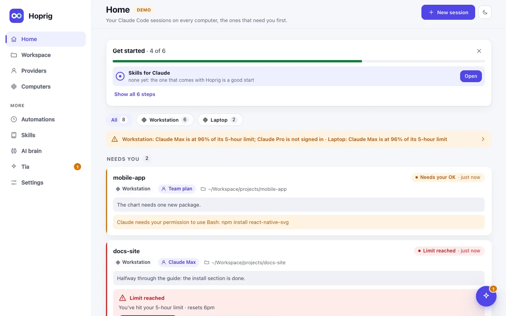
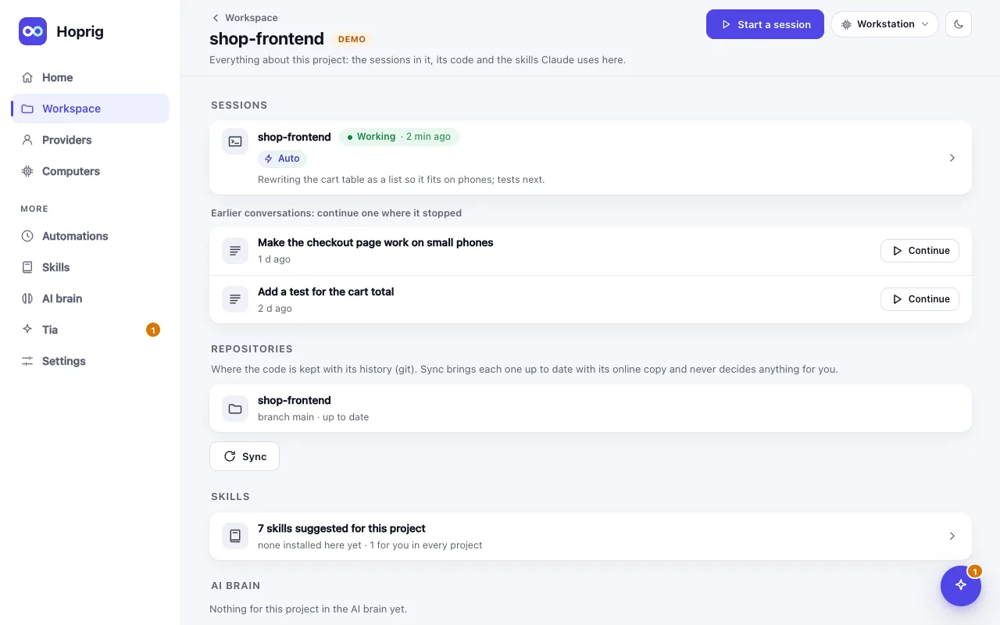
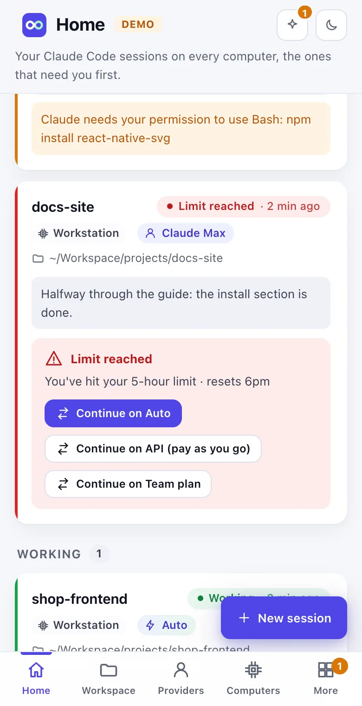
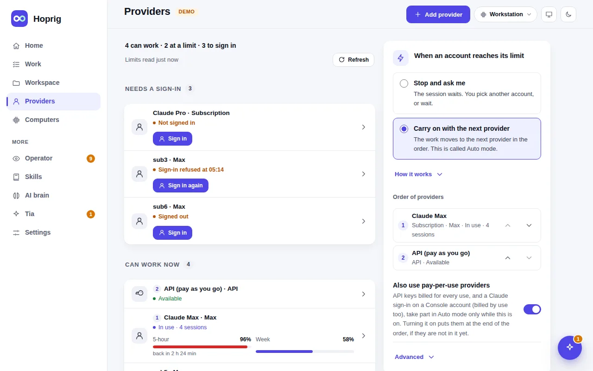
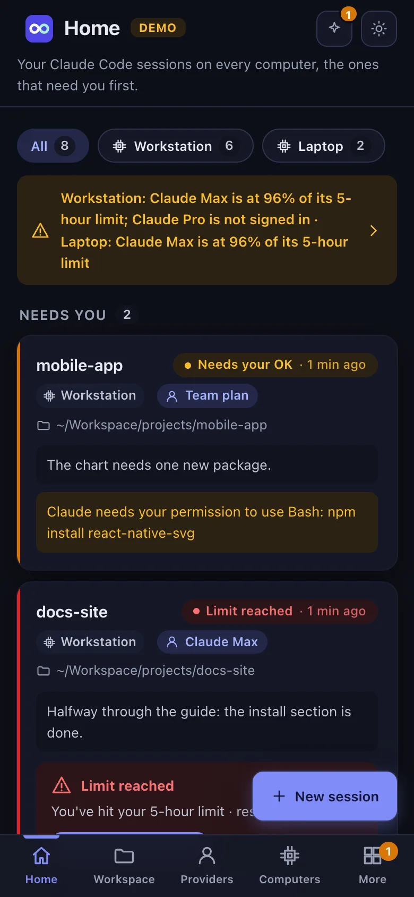
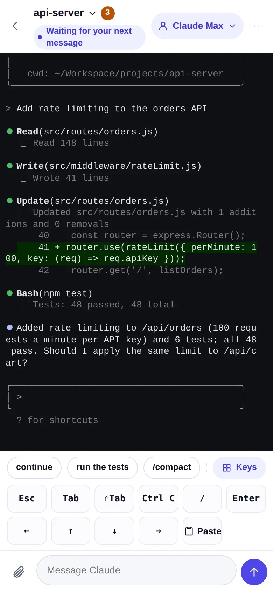
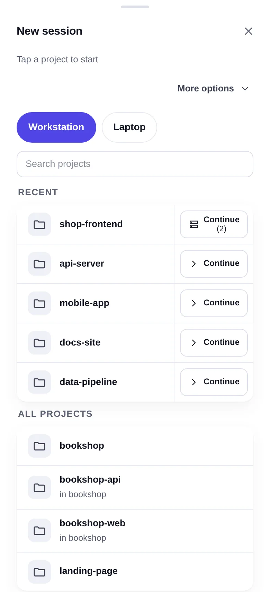
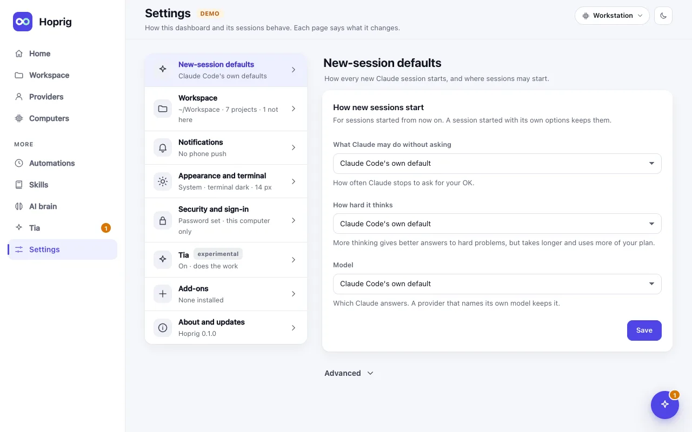
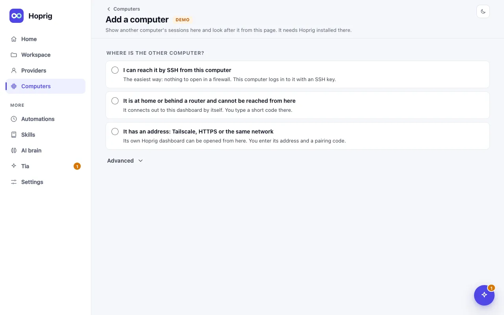

<p align="center">
  
</p>

<h1 align="center">Hoprig</h1>

<p align="center">
  <b>Take a fresh PC or Linux server, install Hoprig, and it sets up everything else for coding with Claude Code,<br>
  managed from one dashboard. On a computer that already has things, it checks what is there and adds what is missing.</b>
</p>

<p align="center">
  <a href="LICENSE"></a>
  <a href="https://github.com/allswebtech/hoprig/actions/workflows/test.yml"></a>
  
</p>

```sh
curl -fsSL https://raw.githubusercontent.com/allswebtech/hoprig/main/install.sh | sh
```

<p align="center">
  
</p>

## What it does

- **A computer ready for coding.** Claude Code, git, Node.js, Python, the GitHub CLI, your projects, skills
  that fit them, and a starting set of working rules for Claude: one guided run, one confirmation per step.
  What is already there is left alone.
- **Sessions that carry on at a usage limit.** Subscriptions, API keys and gateways are all "providers"; a
  session belongs to its folder, not to a provider. One tap moves it to another provider, or Auto mode does it
  for you.
- **Code from anywhere, phone included.** A self-hosted dashboard with the real terminal, built for one thumb.
  It shows which session is working, which is waiting for your next message and which needs you.
- **Several computers in one place.** Home PC, office PC, servers: one page shows every session and starts
  work on any of them. Computers behind a router connect out by themselves. No VPN, no third-party service.
- **It keeps going without you.** Queue the next messages, schedule work, reopen sessions after a restart.
- **One folder tree for your coding.** The same workspace on every computer, with a read-only view of what the
  AI knows.

Linux and macOS today. Windows is not ready: its code is written, and the first test runs on Windows do not pass yet.
Not affiliated with Anthropic; "Claude" and "Claude Code" are Anthropic's.

## Install

```sh
curl -fsSL https://raw.githubusercontent.com/allswebtech/hoprig/main/install.sh | sh
```

It installs what is missing (Node.js and Claude Code, after asking once), then runs `hoprig setup`, which
ends with a QR code: scan it and your phone is signed in to the dashboard. Until that is done, Home shows a
Get started checklist.

<p align="center">
  
</p>

Just want to look? `hoprig demo` opens the dashboard with sample data: no Claude Code and no Claude account
needed.
Everything else: [docs/INSTALL.md](docs/INSTALL.md). Check a computer at any time with `hoprig doctor`.
The command is `hoprig`, or `hop` for short.

## A fresh computer, ready for coding

<p align="center">
  
</p>

```sh
hop pc status                 # what this computer has, what is missing, what needs attention
hop pc setup                  # install what is missing: one confirmation, then it does it
hop project new shop          # a new project, or:
hop project clone acme/shop   # an existing one, with all its code repositories and its AI memory
hop skills suggest            # skills that fit this project; you read each one before it is added
```

In the dashboard: **Computers**, open the computer, **Setup**.

- **Tools**: git, a build toolchain, Node.js, Python, the GitHub CLI and more, with the commands each tool's
  own documentation gives. Save a computer as a small recipe and make the next one the same.
- **Projects**: one folder holds the rules, the AI memory and the docs, with the code repositories under
  `code/`. Claude Code's memory lives in the project's git repository, so it follows you to every computer.
  In the dashboard the projects are under **Workspace**, each with its sessions under it, and each has its own
  page: its sessions, repositories and skills.
- **Skills**: suggestions come from what the project is made of. Before anything is installed you see every
  file and a scan for risky lines; updates show the difference.
- **Working rules**: a starting set for Claude, such as the right model and effort for the task and "done
  means proven". Guides: [docs/PC-SETUP.md](docs/PC-SETUP.md), [docs/SKILLS.md](docs/SKILLS.md).
- **Workspace and AI brain**: one folder tree on every computer, and a view of what the AI knows (below).

<p align="center">
  
</p>

<p align="center">
  
</p>

## The workspace and the AI brain

One folder tree, the same on every computer. Coding is best done inside `projects/`: that is where a project's
rules, memory and code repositories sit together.

```
~/Workspace/
├── ai_brain/              shared AI knowledge: the rules Claude gets everywhere, skills, memory, notes
├── projects/<project>/    one project: its rules, its AI memory and docs, and code/<repo>/ for each repository
├── credentials/           keys and passwords for local work: never in git
├── development/           toolchains and SDKs
├── git/   database/postgresql/   backups/
```

```sh
hop workspace status        # every folder: there or not, and what it is for
hop workspace setup         # create only what is missing; nothing that exists is changed
hop workspace link          # let Claude Code read its global rules, skills and home memory from the brain
```

**A fresh computer gets all of it from git.** `hop workspace map` writes one file in the brain that lists every
git repository of the workspace (addresses only, never a token). On the next computer,
`hop workspace restore <address of your brain>` clones the brain and everything its map names, where it belongs;
`hop workspace sync` keeps every repository in step (fast-forward only; pushing only with `--push`; `--with
<computer>` straight from another computer over SSH). Setup signs in to GitHub with `gh` and offers to restore your
workspace or start one in a private repository.

`hoprig setup` offers the workspace as one step on a new computer. The **AI brain** page shows, read-only, what
the AI knows on a computer: the global rules, the brain's notes and daily logs, the skills, the memory (for
everywhere and for each project) and each project's own notes. It never shows anything outside those places,
folders named `no-ai`, `ignore` or `ai-ignore-dir`, `credentials` folders, dot-files, `.env` and key files, or
anything that is not plain text; text that looks like a secret is masked. Details:
[docs/WORKSPACE.md](docs/WORKSPACE.md).

## Hit a usage limit? Continue the same session on another provider

<p align="center">
  
</p>

Claude Code keeps a session as a file named after its folder, and decides which provider to use from its
environment when it starts. So a provider is just a small file of settings (a profile), and the same session
can be continued under any of them.

```sh
hop                 # choose a provider, then start Claude Code
hop add             # add a provider: a Claude subscription, an API key, or a gateway
hop work -c         # continue this folder's last session on the provider "work"
```

When Claude Code exits, Hoprig asks whether to continue the session on another provider. In the
dashboard it is one tap on the session (**Move to another provider**).

<p align="center">
  
</p>

### Auto mode

```sh
hop auto order sub api      # your subscription first, then an API key
hop auto on                 # off at first: an API key costs money
hop auto                    # start a session in Auto mode
```

In the dashboard: **Providers**, then under **When a provider reaches its limit** choose **Carry on with the
next provider** (that is Auto mode) and put the providers in order.

In Auto mode Claude Code talks to a small router on your own computer. Your subscription answers as long
as it can. The moment it reaches its limit, the same request is answered by your API key: no error
on screen, no restart, nothing to type. When the subscription is free again, requests go back to it.

<p align="center">
  
</p>

Good to know:

- The first request after a move re-reads the whole conversation on the new provider. On an API key that
  is paid at full price; `/compact` first keeps it small.
- The dashboard shows which provider is answering a session right now, each provider's plan usage and when
  its limit resets.
- When the next provider in your order is another subscription, Claude Code is restarted as that
  subscription (a few seconds) instead. See [Is this allowed?](#is-this-allowed)
- Claude Code's own Remote Control does not work through a router or with an API key; the Hoprig
  dashboard is the remote for those sessions.

## Code from anywhere, phone included

<p align="center">
  
  &nbsp;
  
  &nbsp;
  
</p>

- **Home**: every session, in three groups: Needs you, Working, Waiting for your next message. Each shows
  what Claude last said, so you can decide without opening it.
- **New session**: pick a project and Claude starts there on your default provider; the computer, the provider
  and more are under **Options**.
- **Session**: the real terminal, a key bar, a message box that works with dictation, quick messages, and a
  file attached straight into the project.
- **The menu**: Home, **Workspace** (your projects, each with its sessions under it), **Providers**,
  **Computers**, then under **More**: Automations, Skills, AI brain, Tia and Settings.
- **A computer's page**: **Overview** (load, memory, disks, Claude Code and its sessions), **Setup** (what it
  has for coding, what is missing, and its workspace folders) and **Advanced** (programs, open ports, its name,
  power).
- **Settings**: a short list of pages: New-session defaults, Notifications, Appearance and terminal, Security
  and sign-in, Tia, Add-ons, About and updates. Each option has one plain sentence under it.
- **Notifications**: a push to your phone when a session waits for you, needs your OK or reaches a limit.

Sessions run in tmux when it is installed, 3.2 or newer (they survive a restart, and `tmux attach` over SSH
still works), otherwise inside the dashboard's own service (the built-in terminals). An older tmux is not used.

<p align="center">
  
</p>

## Several computers in one place

<p align="center">
  
</p>

| Your situation | What to do |
|---|---|
| One computer, phone on the same Wi-Fi | `hoprig setup`, scan the QR |
| Two or more computers on one network | On one of them: **Computers → Add a computer**, then pick how it is reached. No server |
| Computers at home, a server on the internet | `hoprig setup --hub` on the server; `hoprig join https://your-hub <code>` on each computer |
| Computers at home, no server, you are elsewhere | the public link add-on: a fixed address on your own domain through Cloudflare, or a free temporary one ([how](docs/COMPUTERS.md#a-public-link-through-cloudflare)); or Tailscale |
| Servers only | one is the hub; add the others by their SSH name |

Two computers behind routers cannot find each other without a third one both can reach. Here that is your
own hub: every other computer keeps one connection out to it, so nothing has to be opened on a router. A hub
is small: about 80 MB of memory, measured with 20 computers and 20 open terminals; 512 MB RAM and one core
are enough. Guides: [docs/COMPUTERS.md](docs/COMPUTERS.md), [docs/HUB.md](docs/HUB.md).

<p align="center">
  
</p>

<p align="center">
  
</p>

## It keeps going without you

No AI involved, just rules you switch on, on the **Automations** page (Schedules, Queue, Rules, Activity):

- **Queue**: give a session its next messages; each goes in when Claude finishes the one before.
- **Schedules**: start a session or send a message once, daily or on chosen weekdays.
- **Restore**: after a restart, sessions come back where they were.
- **Retry**: after a server error that is not a limit, wait and continue, three times.
- **Updates**: tell you about, or install, a new Claude Code when nothing is working.

## Tia (experimental, off by default)

An assistant in the dashboard: a chat box at the bottom right of every page, and her own page under **More**.
She manages what is described above and gets a coding job done by driving sessions for you: she starts a
session, picks a provider among the ones you allow, sends the task, answers Claude Code's questions, checks the
result and reports. She is a headless Claude Code that may use only Hoprig's own tools (`hoprig mcp`; your own
Claude Code can use the same tools). She is off until you turn her on under **Settings → Tia**, and she costs
money: her own thinking runs on a provider you choose, and the sessions she starts run on yours.

What she can do, through the dashboard's own routes (the list is `ALLOW` in
[src/assistant/door.mjs](src/assistant/door.mjs)):

- sessions: list and read them, start one, type into one, press a key, rename, stop, move one to another
  provider;
- projects: list them, start a new one, get one from GitHub, add a code repository, sync, create the missing
  workspace folders;
- read the AI brain;
- computers: their state and setup check, run a fix, set one up, update Claude Code, end a process, restart or
  power off, add one by SSH, rename, install, update, start or stop an add-on;
- automations: rules, pause and resume, schedules, queued messages;
- skills: find, suggest, review, install, remove, check for updates;
- a few settings: quick messages, folders, uploads, Auto mode's order, the model and effort of new sessions, the
  projects folder, the working rules; and one shell command on a computer, for a quick check you asked for.

Whatever she reads from a terminal or a file is data to her, never an instruction; actions that cost money,
stop work or run commands are shown to you as a card to confirm; secrets never pass through her.

**What Tia does not do.** These are your own steps; the dashboard refuses them even if she tried
(`NEVER` in the same file). She opens the right page for you instead:

- adding a provider, or its sign-in or key;
- removing a computer, pairing codes, joining and connecting computers;
- the dashboard password and sign-in, the network, signed-in devices and one-time sign-in links;
- notifications;
- changing the permission mode of new sessions;
- her own settings (what she may do, which providers she may use, her token).

## When to use this, and when not

If you use one Claude subscription on one computer, Claude Code's own mobile app and Remote Control are the
simplest way to reach it from a phone. Hoprig is for when you want more than that:

- a new computer or server set up for coding by one command;
- the same session on another provider when a limit is reached, including an API key or a gateway;
- a remote for sessions that Remote Control cannot serve (API keys, gateways, long-lived tokens);
- several computers in one place, on your own hardware, with nothing in between that you do not run.

## Is this allowed?

Hoprig runs the official, unmodified Claude Code and keeps your accounts on your own computers. It has no
server of its own and never shares an account with anyone.

What Anthropic's documentation covers: several accounts of your own on one machine; API keys and gateways as
ways to run Claude Code; and pointing Claude Code at a gateway while it stays signed in with a subscription.
That last one is what Auto mode's router is: it passes Claude Code's own request on, untouched. Hoprig
never attaches a subscription's sign-in to a request itself; only Claude Code does.

What is yours to judge: plan limits assume ordinary, individual use, Anthropic's policies forbid getting
around restrictions and sharing accounts, and Anthropic can restrict an account without notice. Whether
continuing past a limit on a second subscription of your own is acceptable is not something the terms
clearly settle. The surest setup is one subscription, then an API key. Never use someone else's account.
Read the sources yourself:
[Claude Code: legal and compliance](https://code.claude.com/docs/en/legal-and-compliance),
[authentication](https://code.claude.com/docs/en/authentication),
[gateways](https://code.claude.com/docs/en/llm-gateway),
[Usage Policy](https://www.anthropic.com/legal/aup),
[Consumer Terms](https://www.anthropic.com/legal/consumer-terms).

## Security

The dashboard is a remote control for your computer, and it is built that way:

- It listens on this computer only until you choose otherwise. On a network it speaks plain HTTP, so use a
  network you trust; on the internet `hoprig setup --hub` puts it behind HTTPS and refuses plain HTTP.
- One password stored as a scrypt hash, a login rate limit, one-time sign-in links, HttpOnly SameSite=Strict
  cookies, an Origin check on every change, a strict content security policy.
- Another computer gets a token you can revoke. A token cannot change the password, pair, or relay further.
- The router listens on 127.0.0.1 under a secret path and keeps no request or answer text.
- Provider files (sign-ins and keys), tokens and passwords are readable by your user only and are never printed, logged or sent
  to a browser. Found a problem? See [SECURITY.md](SECURITY.md).

## Where it runs

| | Providers, Auto mode | Dashboard | Fresh-computer setup |
|---|---|---|---|
| Linux | run and tested | run and tested (tmux and built-in terminals), systemd service | run in clean Ubuntu, Debian and Fedora |
| macOS | run and tested | run and tested (built-in terminals); the launchd service is written, not yet installed for real | checked read-only; installs not yet run |
| Windows | **not ready**: written, the tests do not pass on Windows yet | not ready | not ready |

Requires Node.js 20 or newer. The tests run on Linux and macOS with Node 20, 22 and 24 on every change
(and natively on macOS with Node 26). On Windows they have been run and do not pass yet, so Windows is not supported. tmux is used from version 3.2 on; with an older one (or none)
the built-in terminals are used. With npm 12 there is nothing to do yourself: setup builds the one module that
needs a build (`node-pty`, the only install script Hoprig's `package.json` approves), and `hoprig doctor` names
the cause when it did not build.

Runtime dependencies: `ws`, xterm.js, `qrcode-terminal`, and optionally `node-pty` for the built-in terminals.
No framework and no build step.

## Commands

`hop help` lists them all with their options.

```
hop                              choose a provider, start Claude Code
hop <profile> [args]             start on that provider (args go to Claude Code)
hop auto [args]                  Auto mode          hop auto on | off | order … | status
hop add | profiles | rm          providers (each one is a profile)
hop setup | doctor | update      set everything up, check everything, update Hoprig
hop pc setup | status | clone    this computer for coding;  hop pc recipe save: a recipe for the next one
hop project new | add | clone | status | sync   projects
hop workspace status | setup | link | map | restore | sync | git   the workspace, its map, the AI brain
hop skills suggest | find | add | list | update  skills
hop serve | passwd | link        the dashboard, its password, a one-time sign-in link
hop service install              run the dashboard in the background
hop machines | join | pair | tokens   several computers
hop addons                       add-ons: a gateway for other AI providers, a public link
hop claude status | update       Claude Code's version
hop demo                         the dashboard with sample data
hop mcp                          Hoprig's tools as an MCP server
```

## Contributing

`npm install`, `npm test`, `node bin/hoprig.mjs demo`. The rules for working on this repository, for
people and for AI tools, are in [AGENTS.md](AGENTS.md); see also [CONTRIBUTING.md](CONTRIBUTING.md).

## License

[MIT](LICENSE)
