<p align="center">
  
</p>

<h1 align="center">Hoprig</h1>

<p align="center">
  <b>One command, and a computer is ready to code with AI.</b>
</p>

<p align="center">
  Free · open source · runs on your own computers · <a href="https://hoprig.com">hoprig.com</a>
</p>

<p align="center">
  <a href="LICENSE"></a>
  <a href="https://github.com/allswebtech/hoprig/actions/workflows/test.yml"></a>
  
</p>

- **It sets the computer up.** One line installs what coding with AI needs, asks nothing, and opens your browser on Hoprig, signed in.
- **Every chat is on one page.** Your sessions, your rules, skills and memory are on one page, also on your phone, and a session goes on with another account when one reaches its usage limit.
- **It is yours.** Free, open source, and it runs on your own computers; the AI it uses is your own Claude plan or key.

**Windows**: press the Windows key, type PowerShell, press Enter, paste this line and press Enter.

```powershell
irm https://raw.githubusercontent.com/allswebtech/hoprig/main/install.ps1 | iex
```

**Mac**: press Command and Space, type Terminal, press Enter, paste this line and press Enter.

```sh
curl -fsSL https://raw.githubusercontent.com/allswebtech/hoprig/main/install.sh | sh
```

**Linux**: press Ctrl+Alt+T, paste this line and press Enter.

```sh
wget -qO- https://raw.githubusercontent.com/allswebtech/hoprig/main/install.sh | sh
```

<p align="center">
  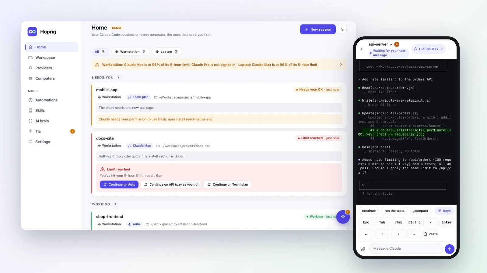
</p>

**What happens next**

1. The line says what the computer is missing, installs it and ticks each step. It asks nothing.
2. Your browser opens on Hoprig, already signed in. At first only this computer can open it.
3. Press **Sign in to Claude** (or **No Claude plan? Pay as you use**), then **New project** or **My own folder**.
4. Tell Claude what to make. You see each change and press **Allow** or **Do not allow**, at your desk or, once you turn it on in Settings, on your phone.

## What it does

- **A chat is the way to code.** One tap on a project opens a chat with its coding tool: Claude Code, or
  OpenCode as a second one. Replies as they are written, each change as a diff, Allow and Deny buttons, the
  to-do list, agents and background tasks. A terminal opens under the chat in the session's folder, and the
  conversation can go on in a terminal session too.
- **One AI brain for both tools.** The same working rules, skills and memory, kept in one git repository and
  linked into each coding tool.
- **Sessions carry on at a usage limit.** Subscriptions, API keys and gateways are all "providers". A session
  belongs to its folder, not to a provider: one tap moves it to another provider, or Auto mode does it for you.
- **A code editor in the page**: VS Code's editor core with Explorer, Search and Source Control.
- **A desktop in the browser**: windows for a computer's terminal, files, editor, processes, services and logs.
- **From anywhere**: one switch, **Settings → Public link**, makes the dashboard reachable from the internet, with no
  server of your own.
- **Several computers in one place**: home PC, office PC, servers. Computers behind a router connect out by
  themselves.
- **Tia**, an assistant that does the work through the dashboard's own routes. What she asks to install, update,
  restart or power off on your computer, or to end a process there, comes to you as a card first, at every level. So
  does what costs money, except where you choose otherwise. Within a daily limit for paid use you set in Settings → Tia (none at first), she
  may write to sessions on providers billed by use unless her level is **Ask me**, and at **Hands off** also start or move her
  sessions there. At **Hands off**, the Operator's limit rule or **Tia decides**, once you turn them on, may also move
  a session at a usage limit onto a provider billed by use, only within that limit, and each move counts against it. At **Hands
  off**, the short call of **Tia decides** and a look into what nobody can explain may also run on such a provider when
  every provider you allowed her is billed by use (Auto mode counts as billed by use here when its order holds such a
  provider), only within that limit too, and each counts against it. The Operator's rules, once you turn them on, restart
  a gateway or the public link that does not answer and end a test's left-over processes by themselves. **Tia
  decides** may make the same restarts, type one fixed line of Hoprig's into a stuck session to nudge it, and end a
  stuck session only in a project where you ticked **Tia may end a stuck session in this project** on the project's
  page ([docs/OPERATOR.md](docs/OPERATOR.md)).
  Typing into a session that runs on a provider billed by use, the nudge too, is money: **Tia decides** does it only at **Hands off** and within that limit, and it counts against it. Off until you turn her on.
- **Improve Tia** (Settings → Tia): Hoprig tries rewordings of Tia's skills, tool descriptions and instructions,
  measures each with her tests, and shows you only the ones that do measurably better. Nothing changes until you
  accept one, and every change has Undo. It starts only by your press and counts against your daily limit for paid
  use; a weekly round is off until you switch it on.
- **Hands-off** lets Hoprig answer some of a coding tool's questions by itself while you are away — the option
  the tool marked as recommended, or your note for the project — so a session does not wait for you, while still
  holding, as your card, anything that is yours alone: a push to the main branch, a release, a pull request, admin
  rights, a delete outside the folder, and the rest. Off until you turn it on, per project or per session.
- **Work**: your tasks, and its **Tasks** tab that lists what waits for your yes first and what is due this week. The list is one file in a git repository of your workspace (the AI
  brain by default); Save commits only that file, brings another computer's changes in task by task, and either
  reaches the server or leaves your change in the file; a save that was interrupted is finished the next time.
  **Do it** on a task starts a coding session with the task as its brief; on a git project it works on a branch of
  its own (`work/<task>`) in its own copy of the project, so your folder is not changed. What it did (its answer,
  commits and changed files) comes back onto the task for **Accept** or **Send back**; Accept leaves the branch for
  Go live, and nothing is merged or pushed. **Plans** hold a goal, milestones and
  dated tasks with what waits for what, on a timeline; **Plan with AI** has a session research a goal and propose a
  plan, and nothing is written before you accept it. **Auto**, a switch per project on Work → Team (off at first),
  lets Tia start that project's ready tasks by herself, one at a time, each one in Activity and stopped by **End**. **Another program** adds a task with a Work token (made in
  Work settings at the foot of Work → Tasks, shown once, good for Work only) and hears its result through a signed webhook; such a task starts
  only when you start it. **Missions** (off at first, on Work → Team) let Tia do a goal with roles: a developer,
  tester or ops session may run only the project's tests, its build and its scripts, each in a box with no network.
  [docs/WORK.md](docs/WORK.md)
- **Operator**: what stopped or is about to, from everything Hoprig watches (a session at its limit,
  an OK that waits, a disk 85% full, a run that stopped), as rows of **Home**'s **Needs you** group (the address `#/operator` opens Home), with one recommended step for each; Tia's own switches are under **Settings**, **Tia**; nothing happens until you tap it, unless you
  switched on one of Tia's rules, **Tia decides** or **Tia looks into what nobody can explain** (all are off at first; [docs/OPERATOR.md](docs/OPERATOR.md)).
- **Updates** of Hoprig, the coding tools and the helper for the public link (cloudflared) on one page, Manual by
  default.
- **A computer ready for coding**: git, Node.js, Python, the GitHub CLI, your projects and skills that fit them,
  installed by one guided run. What is already there is left alone.

**Windows, macOS and Linux.** The install line and the whole test suite run on GitHub's Windows, macOS and Linux
machines (the Windows test jobs are still allowed to fail), and the first run was walked on Windows four ways: a new
PC with scripts off, scripts allowed, an administrator window, and Git missing. Windows is new here, and a real home
Windows PC has seen less of Hoprig than a Linux computer has: the background service (Task Scheduler), winget and a
restart of the service were not run on one. Two things work differently on Windows: a go-live command ended at its time
limit also ends a server it started in the background (on Linux that server goes on running), and a scheduled run whose
coding tool could not be ended switches its schedule off until you switch it on again in Work → Schedules. Hands-off and
the box are not offered on Windows.
Much else was not tried there (see "Where it runs"). Not affiliated with Anthropic or with OpenCode's makers;
"Claude" and "Claude Code" are Anthropic's.

## Who it is for

Three things together: it sets up the computer; it keeps one workspace that comes back from git on any computer,
with an AI memory per project; and a session goes on with another provider or account when one reaches its limit.
Each case below has its own page with the steps, what you need and what it does not do.

What you get, each answered on the page and section it links to:

- [Can the AI write the code for me?](https://hoprig.com/use-cases/review-ai-changes/#what-hoprig-does): Yes, in a chat: you say what you want in plain words, and you see each change and allow it before it is made.
- [How do I keep an AI-built project in order from day one?](https://hoprig.com/use-cases/messy-ai-project/#what-hoprig-does): Every project gets the same folder from the first day: the rules for the AI, its memory, the docs and the code, all in git.
- [Who sets up my computer for coding with AI?](https://hoprig.com/use-cases/not-a-developer/#what-hoprig-does): Hoprig does: one line installs it, and its setup installs and checks what is missing, after asking you once.
- [Can I code on several computers?](https://hoprig.com/use-cases/team-machines/#what-hoprig-does): Yes: each computer set up the same way from one recipe, and all of them on one page of the dashboard.
- [Can I code on my own computer from my phone?](https://hoprig.com/use-cases/code-from-your-phone/#what-hoprig-does): Yes: the dashboard opens in your phone's browser, with a chat per project and the real terminal, and no server of anyone else's.
- [Can AI-built code be ready for real use?](https://hoprig.com/use-cases/production-ready/#what-hoprig-does): Hoprig adds working rules that make the coding tool prove its work, and suggests reviewed skills for security, performance and tests.
- [Does it come with skills and tools?](https://hoprig.com/use-cases/production-ready/#easy-safe-fast-and-ready-to-grow): Yes: skills that fit what your project is made of, each with a scan of its risky lines before you add it, and a skill that sets up a new project from your brief.
- [What happens when my project grows large?](https://hoprig.com/use-cases/messy-ai-project/#when-the-project-grows): It stays in order: each part has one place, every repository is in one map, and plans are kept in Work. The AI's work still needs your review.
- [Does the AI brain learn?](https://hoprig.com/use-cases/messy-ai-project/#your-ai-brain-and-what-it-learns): There is one memory per project and one main brain, in git. Once you turn it on, it drafts skills from work you corrected or kept, at most three a week, and installs none without you.
- [Is it easy, safe and fast?](https://hoprig.com/use-cases/production-ready/#easy-safe-fast-and-ready-to-grow): The set-up is done for you, the working rules keep secrets out of the code, and skills for security and speed are suggested. It does not measure load for you.
- [Can I move my work to another computer?](https://hoprig.com/use-cases/new-computer/#what-hoprig-does): Yes: your AI brain lists every repository, so another computer gets the same projects, rules and memory.
- [Does everything come back from git?](https://hoprig.com/use-cases/new-computer/#what-hoprig-does): Yes: install Hoprig, sign in to git, and your AI brain, its map and your projects come back where they were.
- [Do my computers stay in step?](https://hoprig.com/use-cases/two-computers-one-workspace/#what-hoprig-does): Yes: the same rules, skills and memory through git, every repository brought up to date, and every computer's sessions on one page.
- [Can I run an AI team under one assistant?](https://hoprig.com/use-cases/ai-team/#what-exists-today): In part, today: Tia takes a goal, and sessions with six roles (developer, tester, reviewer, researcher, writer, ops) do its tasks, each checked before it comes back to you.
- [Coming: one dashboard for a whole business?](https://hoprig.com/use-cases/ai-team/#coming): Coming, not built yet: roles beyond code such as sales, posts sent only after your approval, and one dashboard for a whole business.

The cases:

- [I am not a developer. How do I start building with AI on my own computer?](https://hoprig.com/use-cases/not-a-developer/): The set-up is the wall. Hoprig installs and checks everything, then you build in a chat.
- [My AI-built project became a mess after a few weeks. How do I keep it in order?](https://hoprig.com/use-cases/messy-ai-project/): A structure from day one: a project's own rules and memory, one AI brain, skills and checks.
- [How do I code on my own PC from my phone with Claude Code?](https://hoprig.com/use-cases/code-from-your-phone/): The dashboard from anywhere, no server: a chat per project, the OKs and the real terminal.
- [How do I use Claude Code on two computers with the same skills, rules and memory?](https://hoprig.com/use-cases/two-computers-one-workspace/): Home PC, office PC, laptop: the same projects, rules, skills and memory through git, every session on one page.
- [How do I get my whole AI coding setup back on a new, formatted or lost computer?](https://hoprig.com/use-cases/new-computer/): Install, sign in to git, and everything comes back where it was.
- [I hit the Claude Code usage limit in the middle of my work. How do I keep going?](https://hoprig.com/use-cases/usage-limit/): The same session goes on with another provider or account, by one tap or by itself.
- [How do I use Claude Code from my phone with an API key or a gateway?](https://hoprig.com/use-cases/api-key-or-gateway/): Where the coding tool's own remote features stop working, the dashboard still does.
- [How do I keep many client projects apart when I code with AI?](https://hoprig.com/use-cases/freelancer-agency/): One folder, one set of rules and one provider per client project; fetch it when work starts, put it away after.
- [How do I turn a spare PC or a small server into an always-on coding machine?](https://hoprig.com/use-cases/always-on-coding-machine/): Your always-on coding machine: sessions keep running, and you reach them from any browser.
- [How do I set up every machine the same way for AI coding?](https://hoprig.com/use-cases/team-machines/): Every machine set up the same, from one recipe and one AI brain, all on one page.
- [How do I let AI coding work go on while I sleep?](https://hoprig.com/use-cases/work-while-you-sleep/): Tasks in a queue, schedules and Auto mode, and the results waiting in the chats in the morning.
- [How do I make AI-built code ready for real use, not just "it runs"?](https://hoprig.com/use-cases/production-ready/): Working rules, checked skills and proof before "done", for code that has to hold up.
- [How do I plan a piece of work with AI and let sessions do it?](https://hoprig.com/use-cases/plan-with-ai/): Write the goal, let a session propose milestones and tasks, accept what you keep, then have sessions do the tasks.
- [How do I tell an AI assistant what to do, by voice or text, and approve just one step?](https://hoprig.com/use-cases/tell-the-assistant/): Say or type what you want; Tia shows one card with the task, the brief, the provider and the model, and starts nothing before your yes.
- [How do I start a new project with Claude Code from a written brief?](https://hoprig.com/use-cases/new-project-from-a-brief/): Write the brief once; the AI fits the work to the project, asks you once, writes the documents, then builds with proof.
- [How do I put a new server to work from my dashboard?](https://hoprig.com/use-cases/server-from-the-dashboard/): Add it by SSH from the Computers page, let the page install Hoprig there, then set it up and start sessions on it.
- [How do I review and comment on Claude Code's changes before they go on?](https://hoprig.com/use-cases/review-ai-changes/): The changed files beside the chat, comments on any line sent as one message, rewind, branch and your own checks.
- [How do I see on one page what needs me?](https://hoprig.com/use-cases/what-needs-you/): One page lists what needs you, most urgent first, with one button for the recommended step; while Tia's switches are off, nothing happens until you tap.
- [Can I run an AI team under one assistant?](https://hoprig.com/use-cases/ai-team/): Give Tia a goal; sessions with roles (developer, tester, reviewer and more) do its tasks, each checked before it comes back to you. Roles beyond code are coming.

## Install

The line for your system is at the top of this page. The line fetches Hoprig's installer from GitHub and runs it on your computer.
It says what is missing and installs it without asking (Node.js 24.13.1 or newer when it is missing or older, and on
Linux the build tools and a few system parts, with sudo, which asks for its own password; Ctrl-C stops it), then Hoprig
itself from the main branch of this repository, then runs `hoprig setup`. A first run asks nothing: a tick appears for
each part, Claude Code is installed, the dashboard is made ready for this computer only and starts when you sign in to
your computer, and your browser opens Hoprig, already signed in, on one card with two steps: **Sign in to Claude**, then
**Start your first chat**. The phone comes later, in Settings. Run `hoprig setup` yourself later and it is the full run:
it asks about 7 things on a fresh desktop (who may open the dashboard, the one list of installs, the GitHub sign-in,
keeping the workspace on GitHub, a name for this computer, keeping the map up to date by itself, a first project), and
ends with a QR code (on a server: how to reach it from your own computer): scan it and your phone is signed in to the
dashboard.

On a server with only a root login, the installer does not set Hoprig up under root (Claude Code refuses bypass
permissions mode for root): it lists its steps and asks once, *Make the user hoprig and set Hoprig up there?*, then
sets Hoprig up as that user. An older Hoprig that already runs as root moves with `hoprig move-to-user`, which needs
the network ([docs/INSTALL.md](docs/INSTALL.md#a-server-with-only-a-root-login)).

<p align="center">
  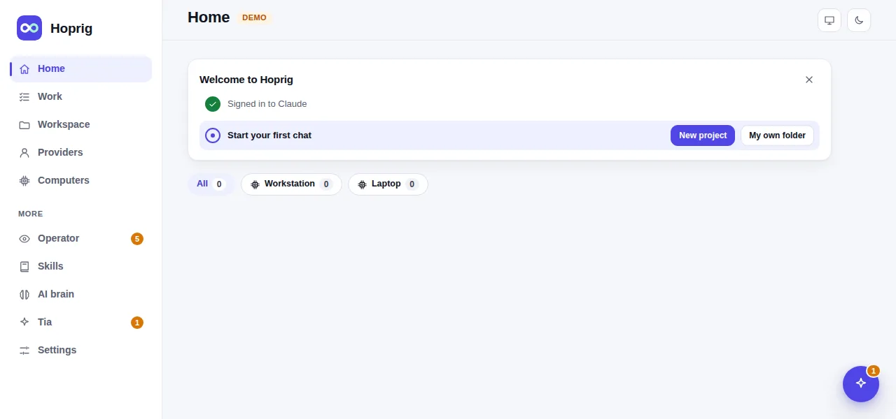
</p>

Just want to look? `hoprig demo` opens the dashboard with sample data: no coding tool and no account needed.
On Windows, what was tried there is in [docs/INSTALL.md](docs/INSTALL.md). Everything else:
[docs/INSTALL.md](docs/INSTALL.md).
Check a computer at any time on its **Setup** tab (**Computers** → the computer → **Setup**), where a problem that
one press can fix has a **Fix** button (or, in a terminal, `hoprig doctor`). Where the dashboard runs as a background
service, **Restart the dashboard** under its **Advanced** tab restarts it; its sheet first says what happens to that computer's sessions
(kept by tmux (a program that keeps terminals running when the dashboard stops), they go on; in the built-in
terminals they end, and come back only if "Reopen sessions after a restart" is on). Only your own page restarts it, never Tia or a token. The command is `hoprig`, or `hop` for short.

## Code in a chat

<p align="center">
  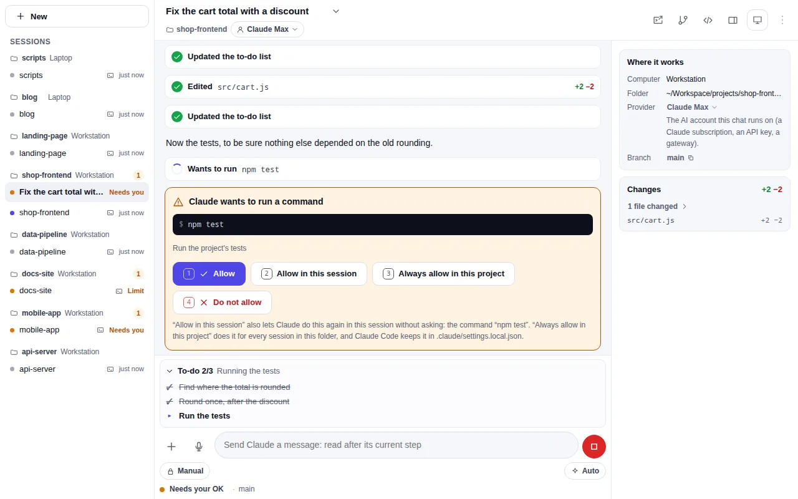
</p>

**New session** on Home opens with **Tap a project to start**: the projects as big rows (**Recent**, then **All
projects**, then **Another folder…**), and one tap on a row starts an App chat there with nothing else asked. A project is one row and its session starts in
the project's own folder, where its rules and AI brain are (a session you started in one of its code folders counts for
the same row); a code folder alone is reached by **Another folder…**. The App
takes the provider, mode, model and effort of the last session in that folder (the first time: **Settings → New
sessions**); the chat's own chips change them at any time. Where two or more computers are linked, a row of small
chips over the projects chooses the computer. **More options** holds only what must be chosen before the start:
**Open in a terminal** (the coding tool's own screen instead of the chat), **Coding tool** (when two or more are
ready), **An earlier conversation**, **On a branch of its own** and **Read other projects too**. A project's own
**New session** has the project set and a **Start** button.
Every model choice lists the chosen provider's own models: a gateway's or an API key's own list (asked when the
choice opens, kept ten minutes), or the models Claude Code offers a subscription. When no list can be had, it says
why, offers opus, sonnet and haiku, and takes an exact model name; a saved model the list leaves out is kept and marked.
From a terminal on that computer, `hop chat [folder]` prints the chat's address and opens it in the browser.

- **What you see**: the reply as it is written, thinking, each tool call on one line with its diff, the to-do
  list, subagents as a tree under the call that started them, background tasks with their progress. In a reply a
  link opens in a new tab and *italic* is shown; every code block has a **Copy** button and each turn has one **Copy** under its last reply; a file name in a tool card or in the text is a button that opens the file in Hoprig's editor at that line
  (a right-click, the menu key or a long press offers **Attach as context**, **Open in** and **Copy** the path;
  only a path inside the session's folder is a button).
- **Background tasks** sit above the message box, as Claude Code lists them under its prompt: one line, the task in words
  when one runs ("npm run dev · 2 min") or the count and kinds ("4 in the background: 2 agents, 1 shell, 1 workflow").
  A press on it opens the Background tasks sheet with each task and its **Stop**; **Output** there shows a shell's
  last 2000 lines or an agent's report, read again every 3 seconds while it is open and the task runs.
- **What you control**: the permission mode, the model, the effort and ultracode are chips over the message box
  and change without a restart. A message typed while it works waits at the end of the conversation as a faded dashed bubble saying
  "Not read yet" with **Edit** and **Remove** (Up in the empty box edits the last one); Claude reads it after its current step.
  The box has one button place: **Stop** while the box is empty and a turn runs, **Send** as soon as you type (Esc always
  stops). **Stop** ends the turn; background tasks go on until you stop them. `/` lists the commands and skills by name, as Claude
  Code's menu (`/compact` takes focus text, `/help` lists them, `/config` opens Settings, `/clear` opens a new
  session in the folder and keeps this one), `@` the folder's files; a picture can be pasted or dropped in.
  `!` before a line runs it as a shell command in the session's folder, as you would type it in the built-in
  terminal: your shell, the dashboard's environment without its secrets, at most 5 minutes (its output shows as it
  comes; **Stop** or Esc ends it; a program it starts in the background keeps running as long as the dashboard
  does, unless its output goes elsewhere: `npm run dev > dev.log 2>&1 &`); nothing goes to the
  coding tool until you send your next message, which carries the command and the end of its output as your own
  text. Through the public link it is behind the same sign-in as the rest of the dashboard (which can open a
  terminal anyway). While a turn runs, a line at the end of the conversation says what Claude does now (Thinking,
  Running a command, Writing) with the seconds; the branch and the context are in the session rail, and the plan's limits where
  the provider reports them. On a wide screen the session rail beside the chat shows the
  environment, the folder's changes and the context (**Hide session rail** in the title bar). In the **Changes** card,
  **Create PR** asks the coding tool to commit, push the branch and open a pull request with `gh` (shown when the folder
  has a remote, `gh` is signed in and there is something to send); once there is one, a line `#12 title` with "Checks
  passing", "Checks failing" or "Checks running" (read after each turn and when the rail opens) has a menu: **Open**,
  **Auto-fix** (when checks fail) and **Merge when ready**, which asks you first because others will see it.
  A session's state reads as **Finished** (its turn is over), **Ready** (nothing written to it yet), **Ended**
  (closed), **Working**, **Working in the background**, **Needs your OK** or **Limit reached**, the same on Home
  (whose group is **Ready**), in the list and in notifications.
- **As in the Claude Code desktop app**: the modes are Manual, Accept edits, Plan, Auto and Bypass permissions
  (Bypass only once **Allow bypass permissions mode** is on in **Settings → New sessions**, which asks
  first; the desktop app has the same switch under **Settings > Code**; off, a terminal session started in bypass
  starts again without it after a move or a restart, and Settings counts the ones still running; New sessions names the modes with
  the same words; a dashboard that already used bypass keeps it on after the update and says so once on Home). Right after
  Bypass the menu has **Allow everything** (Claude Code only, offered where Bypass is, never as root, and the first time on a
  computer it asks once): in a session you put into it yourself, nothing of Hoprig's wall is held and nothing asks, also
  while Hands-off is on (a command Hoprig cannot read, a delete, a push, a release, sudo), and one quiet line says what it
  would have held; it is for work you watch or trust; only a delete read for certain as
  removing your whole home folder, workspace, projects folder or disk still waits for you, checked before the command runs; the caret
  beside the title opens the session menu (**Transcript view** Normal, Thinking or Verbose, **Open in** with **Continue in
  Terminal** (the same conversation in a terminal session), **Files** and **Source control**, **Archive**, **Copy branch
  name**, **Fork**: a new session on a copy of the conversation, which you switch into,
  as Claude Code's `/branch`; `/fork [prompt]` makes the copy and keeps you here; `/model sonnet`, `/effort high`,
  `/branch name` and `/clear name` work as typed); a click on the title renames it in place (Enter saves, Esc cancels). The title bar has
  **Terminal**, **Changes** and **Files**: **Terminal** (`` Ctrl+` ``) opens a shell under the chat in the session's folder, with
  **+** for another tab, and hiding it keeps the shell (the bin on a tab ends that tab's shell, and archiving the chat ends the shells made for it, whoever archives it). **Archive** asks nothing: a toast says Archived and has **Undo**; it asks
  ("Archive anyway") only for a session that is working, or for one on a branch of its own with changes not committed.
  New session's **More options** has **On a branch of its own (worktree)** for Claude Code: Hoprig makes a new branch and a
  separate copy of the project's files under `.claude/worktrees` (which the project's git leaves out of its changes), and the chat works there (a folder that is not a git
  repository starts as usual and says so; a chat on a branch says its branch in its first line, and its folder is listed under its project). Ctrl+Alt+N (Ctrl+Shift+N on a Mac) opens a new session. A **Home** icon is at the
  top of every chat, and the panel button at the left of the title bar hides and shows the session list (`Ctrl+\`, `Cmd+\` on
  a Mac; remembered in this browser). From
  900 px wide the session list sits at the left (below that, the same button opens it over the chat; a tap outside or Esc closes it): **+ New**, the sessions of every computer grouped by folder (or
  by state or computer: **Group and sort** on its heading, where **Archived** lists this computer's archived App
  sessions to continue one), what needs you marked; a right-click on a row has **Open in new window** and, for an App
  session, **Archive** and **Delete** (the desktop app's Split view has no counterpart here); a phone keeps Back to Home.
  Each row has the name on its own line, and its state and time under it.
  Ctrl+Shift+] and Ctrl+Shift+[ open the next and the previous session of that list. **Keyboard shortcuts** (Ctrl+/,
  or `?` outside the message box) lists every key of the App, and under "Kept by the browser" the desktop app's keys
  a page never gets (Ctrl+N, Ctrl+W, Ctrl+Tab) with where the App has them.
- **A question an MCP server asks you** (an MCP server is a program that gives the coding tool more tools) shows as a
  card in the chat, as Claude Code's own questions do: the server's name, its words as plain text in a box of their
  own, its fields (or the one web address it asks you to open), **Send** and **Decline**. Only you answer it: no
  permission mode, Hands-off or Tia does, and Home and notifications say only "An MCP server asks you a question".
- **A session's name is Claude Code's own name for the conversation**, in the session list, the title bar, the
  tab, Home, notifications and a terminal session's card: its first words until Claude Code writes its title, then
  that title. **The person's newest rename wins, wherever it was typed** (**Rename** here, a click on the title, or
  `/rename` in Claude Code); a title Claude Code generates never wins over a rename. A rename made here is kept by
  Hoprig, also after a restart. Started from the App, Claude Code makes no title by itself, so after a session's first
  reply the App asks it for one: one small request to the session's own provider. **Name sessions with a short
  title** (a session's short name) is always on now; an old setting that turned it off is still honoured.
- **Delete** (the last entry of the session menu, of a row's menu, and a button on each ended conversation of
  **Earlier conversations**) moves the conversation to Hoprig's trash: the toast has **Undo**, **Trash** in the list's
  menu has **Put back**, and after 30 days it is removed with its transcript. **Select to delete** in the same menu
  picks several at once. Only Claude Code's own files of that conversation move (its `.jsonl` and its folder of the
  same id); a session that is working, waits for an OK or runs in a terminal is not deleted, and the page says why.
  **Changes** (or the rail's Changes card) opens the diff pane: the folder's files, unified or side by side; a **+**
  by a line opens a comment box, Enter queues the comment, Cmd/Ctrl+Enter sends them all as one message. Each of
  your messages has **Rewind to here**: **Restore code and conversation**, **Restore conversation**, **Restore
  code** or **Never mind**, as Claude Code's rewind (its Summarize choices are not offered: the coding tool's
  stream has no request for them). Dollars per turn show only in Verbose and only for a provider billed by
  use.
- **Its OKs**: **Allow**, **Allow in this session** (stops the asking for that kind of call for the rest of this session;
  nothing is written to a settings file), **Always allow in this project** (the same rule, which Claude Code itself
  keeps in the project's `.claude/settings.local.json`) and **Do not allow**, in the chat; its card on Home has the
  first, second and last. In the mode
  Bypass permissions Claude Code asks nothing except before some deletes; Hoprig answers for it only when the delete
  is plainly inside the session's folder. A question to you, a plan to approve, what your own settings insist on
  and any other delete Claude Code stops for still come to you, and a "deny" rule of your settings stays denied in
  every mode. In Allow everything (Bypass and more, chosen only by you on your own
  page) Hoprig answers Allow to every permission, also what it cannot read, and holds only a delete it reads for certain as
  removing your whole home folder, workspace, projects folder or disk; a question, a plan, a sign-in and a usage limit still
  come to you. Tia's sessions, schedules and Work never run in it.
- **One place at a time**: **Open in** → **Terminal** in the session menu takes the conversation to a real
  terminal, and **Open as chat** in a terminal session's menu brings it back. A conversation runs in one process
  only: a chat, a terminal session, or `hop` typed by hand in any terminal of that computer. The second one is
  refused in one sentence that says where the conversation runs and what to do; in a chat, **Continue here** stops
  that terminal and goes on in the chat.
  **Files** in the title bar opens the editor; the diff pane's editor button opens its Changes view.

<p align="center">
  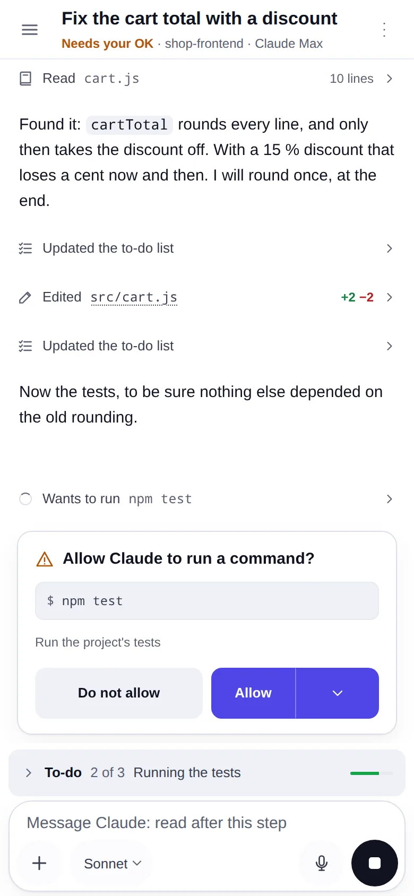
  &nbsp;
  
  &nbsp;
  
</p>

### Lead model: one model plans, others do the parts (Claude Code)

**Lead model** (off by default; in the chat's Lead chip, Plan with AI, Settings → New sessions and
Settings → Tia) makes the model you chose the lead: it plans the task and hands each part to a helper by its kind of
work. Running and recording (tests, builds, searches, logs, mechanical edits) goes to the provider's fastest model at
low effort, writing and reviewing code to its strong model, an unknown cause, a design decision or the last check to
its strongest at high effort. The models are picked from the chosen provider's own list, never another provider's; a
tier it lacks falls to the next it has, and one line under the switch says which models it will use before anything
starts. The helpers are Claude Code's own (given at the start), so no other process runs them, and a helper's model
and effort are its kind's: a call in which the lead names another model or effort runs without it (a hook takes it
out). It pays on work with parts that can be done apart; on a small task it costs more (three to six times the tokens
in our tests), and the line under the switch says so. **Who did what** in the chat's side rail (and in the chat's ⋮
menu at any width) shows each part with its model and its tokens (new, written and read from the cache, apart), and
one total per tier, read from Claude Code's own records; a Work run that had helpers shows the same under it, in a
task's runs and in Activity, and a plan shows its tasks' runs per tier. A Lead chip under the message box says whether
Lead is on. With the switch off a session starts exactly as before. New session does not ask for it: the Lead chip in the chat and
Settings → New sessions do. Another coding tool shows the switch off.
A terminal session has no Lead: Hoprig cannot see what each part of a terminal session costs, so it cannot
show or count its money in the daily limit for paid use as it does in the App.

**Use other providers** (shown while Lead model is on, off by default) lets the lead also hand a part to another
provider you tick (the list, right under the switch, shows each one's coding tools, whether it is billed by use and its
limit). A part is a session of its own on that provider in the same folder, which you can open from Home; it runs on
its kind's model of that provider's list, in the lead's own permission mode (never in bypass unless "Allow bypass
permissions mode" is on, and the line under the switch names the mode), and its answer returns to the lead as data.
Hoprig checks every part itself: only a ticked provider (where Tia leads, only one she is allowed), none at its limit
(skipped, and said in the chat), and never more at once than "runs by themselves at once", which Work's runs count
too. A part on a provider billed by use starts only where you allowed pay-per-use for work that goes on by itself, or
after a card in the lead's chat that names the provider and the part: No, or no answer, and the lead does that part
itself. Where Tia leads, a part on a provider billed by use starts by itself only at **Hands off** and only within the daily
limit for paid use (Settings → Tia); with no limit set, or not enough of it left today, it is that card. Parts that run at once share what is left of that limit; each holds its share while it runs. A part that starts by your yes on that card is counted in what Settings → Tia shows for today, but is never checked against the limit: it counts $0.50 until its chat reports what its turn cost, and when that turn ends without a reported cost, the $0.50 stays counted until the day ends. When the dashboard stopped while a part ran, Hoprig did not see the part end and could not measure what it cost, so the rest of its budget stays counted until the day ends. After the restart, Settings → Tia says it is counted for a part whose end Hoprig did not see, not for a part that runs now. A later start of a part (after it stopped for being idle, or after a restart) with no limit set any more, or no room left in it, starts nothing and holds nothing; when you send it a message, its chat says that Claude Code could not start, and why. No key or address is ever in what a model is given; a chat's part token and its file go when the chat ends. The switches and the ticks are kept with the chat, the
plan and Tia's settings; a choice made for one session wins over the default.

### Two coding tools: Claude Code and OpenCode

Claude Code can do everything here. **OpenCode** is the second coding tool: a chat or a terminal session, the
providers that fit it, the shared AI brain and updates. Turn it on in **Settings → New sessions → Coding tools**: **Install**
puts it into Hoprig's own tools folder at the version this Hoprig is tested with (never globally), and its own
self-update and its makers' free cloud models are switched off. New session then offers it next to Claude
Code under **More options** and keeps the one you chose last; a project's own New session chooses the coding tool that project used
last. In a terminal: `hop opencode [provider]`.

OpenCode runs only on a provider that speaks its API: an API key or a gateway, never a Claude subscription (a
subscription's sign-in is for Claude Code only, always). Auto mode, plan usage and Tia's own thinking are Claude
Code's only.

<p align="center">
  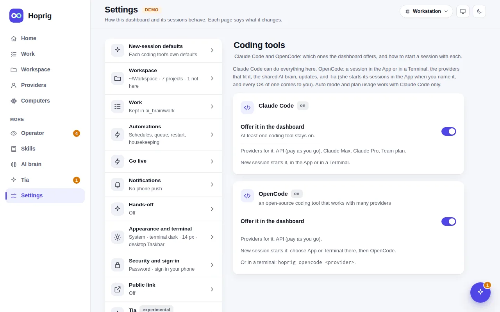
</p>

### One brain for both

`hop workspace link` (or **Link** on the AI brain page) makes every coding tool that is on read the same
global rules, skills and memory from your AI brain, a git repository of your own:

| | Rules | Skills | Memory |
|---|---|---|---|
| Claude Code | `~/.claude/CLAUDE.md` → the brain | `~/.claude/skills` → the brain | its home memory → the brain |
| OpenCode | its global `AGENTS.md` → the brain's rules file | `~/.agents/skills` → the brain | none of its own: the shared rules tell it where each project's memory is |

Nothing is overwritten: a file or folder that is already there is merged into the brain and kept as a dated
backup. Details: [docs/WORKSPACE.md](docs/WORKSPACE.md).

## Hit a usage limit? Continue the same session on another provider

<p align="center">
  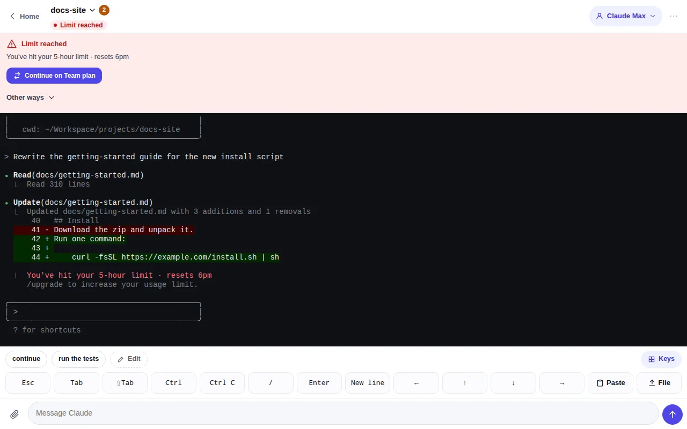
</p>

A provider is a small file of settings (a profile): a Claude subscription, an API key or a gateway. Claude Code
keeps a session as a file named after its folder, and takes its provider from the environment it starts in, so
the same conversation can be continued under any provider.

```sh
hop                 # choose a provider, then start Claude Code
hop add             # add a provider: a Claude subscription, an API key, or a gateway
hop work -c         # continue this folder's last session on the provider "work"
```

At a limit, a chat or a session says so and offers the other providers: one tap and the same conversation goes on
there (a chat's provider chip, or **Move to another provider** in a session's menu, does the same at any time).
When a session in a terminal stops at a limit or an error, Hoprig asks whether to continue on another provider;
one you end yourself (`/exit`, Ctrl+D) just ends, with one line on how to continue it later.

A provider that uses Claude Code's own sign-in can also go on with another Claude account of yours, as `/login`
does: **Sign in with another Claude account**, on the limit card, on Home and on **Providers**. You sign in in the
browser (from a phone: a link and a code); until that is complete the account of now stays. The provider's own
page shows who is signed in and has **Sign out**. A new account has its own limits, so the provider's limit mark
goes when the account changes. See [Is this allowed?](#is-this-allowed)

<p align="center">
  
</p>

### Another gateway

A gateway is a program on your computer that offers other AI providers (OpenAI, Gemini, OpenRouter, a local
model…) through Claude's API, so Claude Code can use them. Hoprig ships one as an add-on, TRouteAI, and manages it:

- **One press sets it up.** `hop addons setup trouteai` and **Providers → Add provider → Other providers → Set up
  TRouteAI** install it into Hoprig's own folder, start it, wait until it answers, make the key "Hoprig sessions
  (computer name)" with the gateway's own command and save it as a provider. A copy that npm already put on the
  computer stays in use until you press Install. Hoprig keeps no management key: the gateway's command token is sent
  only from this computer, only to a program that runs as your own user.
- **Accounts, combos and limits on Providers.** A TRouteAI panel shows its accounts with their state and limit
  windows; you can test, turn off, remove and add accounts (by a key, a sign-in code or a link), make combos and
  remove the keys Hoprig made. A provider's check that finds a model name without a combo has a **Make the combo** press.
- **The lifecycle on Advanced → Service → Gateways.** Restart, Log, Update, Remove (its copy in Hoprig's folder only; your data and
  the provider stay: `hop addons remove trouteai`) and the gateway's own dashboard password. `hop doctor` says which copy runs.
- **Still in TRouteAI's own page**, until its next version: adding a provider that its list does not offer yet, and its
  other settings.

Any other gateway can be added as a definition of your own:

```sh
hop gateways                   # the gateways Hoprig knows, and yours
hop gateways add relay --title Relay --port 20100 --bin /opt/relay/bin/relay --args "--listen=127.0.0.1:PORT"
hop addons setup relay         # start it and make its provider
hop gateways confirm relay     # after you updated its program: run it as it is now
hop gateways remove relay
```

A definition has a short name (lower-case letters, digits and `-`), a title, a port (1024 to 65535, free when it is
added), either the program (its full path, or a name found on PATH) or the npm package Hoprig installs and updates it
with, the arguments that tell it the port (`PORT` stands for the port; only letters, digits and `. _ = : , @ / + -`),
and the path of its own page if it has one. It is kept in `config.json` under `gateways` → `defined`, and checked
again whenever it is read.

A program is pinned when you add it: a name is looked up on PATH then and a link is followed, and what is kept is the
file itself with a fingerprint (sha256) of it. The file and its folders must be ones only you (or the system) can
change, outside the workspace. On a Mac, Homebrew lets every admin user of the computer change its folders, so a
program installed with brew is refused: copy it to a folder only you can change (such as `~/bin`) and add it from
there. Hoprig runs exactly that file; once it changes (an update of the program too), it does
not start it until you confirm it again: `hop gateways confirm relay` shows the file as it is now with its fingerprint
and asks as `add` does, or **Confirm the new program** on its row in Settings → Add-ons. The definition, its sharing
and the keys of other computers stay as they were. Hoprig also keeps the program as you typed it (a name on PATH, or a
link): when an update moves it (a new version in a new folder, the link moved there), confirm looks that up again and
shows the file it leads to now beside the one you confirmed. A gateway added before Hoprig kept that is named again with
`hop gateways confirm relay --program <path>`. `hop gateways` and the page say when a program changed. The program of an npm package is the one npm installed globally for that
package; a copy of that name earlier on PATH (a project's `node_modules/.bin`) is not run.

**It is a program Hoprig will run**, as your user, whenever you start it or a session on its provider needs it.
So you add it yourself: `hop gateways add` shows the exact program and arguments and asks in your terminal for the
dashboard's password (y/N while there is none; it refuses without a terminal and in a shell that a coding tool or the
dashboard started), and **Settings → Add-ons → Add a gateway** shows them and asks the same on the page. The
assistant's tools cannot add one. Nothing of it goes through a shell. This guards against a mistake and against a
coding tool trying it in passing, not against a program of your user that sets out to: such a program can edit
`config.json` itself, as it can any of your files.
On another computer, its page's **Advanced → Service → Gateways** starts, stops and runs a gateway as a service there (see
[docs/COMPUTERS.md](docs/COMPUTERS.md#each-computers-health-and-a-gateway-on-it)).
Once added it is an add-on like the shipped one (`hop addons start | stop relay`); with more than one gateway,
**Other providers** first asks which one.

### Auto mode (Claude Code)

```sh
hop auto order sub api      # your subscription first, then an API key
hop auto on                 # off at first: an API key costs money
hop auto                    # start a session in Auto mode
```

In the dashboard: **Providers**, then **At a limit**, and choose **Carry on with the next
provider** and put the providers in order. A chat or a session on the provider "Auto" then talks to a small
router on your own computer: your subscription answers as long as it can, and the moment it reaches its limit
the same request is answered by the next provider, with no error on screen and nothing to type. When the
subscription is free again, requests go back to it.

<p align="center">
  
</p>

Good to know:

- The first request after a move re-reads the whole conversation on the new provider. On an API key that is paid
  at full price; `/compact` first keeps it small.
- When the next provider in the order is another subscription, Claude Code is restarted as that subscription (a
  few seconds) instead. See [Is this allowed?](#is-this-allowed)
- Claude Code's own Remote Control does not work through a router or with an API key; the Hoprig dashboard is the
  remote for those sessions.

## The code editor

<p align="center">
  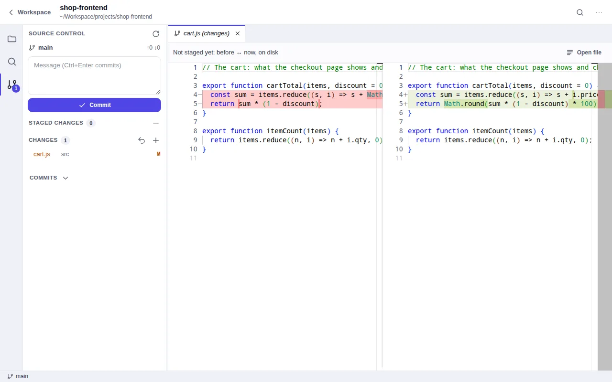
</p>

**Open code** on a project, a repository, a chat's Files button or a session's menu opens the folder in VS Code's
editor core (Monaco), inside the page and behind its sign-in, also for another computer's folders. **Explorer**
(new, rename, delete), **Search** in files and **Source Control** (the changes side by side, stage, unstage,
discard, commit, the log); **N changes** on a project goes straight there. VS Code's keys work: Ctrl+S, Ctrl+P,
the command palette (Ctrl+Shift+P, F1), Ctrl+Shift+F and Ctrl+Shift+H (replace across files, with a preview),
Ctrl+G, Ctrl+B, Ctrl+\` (a terminal in the opened folder), and the code editor's own. A browser tab keeps Ctrl+W,
Ctrl+N, Ctrl+T, Ctrl+Shift+T, Ctrl+Tab and Ctrl+PageDown/PageUp for itself: there the editor uses VS Code for the
Web's keys (Ctrl+Shift+Alt+N closes a tab, Ctrl+Alt+N makes a file) or a Ctrl+K chord (Ctrl+K Shift+T reopens a
closed tab), shown beside each command in the palette and in **Keyboard shortcuts** (Ctrl+K Ctrl+S); installed as
an app, VS Code's own keys work too. A tab's menu (right click or long press) closes others, to the right or the
saved ones, copies its path and pins it. A save never overwrites a file that changed on disk without asking; a
replace across files skips such a file and names it. On a phone one pane shows at a time, with **Plain text
editing** where the code editor cannot be typed into. Font Size, Tab Size and Word Wrap are in **Settings →
Editor**; the colours follow the page.

## The desktop

<p align="center">
  
</p>

On a wide screen, the **Desktop mode** button at the top right of the pages (the chat's title bar has none; or **Open desktop** on a computer's
page) opens that computer as a desktop in the browser: windows that move, resize, snap to halves and quarters
(also Alt+Shift with an arrow), minimise and maximise, a right-click menu, and the layout kept per computer. Its
apps are the computer's own: **Sessions**, **Terminal**, **Files** (move, copy, a trash folder, upload, download,
archives), **Editor**, **Task manager** (processes, performance, disks, network), **Services** (start, stop,
restart with the administrator password) and **Logs**. **Settings → Appearance** chooses the style: **Taskbar**
(the default) or **Dock**, and the desktop's keys: **Alt+Shift** (the default), **Ctrl+Alt** or **Off**, held with an
arrow to snap, maximise and restore, M to minimise, W to close and \` (the key above Tab) to go to the next window in
the order last used. Alt+Tab belongs to your computer; here it is Alt+Shift+\` (on a Mac the keys are written
Option+Shift and Cmd+Tab is the computer's; GNOME keeps Alt+Shift+\` and Ctrl+Alt with an arrow for itself, and
Settings says so there). In the code editor the arrows with these keys stay with what you type,
and on a Mac every one of these keys does in a text box; the title bar's menu has every act. **Dashboard** at the top right goes back. On a small screen the desktop is a grid of the
same apps, each opening as a page.

## From anywhere: the public link

<p align="center">
  
</p>

**Settings → Public link** (or `hop public on`) makes this dashboard reachable from anywhere through a Cloudflare
tunnel: no server of your own and nothing opened on your router. It is off until you turn it on, and it is one
switch with two kinds, never both at once:

- **Temporary**: a new `https://….trycloudflare.com` address each time it starts; nothing to set up.
- **Custom**: your own address that stays the same, on a domain in a free Cloudflare account (set up once on the
  page).

The helper for the public link (cloudflared) installs itself the first time. Turning the link on needs a strong dashboard password (the page
asks for one in place), and a visitor sees only the sign-in page. A link that was on comes back after a restart
(a Temporary one with a new address, which the page shows and sends to your notifications).
`hop public on --temporary | --custom`, `hop public off`, `hop public status`.

## Several computers in one place

<p align="center">
  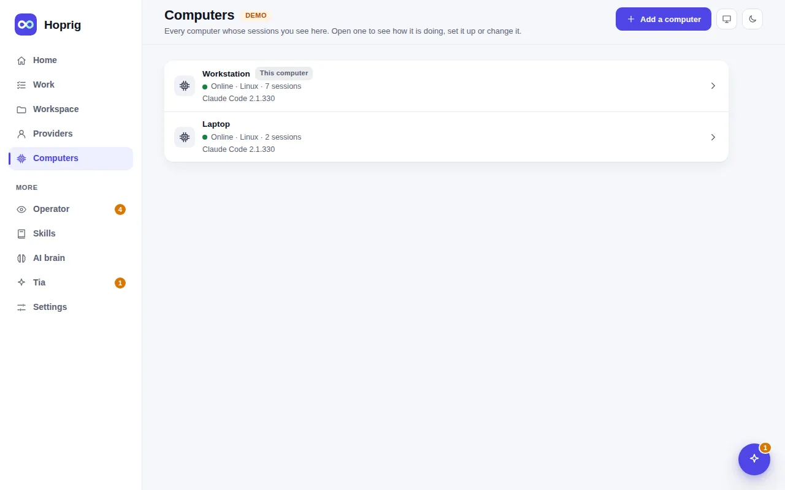
</p>

| Your situation | What to do |
|---|---|
| One computer, phone on the same Wi-Fi | `hoprig setup`, scan the QR |
| Two or more computers on one network | On one of them: **Computers → Add a computer**, then pick how it is reached. No server |
| Computers at home, a server on the internet | `hoprig setup --hub` on the server; `hoprig join https://your-server <code>` on each computer |
| Computers at home, no server, you are elsewhere | the public link on the main one; on the others: **Computers → Link to my main Hoprig** ([how](docs/COMPUTERS.md#from-anywhere-the-public-link)). With Temporary, the link ends when its address changes, so computers that should stay linked need Custom or a server |
| Servers only | one is the main computer; add the others by their SSH name |

Every other computer keeps one connection out to the main one, so nothing has to be opened on a router. A main computer is
small: about 80 MB of memory, measured with 20 computers and 20 open terminals. Guides:
[docs/COMPUTERS.md](docs/COMPUTERS.md), [docs/HUB.md](docs/HUB.md).

**One gateway for every computer.** **Providers → TRouteAI → Gateways on your computers** lists every gateway (such as
TRouteAI) on every linked computer. **Use here** makes it a provider of this computer in one step. A gateway can
be shared through its computer's dashboard: the other computer gets a key of its own, the gateway keeps its own
key and stays on 127.0.0.1, and a key a linked computer made ends when that computer's token is revoked.

<p align="center">
  
</p>

## A fresh computer, ready for coding

<p align="center">
  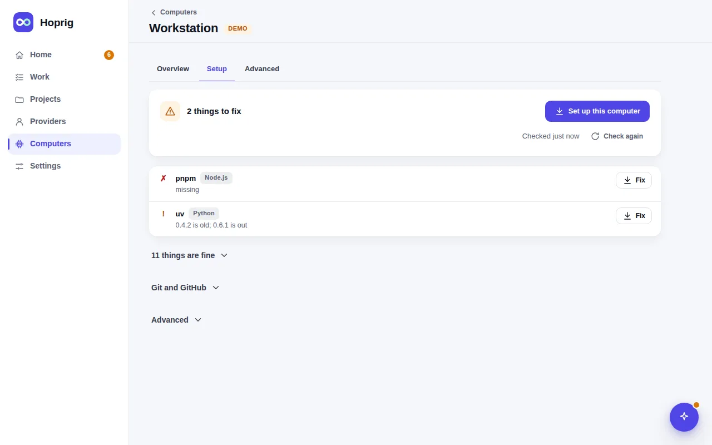
</p>

```sh
hop pc status                 # what this computer has, what is missing, what needs attention
hop pc setup                  # install what is missing: one confirmation, then it does it
hop project new shop          # a new project, or:
hop project new shop --brief brief.md --start   # one an AI session sets up from your brief, or:
hop project clone acme/shop   # an existing one, with all its code repositories and its AI memory
hop skills suggest            # skills that fit this project; you read each one before it is added
```

In the dashboard: **Computers**, open the computer, **Setup**. Everything there runs in the page: **Set up this
computer**, a check's **Fix**, a recipe, the commit name, the GitHub sign-in (with a one-time code) and Claude
Code's own sign-in. When a step needs the administrator password, the page asks for it once; it goes to `sudo`
only, is never saved, and is masked in the output.

On **Setup**, each problem has its press under it: **Fix** where Hoprig can do it, a link to the page that does it,
or **Sign in** for Claude Code. A step that needs administrator rights and that no Fix does says why ("It needs
administrator rights, so the computer asks for your password, which only you type."), shows the one line, and
**Open a terminal with this line** opens a new terminal session with the line typed: you press Enter yourself, and
nothing else (not Tia, not an automation, not another computer) types into that session.

- **Projects**: one folder holds the rules (`AGENTS.md`, and `CLAUDE.md` for Claude Code), the AI memory and the
  docs, with the code repositories under `code/`. The memory lives in the project's git repository, so it follows
  you to every computer. The projects are under **Workspace**, each with its own page: its sessions, repositories
  and skills. Guide: [docs/PC-SETUP.md](docs/PC-SETUP.md).
- **New project's skills**: every new project gets the New Project skill (**Add the New Project skill**, ticked;
  `--no-skill` leaves it out), and **Add skills that fit its technology** adds text-only skills from your own and
  from the reviewed catalog by themselves, with Undo; anything else waits for you. Guide: [docs/SKILLS.md](docs/SKILLS.md).
- **Skills**: suggestions come from what the project is made of. Before anything is installed you see every file
  and a scan for risky lines; updates show the difference. Guide: [docs/SKILLS.md](docs/SKILLS.md).
- **Skills worth adding**: once a week, when you turn it on, new skills from the reviewed skill collections (Hermes
  Agent) that fit your projects are offered with the reason; nothing is added without you.
- **Working rules**: a starting set, such as the right model and effort for the task and "done means proven".
- **Kits**: Basics, Node.js, Python, GitHub and Terminal extras are set up by default; Docker, PHP + database,
  Flutter versions (fvm), Flutter and Android are optional, off until you choose them. On Windows, Python and Terminal extras are optional too. Flutter and the Android SDK's
  command-line tools go into the workspace's `development/` folder, downloaded only from Google's own hosts and checked
  against the vendor's own list; one you already have (and an Android Studio) is used where it is. Android Studio is
  not downloaded, and Google's licence stays yours to accept. The sheet says what it downloads, how big it is and
  what it changes before the one yes.

<p align="center">
  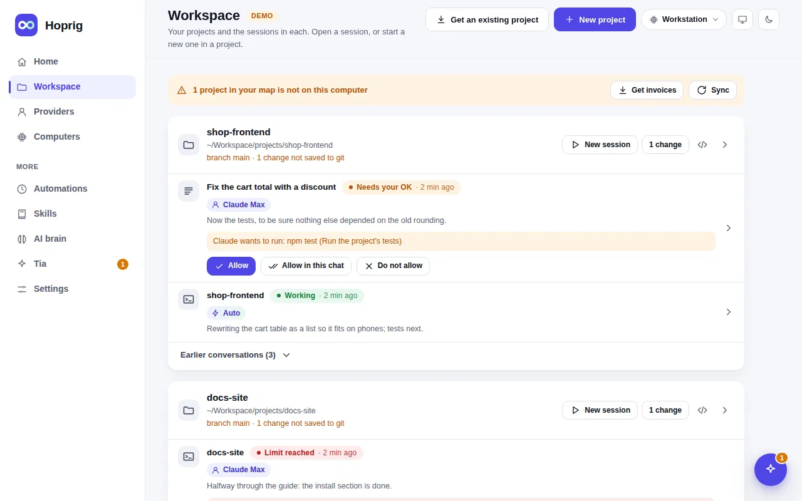
</p>

### The workspace and the AI brain

One folder tree, the same on every computer:

```
~/Workspace/
├── ai_brain/              shared AI knowledge: the rules every coding tool gets, skills, memory, notes
├── projects/<project>/    one project: its rules, its AI memory and docs, and code/<repo>/ for each repository
├── credentials/           keys and passwords for local work: never in git
├── development/           toolchains and SDKs
├── git/   database/postgresql/   database/mysql/   backups/
```

```sh
hop workspace status        # every folder: there or not, and what it is for
hop workspace setup         # create only what is missing; nothing that exists is changed
hop workspace link          # let your coding tools read the same rules, skills and memory from the brain
hop pc leave --check        # before a format: what exists only on this computer (Computers → Before you format this computer)
```

**A fresh computer gets all of it from git.** `hop workspace map` writes one file in the brain that lists every git
repository of the workspace (addresses only, never a token). On the next computer, `hop workspace restore <address
of your brain>` clones the brain, the credentials repository, your groups' repositories and the other repositories,
where they belong; each project comes when you ask for it, with `hop get <name>` (or all of them with
`--with-projects`). `hop workspace sync` keeps every repository in step (fast-forward only; pushing only with
`--push`). The **AI brain** page shows, read-only, what
the AI knows on a computer, and never anything in folders named `no-ai`, `ignore` or `ai-ignore-dir`,
`credentials` folders, dot-files, `.env` and key files; text that looks like a secret is masked.

`hop get shop` fetches one project by its name, with its code repositories and its memory, into a folder of that
name. **Groups** are folders of projects of your own beside `projects/` (`hop workspace group add client-work`),
written into the map so every computer gets them. Hoprig acts only inside each project's own folder: a link that
leads out of it is not followed, unless you name it as yours on that computer with
`hop workspace mylink add <path>` (a project kept on another disk). Details: [docs/WORKSPACE.md](docs/WORKSPACE.md).

<p align="center">
  
</p>

## It keeps going without you

<p align="center">
  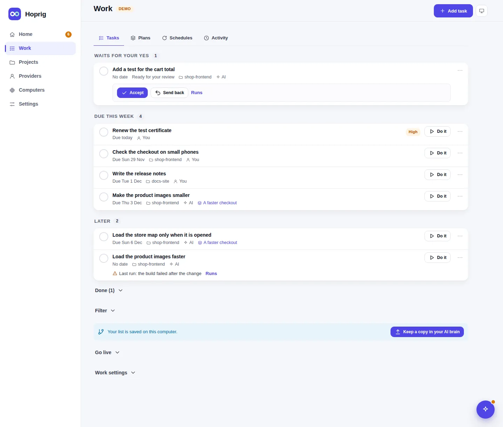
</p>

The rules that start things are fixed, with no AI deciding: a schedule starts at its time, the queue sends at the end
of a reply. What they start can be an AI session. The schedules are in **Work → Schedules**, what they
did is in **Work → Activity**, and the switches are under **Advanced** in **Work → Schedules** and in **Settings → Automations**:

- **Queue** (always on: it acts only on messages you queued; you queue a message on the session itself): give a session its next messages; each goes in when a reply ends, and only while the
  coding tool is the program in front in that terminal. When it is not (it has ended, or another program runs
  there), the message waits and its row says why.
- **Schedules**: at a set time (once, daily or on chosen weekdays), let the AI work by itself in a project, start a
  chat (or a session in a terminal), or send a message to one. When the AI works by itself, it works on a branch of
  its own. A task of Work can repeat too, and can be run by AI at a set time (see [docs/WORK.md](docs/WORK.md)).
- **Reopen sessions after a restart**: Claude Code's and OpenCode's terminal sessions come back where they were, each
  on its own conversation. An OpenCode session whose conversation has no id yet is not reopened on another one: Work →
  Activity names it as not reopened. A terminal a chat took over with **Continue here** stays closed, however soon
  after the press the dashboard ends. It is on at first
  with the built-in terminals (the dashboard's own). With tmux (a program that keeps terminals running when the
  dashboard stops) it is off at first: tmux sessions live through a restart of the dashboard, but not a restart of
  the computer; switch it on to have them back after one.
- **Try again after a server error** (off at first): in a Claude Code session, after a server error that is not a
  limit, wait and continue, three times.

**Pause all automations** is under **Settings → Automations → Advanced**; while they are paused, that page and
Work → Schedules say so with a Resume button.

## Updates

<p align="center">
  
</p>

**Settings → Version and updates** is one page for Hoprig, Claude Code, OpenCode and the helper for the public link (cloudflared): each row shows the
installed and the newest version, **Check now** and **Update now**, and one sentence on what an update does to
what is running. One choice for all:

- **Manual** (the default): it looks and shows what is new; nothing is installed until you press **Update now**.
- **Automatic**: it also installs each update by itself, at a safe moment: Claude Code when none of its sessions
  is working, OpenCode when none of its sessions is open, the helper for the public link when the link is off. Hoprig
  itself is never updated by itself; Automatic tells you, and you choose the moment.

Hoprig's newest version is read from where it is installed from: the version in `package.json` on the main branch
of this repository (a git checkout asks its own remote). When it cannot be read, the row says why in one sentence.
`hop update` updates Hoprig from the same place.

`hop tools` does the same for the coding tools in a terminal (`tools install | update | on | off <tool>`).

## Tia (experimental, off by default)

<p align="center">
  
</p>

An assistant in the dashboard: a round button at the bottom right of every page, and her own page under **More**.
She manages what is described above and gets a coding job done for you: she opens a chat in a project, picks a
provider among the ones you allow, sends the task, watches it, and reports. She is a headless Claude Code that
may use only Hoprig's own tools (`hoprig mcp`; while she is on, your own Claude Code can use the same tools). She is off until you
turn her on under **Settings → Tia**. The provider she thinks on is set there by **Tia runs on**. Left at
**Automatic**, it is the first of the subscriptions she may use that can answer now, so a message to her costs
nothing beyond your plan. With no such subscription, it is Auto mode when that is on and you allow it to her, else the
first provider you allow her that can run Claude Code; left at Automatic, she never runs on one you did not tick (a
provider you choose yourself under **Tia runs on** is used even when it is not ticked). When none you allow
her can run her, she says so and where to tick one (Settings → Tia → "Providers she may use"). On a provider billed by use she
answers only within the daily limit for paid use you set there. When every one of those
subscriptions is at its limit, she says so, and when Hoprig knows it, the time the first one can be used again;
she never moves by herself to a provider billed by use. The chats she starts run on the providers you allow her; on a
provider billed by use they cost money (see below).

**After an update from an earlier version:** earlier versions ran Tia when the settings never named her, although
Settings → Tia showed her off. Now she is off until turned on. If you used her without ever touching that switch,
her page says she is off and her jobs are not watched until you turn her on in **Settings → Tia**; her conversations and
jobs are kept.

What she can do, through the dashboard's own routes (the list is `ALLOW` in
[src/assistant/door.mjs](src/assistant/door.mjs)):

- chats and sessions: start a chat (Claude Code, or OpenCode when you name it) or a terminal session, send a
  message, answer an OK by the rules below, stop a reply, rename, end, and move a chat or a session to another
  provider at a limit;
- Work (see [docs/WORK.md](docs/WORK.md)): what needs you today, the list, a task and what its runs did; add a task,
  change it, mark it done or open again, and take her last change back; have a session do a task ("do the cart fix in
  the shop project"): she finds the project, writes the brief and picks the model and effort by the kind of work, and
  one card shows you all of it before anything starts. When the session's turn ends she reads its result and tells
  you in two lines; accepting it, sending it back, dropping and removing a task are cards, never hers alone; read
  your plans, and put a task into a plan, move it in one or change what it waits for, at once only when your own
  message names the plan or the task (else a card); making a plan or changing its own title, goal and milestones stay
  yours;
- projects: list them, start a new one, get one from GitHub, add a code repository, sync, create the missing
  workspace folders; read the AI brain;
- computers: their state, setup check and coding tools; run a fix, set one up, check for updates, update or
  install a coding tool, turn a coding tool on or off, end a process, restart or power off, add one by SSH,
  rename, start or stop an add-on, turn the public link on or off;
- automations, skills, and a few settings (quick messages, folders, uploads, Auto mode's order, the model and
  effort of new sessions, the projects folder, the working rules); one shell command on a computer, for a quick
  check you asked for.

**What she does by herself, and what always comes to you.** In a chat she started, she answers an OK by herself only
for looking at named files (reading inside the chat's folder, listing, git's reading commands without a patch) and
for the project's own checks (`npm test`, and `npm run` with one of a short fixed list of names: `test`, `lint`,
`build`, `typecheck`, `check`, `test:unit` and the like; `node --test`). Every change to a file, every other command
or script name, a search through every file of a folder (`grep -r`, `rg`, a patch of `git diff` or `git log -p`,
Claude Code's own search when it does not name a kind of file such as `*.js`), any tool she does not know, and every
OK of an OpenCode chat is your card. Whatever costs money, ends a session she did not start, installs or updates
something, turns a coding tool on or off or opens the computer to the internet is a card too. Money has exceptions
you choose. Within the **Daily limit for paid use (US $)** you set in Settings → Tia (empty at first), she may write to
sessions and chats on the paid API providers you allowed her, unless her level is **Ask me**. At the level **Hands
off** (the default is **Do the work**) she also starts chats and sessions there and moves the ones she started
there, without asking, within that limit. At **Hands off**, the Operator's limit rule or **Tia decides**, once you
turn them on, may also move any session at a usage limit onto such a provider, only within that limit, and each move counts
against it ([docs/OPERATOR.md](docs/OPERATOR.md)). Once you turn it on, **Tia decides** may also end a stuck session,
whoever started it, but only in a project where you ticked **Tia may end a stuck session in this project** (the same
guide). A terminal session's OK is judged only by the text on
its screen against a list of risky things, which is best effort.

She answers the OKs of a chat or a terminal only when she opened it on a new conversation: one she opens on an
earlier conversation is not hers to answer.
A Work run she started for you is yours: its OKs come to you, unless you turn on **She answers the OKs of her Work
runs** (Settings → Tia, off at first). Then she answers its OKs by the rules above while she follows it, never at
**Ask me** and on a provider billed by use only at **Hands off**; text typed into it, "do not ask again" and a stop
stay your card, and each answer is a line in her Activity.
She stops answering a chat's OKs as soon as you type into it, when its conversation went on in a terminal, and when it
went on elsewhere while the dashboard was stopped (it is checked again at the start). What she reads from a chat, a
terminal, a page, a file or another computer (a name, a title, an error) is data to her, never an instruction; secrets
never pass through her.
A session she started keeps her hold on administrator commands and pushes until it ends, whoever types into it; even at
Full a delete outside the session's own folder (also as administrator), a push or a merge into the main branch, a
release, a pull request, a direct call to GitHub or GitLab (`gh api`, `glab api`) that can change something there, a
deploy, a change to `project.json` or to Hoprig's own files, and a line Hoprig cannot read stay yours, and a Codex or OpenCode session of hers is refused below Full ([docs/OPERATOR.md](docs/OPERATOR.md#what-a-session-she-starts-does)).

**Files with secrets.** She does not say yes by herself to reading a file whose name says it may hold secrets
(`.env`, keys and key stores, `key.properties`, `gradle.properties`, Apple's `.p8` keys, `.yarnrc.yml`, `auth.json`,
`.my.cnf`, `.git/config`, Terraform state, a `cred` folder and the like). That is a list of names, not a wall around your secrets: inside the chat's folder Claude Code's own Read
reads without asking in its default mode, and a key can sit in a file of any name. Keep secrets out of project
folders you let a chat work in.

**Her cards.** What a tool of hers found or did shows under her answer as a card, so a phone needs a glance and one
tap, not a paragraph. The dashboard makes each card from the tool's result; she writes only words, and nothing she
writes becomes a card, a link or a button (her text is shown as text; a page of the dashboard comes as an Open card).
A card holds names, states, numbers and times, never a key, a folder path of the computer or a file's content.

<p align="center">
  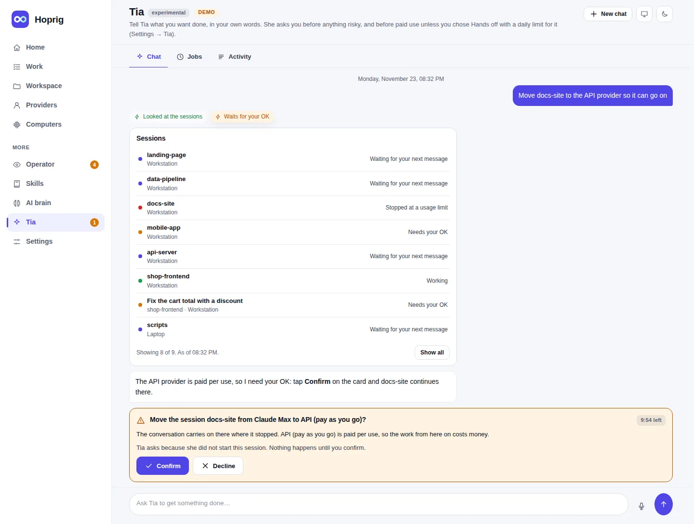
  &nbsp;
  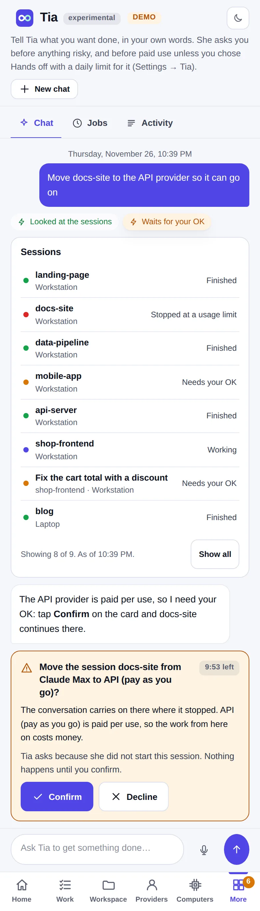
</p>

| Card | Comes from | What a tap does |
|---|---|---|
| Confirm | anything that needs your OK | Confirm runs it, checked again first; Decline does nothing |
| Form | a confirm card for a setting of one value | you may change the value before Confirm; it is checked as hers is |
| Choice | `notify_owner` with two to four answers | sends that answer as your message, nothing else |
| Status | `read_session`, a start without a job | opens the session; the card follows it while you look |
| Progress | a start or watch with a job, Work's start and run | opens the jobs or Work; it follows the job or run |
| List | `list_sessions`, Work's today and list, computers, the setup check | opens the item, or "Show all" its page |
| Numbers | `get_computer_status` (providers, one computer) | nothing: the figures and when they were read |
| Result | Work's add, change, done, reopen; stop, move, a finished job | opens where to see it; Undo takes her act back |
| Needs you | `read_attention` | the recommended step, through the Operator's own checks |
| Open | `open_screen` | opens that page |

A status, progress or needs-you card shows what is so now: it changes in place while you look, says when its subject
ended or is gone, and after a reload says "Checking…" until it is read again. It reads through the page's own
refresh (every 3 seconds, 15 while the tab is hidden), with one request for every such card on screen. A tap on a
card that is out of date does nothing and shows the current state; Undo works only while her act is still her newest
one, once.
A choice card she shows while a session of her job wakes her also comes as a push, sent as a "waiting" notification, so
what you chose under Settings → Notifications holds for it.

**Speak instead of typing.** Her box and the App's message box have a microphone. It uses the browser's own
speech recognition (Chrome, Edge and Safari have one; the language is a setting of the device under **Settings →
Appearance**: English, Hindi, or the browser's own). The words appear in the box and you send them yourself; a
spoken sentence is never sent by itself. Hoprig never gets the audio and keeps nothing of it; the browser turns it
into text (Chrome's own recognition does that on Google's service). Where the browser has no recognition, the
microphone is shown struck through and says so when tapped. The page allows the microphone for the dashboard's own
pages only.

**What Tia does not do.** These are your own steps; the dashboard refuses them even if she tried (`NEVER` in the
same file). She opens the right page for you instead:

- adding a provider, signing it in or out, or its key; another coding tool's own sign-in;
- removing a computer, pairing codes, joining and connecting computers;
- the dashboard password and sign-in, signed-in devices and one-time sign-in links, the public link's Custom set-up;
- notifications, and whether updates install by themselves;
- her own settings (what she may do, which providers she may use, her token).

Her administrator rights (Off, Ask each time, Full) and the git sign-in of the sessions she starts are explained in
[docs/OPERATOR.md](docs/OPERATOR.md#administrator-rights-and-the-git-sign-in-of-her-sessions).

## The menu and the settings

**Home** (every chat and session, the ones that need you first), **Work**, **Workspace**, **Providers**,
**Computers**, then under **More**: Skills, AI brain, Tia and Settings. **Settings** is a list of seven
rows: New sessions (with the coding tools and Hands-off), Notifications, Appearance (with the code editor), Security
and sign-in (with the folders Hoprig may open, Log out and the Public link), Tia, Automations (with the Workspace)
and Version and updates (with the field reports); Add-ons is reached from Security and sign-in, and Runs as root
appears only when it applies. Work's own settings are
at the foot of **Work → Tasks**, the schedules' two at the top of **Work → Schedules**. Each
option has one plain sentence under it. **Notifications**:
a push to your phone when a session waits for you, needs your OK or reaches a limit.

Terminal sessions run in tmux when it is installed, 3.2 or newer (they survive a restart of the dashboard, and
`tmux attach` over SSH still works), otherwise inside the dashboard's own service (the built-in terminals).
On a session's terminal page, a file dropped anywhere on the page or pasted with the paste key (Ctrl+V, Cmd+V, or a
screenshot in the clipboard) goes to the session's computer and its path is typed at the prompt, as a terminal does
on a drop (no Enter); on a touch screen the key bar's **File** key opens the device's picker. These files are kept
in Hoprig's state folder (`drops/<session>`, readable by you only), never in the project, and removed after a week.
A terminal session starts in your own shell, which is given only Hoprig's command and a file that is readable by you
alone and works once: the folder, the provider and the first message are never typed into the shell, so a first
message arrives as it was written, several lines included (on Windows, a coding tool installed as a `.cmd` script
gets it on one line: cmd.exe cannot carry a line break). What anyone but you types into a running session (the
queue, a schedule, the continue prompt, Tia, another computer) goes in only while the coding tool is the program in
front there, without control characters; your own typing on the page goes in as before. A move to another provider,
a restart and **End session** end the programs in the terminal first, and only then start the new one or end it.

<p align="center">
  
</p>

## Not built, or not proven yet

Said plainly, so nothing here is a surprise:

- **Codex is not part of this version.** Its code is kept and tested, but it is switched off: no page, command or
  provider kind offers it.
- Tia cannot continue an earlier OpenCode conversation by its id; she can only continue the folder's newest one.
- **Not seen from a real model**: OpenCode's own question forms (the page has them; a real model never asked one in
  the tests).
- **The last checks of this version ran on stand-ins** for the coding tools (small programs that answer the way
  Claude Code and OpenCode do), not on real Claude Code or real OpenCode. The one exception: what the page's
  **Allow** in a terminal session looks for was checked against screens recorded from real Claude Code 2.1.326; a
  later Claude Code that draws its permission dialog another way gets no answer from the page (it sends you to the
  terminal).
- **Work, what is not there yet**: Tia does not carry a Work run of hers on to another provider after a usage limit
  by herself, and she does not answer the OKs of a session of hers that no job follows. Hoprig does not write a note
  into a session to take the option it recommends.
  The sessions that need an OK are shown on the dashboard (Home, the Operator), not in `hoprig tasks`.
- **What Hoprig's folder check cannot see** (Hoprig stays inside each entry's own folder of the workspace): a folder
  that a program already running on this computer swaps for a link in the instant between the check and the act, and
  a bind mount, which looks like a folder.
- **Files on the desktop**: dragging between two Files windows is not built.
- **A submodule's own changes are not counted in the repository around it**: Source Control and the project counts
  read git without looking inside a submodule's files (its own settings could start programs). A submodule with
  uncommitted changes shows them when you open it as its own folder; a new commit in it still shows in the parent.
- **Tried by hand only on Linux**: what came in 0.2, in 0.3 and in this version. The tests also run on GitHub on
  macOS, and on Windows, where a failure does not yet block.
  - New since 0.2: the chat, OpenCode, the editor, the desktop, the public link switch, Updates, one process per
    conversation, the start of a terminal session by its start file, the text typed only for a coding tool in front,
    the ending of a terminal's programs before the session ends, the safe git reads.
  - New in 0.3: Work and **Do it**, the New session popup, the App's title bar, session menu and session rail,
    `hoprig get` and its folder rule, groups, naming rules and a group's own command, the folder check and
    `hoprig workspace mylink`, a gateway of your own, the page's answers in a terminal session, the rule of bypass mode.
  - New in this version: projects fetched only when you ask (`hoprig get`, `hoprig drop`), `hoprig adopt`, the
    Operator, Work's plans, schedules and progress, the box (a command run with no network and without your home:
    [docs/BOX.md](docs/BOX.md)), a new project from a brief, skills learned from your work
    ([docs/SKILLS.md](docs/SKILLS.md)), field reports ([docs/FIELD-REPORTS.md](docs/FIELD-REPORTS.md)), a server set
    up from the dashboard. Everything new in this version was also run only on Linux, and not yet with two real
    computers linked.

  Written for macOS and not run there: the refusal of a gateway program in a folder that Homebrew lets other users
  change. How Hoprig tells that a
  process is still the one it started (a process id can belong to another program after a restart of the computer)
  is exact on Linux; on macOS and Windows it is written and tested with recorded answers of the system only.
- **A `hop` launcher that is killed hard while its coding tool goes on**: Hoprig keeps a terminal session's record
  while its launcher runs, so after a `kill -9` of the launcher that terminal reads as a plain terminal, what the
  coding tool does and asks is not shown, and its conversation counts as free: Hoprig does not stop the App or another
  terminal from starting a second process on it.
- **On Windows**, a second temporary address of the public link whose file names no process identity (one an earlier
  version started) cannot be stopped by Hoprig: it says so, and that helper is ended by hand.
- **Not proven on real devices**: a phone's on-screen keyboard in the editor and the chat; changing the Claude
  account of a provider from the page end to end with a real account; a real stop or restart of a service from the
  desktop.

## When to use this, and when not

If you use one Claude subscription on one computer, Claude Code's own mobile app and Remote Control are the
simplest way to reach it from a phone. Hoprig is for when you want more than that:

- a chat for your projects that works the same from a desktop and a phone, on every computer you own;
- the same session on another provider when a limit is reached, including an API key or a gateway;
- a second coding tool (OpenCode) for providers other than Anthropic, with the same rules, skills and memory;
- a new computer or server set up for coding by one command;
- several computers in one place, on your own hardware, with nothing in between that you do not run.

## Is this allowed?

Hoprig runs the official, unmodified Claude Code and OpenCode and keeps your accounts on your own computers. It
has no server of its own and never shares an account with anyone.

What Anthropic's documentation covers: several accounts of your own on one machine; API keys and gateways as ways
to run Claude Code; and pointing Claude Code at a gateway while it stays signed in with a subscription. That last
one is what Auto mode's router is: it passes Claude Code's own request on, untouched. Hoprig never attaches a
subscription's sign-in to a request itself; only Claude Code does. A Claude subscription is never given to
OpenCode or to any other program: OpenCode runs only on API keys and gateways.

What is yours to judge: plan limits assume ordinary, individual use, Anthropic's policies forbid getting around
restrictions and sharing accounts, and Anthropic can restrict an account without notice. Whether continuing past a
limit on a second subscription of your own (as another provider, or by signing in with another Claude account) is
acceptable is not something the terms clearly settle. The surest setup is one subscription, then an API key. Never
use someone else's account. The provider behind an API key or a gateway has terms of its own; read them too.
Read the sources yourself:
[Claude Code: legal and compliance](https://code.claude.com/docs/en/legal-and-compliance),
[authentication](https://code.claude.com/docs/en/authentication),
[gateways](https://code.claude.com/docs/en/llm-gateway),
[Usage Policy](https://www.anthropic.com/legal/aup),
[Consumer Terms](https://www.anthropic.com/legal/consumer-terms).

## Security

The dashboard is a remote control for your computer, and it is built that way:

- It listens on this computer only until you choose otherwise. On a network it speaks plain HTTP, so use a network
  you trust; on the internet use the public link (HTTPS through the tunnel) or `hoprig setup --hub`, which puts it
  behind HTTPS and refuses plain HTTP.
- One password stored as a scrypt hash, one-time sign-in links, HttpOnly SameSite=Strict cookies, an Origin check
  on every change, a strict content security policy. The public link asks for a strong password before it turns on.
- Five wrong passwords and a visitor waits: this computer counts as one visitor whatever local address it uses,
  every visitor through the public link counts on its own, a limit for all wrong passwords together never locks
  this computer out, and a one-time sign-in link has its own count, so guesses do not lock it.
- When the dashboard reads a project's git state (Source Control, quick open, the chat's `@` files, the project
  counts), the repository's own settings never start a program: hooks, filters, diff and signature programs are
  switched off for that read. A git command a coding tool runs is the coding tool's own.
- Installs, updates, downloads and the demo get an environment without provider keys; the helper for the public link, when
  Hoprig downloads it, is checked against its known SHA-256 before it is used (one already on the computer's PATH, or
  installed with Homebrew on a Mac, is used as it is).
- Another computer gets a token you can revoke. A token cannot change the password, pair, or relay further.
- The router listens on 127.0.0.1 under a secret path and keeps no request or answer text.
- The editor and the desktop's Files reach only the folders the dashboard may show (**Settings → Security and
  sign-in** sets them, or everything your user can open); every path is checked on the server. Private folders
  (`no-ai`, `ignore`, `ai-ignore-dir`), git's own folder, the dashboard's own folders and sign-in files are never
  shown, searched or changed.
- A file of a project shown as a page runs in a sandbox. A shared gateway's keys are kept as hashes, and only `/v1/`
  paths pass.
- The administrator password for a setup step or a service is asked in the page when `sudo` needs it, given to
  `sudo` on its input, and never saved or shown.
- OpenCode's server, which Hoprig starts for a chat, listens on this computer only and always with a password; its
  routes that would return a key never reach the browser. A provider's key is given to a coding tool in its
  environment when it starts, never written into the tool's own files.
- Provider files (sign-ins and keys), tokens and passwords are readable by your user only and are never printed,
  logged or sent to a browser. Found a problem? See [SECURITY.md](SECURITY.md).

## Where it runs

| | Providers, Auto mode | Dashboard | Fresh-computer setup |
|---|---|---|---|
| Linux | run and tested | run and tested (tmux and built-in terminals), systemd service | run in clean Ubuntu, Debian and Fedora; the install line itself, from a packed build, also in Debian 12, Fedora, Alpine and Ubuntu 24.04 on arm64 |
| macOS | run and tested | run and tested (built-in terminals) before this version; what is new in it was not run there (see above); the launchd service is written, not yet installed for real | the install line and the first run run green on GitHub's macOS machines; an install on a real Mac not yet run by hand |
| Windows | used by hand once (Claude Code, a subscription and a gateway on the computer); the whole test suite runs green on GitHub's Windows machines (Node 24 and 26) | used by hand once (built-in terminals, a chat, the Task Scheduler service); not tried: updates, the desktop, the editor, other computers, the public link | the install line (`install.ps1`) and the first run walked on GitHub's Windows machines four ways (scripts off, scripts allowed, an administrator window, Git missing); `pc setup` with winget used once |

Requires Node.js 24.13.1 or newer (Node.js 22 and older are not supported; `hoprig` says so in one sentence on an
older Node.js, with the line that installs the newest one). The tests run on Linux and macOS with Node 24 and 26 on
every change, and on Windows as a job that is still allowed to fail (a failure there does not fail the run). It runs
green there on GitHub's machines with Node 24 and 26; Windows is new here, and a real home PC has seen less of it
than a Linux computer has (see the Windows paragraph near the top). tmux is used from
version 3.2 on; with an older one (or none) the built-in terminals are used. With npm 12 there is nothing to do
yourself: setup builds the one module that needs a build (`node-pty`, the only install script Hoprig's
`package.json` approves), and `hoprig doctor` names the cause when it did not build.

Runtime dependencies: `ws`, xterm.js, Monaco (VS Code's editor core), `qrcode-terminal`, and optionally `node-pty`
for the built-in terminals. No framework and no build step.

## Commands

A short list: `hop help` has every command, and `hop <command> --help` its words.

```
hop                              choose a provider, start Claude Code in this terminal
hop chat [folder] [--tool opencode]   open a chat in the folder (prints its address, opens the browser here)
hop <profile> [args]             start on that provider (args go to Claude Code)
hop opencode [provider] [args]   OpenCode in this terminal, on a provider that serves it
hop auto [args]                  Auto mode          hop auto on | off | order … | status
hop add | profiles | rm          providers (each one is a profile)
hop tools                        the coding tools: install | update | on | off <tool>
hop setup | doctor | update      set everything up, check everything, update Hoprig
hop pc setup | status            this computer for coding;  hop pc recipe save: a recipe for the next one
hop get <name>                   get a project with its code repositories (= hop project clone)
hop drop <name>                  take a project off this computer safely (--check, --dry-run)
hop sync [<name>]                bring the repositories here (or one project) in step with git (= hop workspace sync)
hop adopt scan | plan | apply | verify | retire   a computer that already has projects: bring them into the workspace
hop sessions move <old> <new>    the coding tool's conversations of a folder, copied to its new place
hop project new | add | start | clone | setup | status | sync | link   projects (new --brief <file>)
hop workspace status | setup | link | map | restore | sync | git   the workspace, its map, the AI brain
hop workspace group | find | tool | mylink | rules | needs | label   groups, their commands, your own links
hop tasks [today] | list | add | edit | done | open | drop | do | runs | plans | save   Work: your tasks (docs/WORK.md)
hop ship status | together | check | allow | live | back | auto | drop   Go live: finished task branches together, checked (docs/GO-LIVE.md)
hop box check | run              run a command in a box: no network, and it cannot see your home folder (docs/BOX.md)
hop skills suggest | find | add | list | update  skills
hop field [show <id> | inbox <folder>]   field reports of Hoprig's own work (docs/FIELD-REPORTS.md)
hop serve | passwd | link        the dashboard, its password, a one-time sign-in link
hop service install | uninstall | status | restart   the dashboard in the background; start it again after an update
hop public on | off | status     the public link (--temporary | --custom)
hop machines | join | pair | tokens   several computers
hop addons                       add-ons: a gateway for other AI providers
hop gateways add | confirm | remove   a gateway of your own (a program Hoprig runs)
hop claude status | update       Claude Code's version
hop demo                         the dashboard with sample data
hop mcp                          Hoprig's tools as an MCP server
```

The Hoprig skill teaches a coding tool to use these commands; it is made from their own help at every version.
Without Hoprig: `npx hoprig-skill --claude` (or `--agents`, `--project <dir>`) puts it into a coding tool's skills
folder ([the skill](https://hoprig.com/skill/)).

## Contributing

`npm install`, `npm test`, `node bin/hoprig.mjs demo`. The README's screenshots come from the demo only:
`node tools/screenshots.mjs`. The rules for working on this repository, for people and for AI tools, are in
[AGENTS.md](AGENTS.md); see also [CONTRIBUTING.md](CONTRIBUTING.md). A pull request is merged once you agree to the
[contributor licence agreement](CLA.md), by one line in the pull request. How a release is made: [RELEASING.md](RELEASING.md).

## License

Hoprig is licensed under the [Apache License, Version 2.0](LICENSE). Copyright 2026 Kevin Pareek; see [NOTICE](NOTICE).
Earlier versions, up to and including 0.2.1, were released under the MIT License.

Contributions are accepted under the [contributor licence agreement](CLA.md). "Hoprig" and its logo are trademarks
of Kevin Pareek: the licence of the code does not cover them, and [TRADEMARKS.md](TRADEMARKS.md) says how you may
use them.
