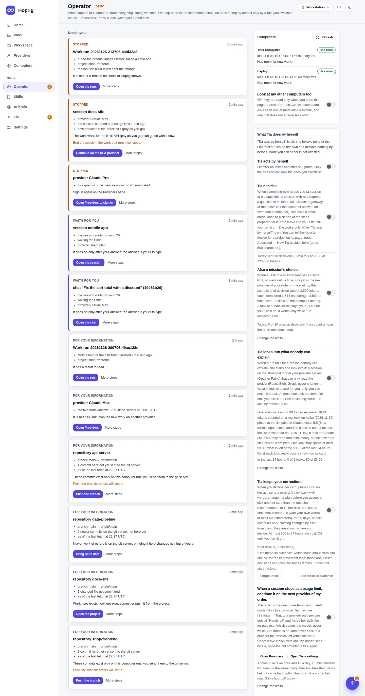

# Operator: what stopped or is about to

The **Operator** page is one place that says what stopped or is about to, from everything Hoprig already watches, so you do not
have to look at every page in turn. It recommends one step for each thing; nothing happens until you tap it, unless you switch on one of Tia's rules,
**Tia decides** or **Tia looks into what nobody can explain** (below). All of them are off after an install and after an update.

## The page

**Operator** is in the sidebar's second group, **More**, with the number of things that need you next to it.

- **Needs you**: the attention list. Each item says what it is about, since when, a few facts, and why the step it
  recommends is the right one. The recommended step is the one button; the other steps and **Not now** are under
  **More**. Items are in this order: stopped work (a usage limit, a session with no progress, a provider that is
  signed out or at its limit), what waits for you (a question or an OK), this computer, then information (among it
  repositories with commits or changes that exist only on this computer: work in progress, said, but it can wait).
  Inside each group the oldest comes first.
- **Watched**: every place Hoprig looks at, when it was last read, or why it could not be read
  ("could not be read: …"). A place that could not be read is never shown as if all were fine.
- **Computers**: each computer of this dashboard with its room for new work (**Has room**, **Busy**, **Full** or
  **Not known**) and why, with **Refresh** to read them again. The switch **Look at my other computers too** is off at
  first: then the other computers are read only when you open the page or press Refresh.
- **What Tia does by herself**: the main switch **Tia acts by herself**, the button **Tia OFF** (shown while she may
  act), **Tia decides**, her other switches and her five rules (below).
- **Done by Tia**: every step a rule or a decision of hers did, or was refused, with Undo where the step has one. A line never shows a
  path or an address, so a word with a slash in it (such as "and/or") may show as "…".
- **Done by you**: the steps you tapped, with what happened.

## What it watches

| Kind | Shown when |
|---|---|
| limit | a session, or an agent inside it, stopped at a usage limit. It says "wait until" a time only when the coding tool's line or the provider's reported window named one; with none, no time is guessed |
| stuck | a session says it works but has made no progress for 20 minutes |
| asks | a session waits for your answer or your OK (with how long) |
| ended | a session's coding tool ended, or a Work run failed, stopped or finished, within the last day |
| provider | a provider used 80 % of a window (near) or 100 % (reached), its sign-in is gone, or a gateway does not answer its port |
| machine | load above 1.5 per CPU, less than 10 % memory available, a disk or the temporary folder 85 % full |
| leftover | a tmux server on a private socket with no client whose shells run nothing (no child process of any name, and no session's run record names it), or a test dashboard on another port, older than 10 minutes |
| repo | a repository of the workspace is behind, ahead, has uncommitted changes or a branch without an upstream |
| live | the login page or the public link does not answer |
| automation | an automation committed a change to your AI brain since you last opened this page |
| unknown | a Work run failed for a reason no check of Hoprig knows, a task's runs ended in an error twice, or a mission's check failed the same way after a fix, within the last day (see "What nobody can explain" below) |
| providerstop | a provider stopped a session, or an agent inside a session that goes on, in another way than a usage limit: a model name the endpoint refuses, a sign-in that is gone, no answer, a server error past the retries, the provider's own refusal, an input the model does not take. A chat of the App makes the same item, opened as the chat. The item says which agent and what it was doing, the tool's own words (cleaned, cut short) and the one step: sign in, restart the gateway, or open the session or chat. For a model name the endpoint refuses, its second step is "Check this provider", which opens that provider's page (the check runs only when you press it there), and its reason is the line the last check gave to mend it: a combo of that name at the gateway, or a MODELS entry that names a model the check found served (which mends a session only with that provider's map turned on for sessions, and then says so). A refusal is never sent again or elsewhere. How each stop is named: `docs/PROVIDERS.md` |

Repository state is from the last fetch only (the item says when that was): a look never fetches, starts no model and
does not wait for the network. Git, the process list and the two addresses are looked at in the background, about
once a minute (git once in five).

That background look goes on while the dashboard runs, also when no page is open. It only reads: git in each
repository of the workspace (no fetch, and the repository's lock is not taken), `df`, `ps` and `ss`, `tmux` for a
server on a private socket, whether a gateway is installed and runs (its program is not started for that), one knock on a gateway's port, and the login page of this
dashboard (and of the public link while the link is on). It writes nothing, starts no model and reads no terminal's
content.

## The steps

Each step is something Hoprig already does elsewhere, with the same checks:

- **Continue on the next provider**: the same move as a session's provider menu.
- **Open**: opens the session, project or page where the thing is. The card names it: **Open the session**,
  **Open the chat**, **Open the project** and the like. A question is always answered by you, in the
  session.
- **End the session**.
- **End the process**: the process is read again by its number and start time first; a process that is not the same
  one any more is left alone.
- **Bring up to date**: only when newer work of others is on the git server and nothing of yours is only here; it
  brings that work here, and nothing of yours changes.
- **Push the branch**: only when commits of yours are only on this computer and nothing newer is on the git server.
  Others see it.
- **Restart the public link** or **Restart the gateway**.
- **Open the commit** an automation made.
- **Start new work on** another computer: only on the overload item, only when Settings → Tia names computers Tia may
  use and one of them has room. Only Tia's new sessions and chats start there; nothing that runs moves. It ends by
  itself once this computer has been calm for 10 minutes (2 hours at most); **Undo** under **Computers** ends it at once.
- **Not now**: hides the item until what it says changes. Only time going by does not bring it back; a new fact does.

When the thing changed between your look and your tap (or is gone), the step is not done and the page shows it as it
is now. Tapping twice does it once.

## Sessions Hoprig did not start

A session you ran with Claude Code yourself, outside Hoprig, makes the same `limit` and `providerstop` items: the look
reads the coding tool's own records (its transcripts and each agent's in the `subagents` folder), read only and a
bounded part per look. Such an item is named "session <id> in <folder>, not started by Hoprig", opens the Providers page
and offers no "End the session". A session Hoprig started is told by its own run record, or, after that record is
gone, by the list of conversations Hoprig ran in the last day (`operator/conversations.json` in the state folder,
written by a look only when it sees a new one).

## What Tia does by herself (her rules)

Tia may do a step by herself only by a rule you switched on or by **Tia decides** (below), and only while **Tia acts
by herself** is on and Tia herself is on (Settings → Tia). All of it is off after an install and after an update. No model is asked: a rule is
code that does the item's recommended step, and it reads only what the Operator found (the kind of the item, its
step, what the step acts on, its age), never a session's name, a branch, a provider's label or a command line, so
nothing those say can switch a rule on or change what it does. There are five rules, and only these:

| Rule | What it does | Undo |
|---|---|---|
| limit | When a session stops at a usage limit, continue it on the next provider of my order (the **Order of providers** under **When a provider reaches its limit** on Providers). Only when Claude Code itself reported the limit (a limit line that only shows on the screen stays yours), only to a provider Tia may use (Settings → Tia), to a provider billed by use only when her level is Hands off, never while Auto mode is on (Auto mode does it then), never back to a provider the session left within the hour, whoever moved it then (your tap, Auto mode, the rule, or you by hand in a terminal). | Move it back with one tap under Done by Tia, once the old provider is free again; refused in plain words when the session ended, moved since, or the old provider is still at its limit. |
| gateway | When a gateway that open sessions go through does not answer, restart it. Not a gateway that is only not started yet, and never one you stopped yourself (Settings → Add-ons → Stop, or `hoprig addons stop`) until it is started again. | none |
| link | When the public link is on and does not answer, restart it. | none |
| leftover | End a test's left-over processes: only what this page calls left over, once older than an hour, and only a test's: an idle tmux server that a test or a try of Hoprig started (its state folder is in the temporary folder), or a test's dashboard. Your own tmux servers stay yours, also one started in the temporary folder. | none: an ended process cannot be undone |
| elsewhere | When this computer is overloaded, start new work where there is room. Only Tia's new starts, only on a computer you let her use (Settings → Tia) that has room, until this computer has been calm for 10 minutes (2 hours at most). Nothing that runs moves. | **Undo** under **Computers** on this page ends it at once. **Tia OFF** on this page ends it too when this rule or Tia set it; one you started with your own tap stays until it ends by itself or you press Undo. |

A repository, a message to a session, and anything that is yours alone (a sign-in, a push, a release, a delete
outside a session's folder) are never a rule. Money has one exception: at her level **Hands off** the limit rule may
move a session onto a provider billed by use, but only within the daily limit for paid use (Settings → Tia), and each move
counts $0.50 against it, as her own move does. With no limit set, or the limit used up, the move is yours: the item says so
in one line, with the button **Set a daily limit for paid use**. Your own tap on **Continue on the next provider** is not counted.

- **Limits.** Each rule does at most 3 steps an hour and 10 a day, and waits 10 minutes before it acts on the same
  thing again (change them under each rule). After two tries on the same thing within a day that did not help (it came
  back within the hour after each), the rule leaves it to you: its card says "Yours: Tia tried twice …". It tries again a day later, or after you
  tapped it yourself. A step a limit refuses is one line under Done by Tia, never skipped in silence.
- **Projects.** On a project's page, under Advanced, **Tia never acts in this project**: no rule acts for its
  sessions, its Work runs or its processes, also through a link to its folder, and also for a project in a group.
  While a project is out, a session or a process whose folder cannot be told is left to you too. On another
  computer's page these switches are only shown: they are changed on that computer's own dashboard.
- **Tia OFF.** One press on this page stops her: no new step starts after it,
  a step on its way ends and is written first, and the page says in one sentence what is off. Your rules stay as you
  set them for the next time.
- Every step of a rule goes through the same checks as your tap: the list is built again, the item must still be as
  it was, the step must be one of its own, and the same step twice is done once. What the rules did is kept in
  `operator/reflexes.json` of the state folder; when that file cannot be read, it is set aside and Tia does nothing by
  herself for a day. Two dashboards on one state folder never act at the same time.
- Only you change these, from this page: Tia's own tools cannot, and another computer cannot.

## What Tia decides (her one short call)

Off after an install and after an update. Under **Tia acts by herself**, the switch **Tia decides** lets her pick a
step for something new that no rule of yours took. For each new or changed item of these kinds she asks a small
model ONE question, with the item's few facts and your note for its project, and the model may only answer with one
of the steps prepared for it, or leave it to you:

| Kind | Steps she may pick |
|---|---|
| limit | continue on the next provider (only a limit Claude Code reported); wait, when the limit ends within the hour |
| stuck | nudge it once with one fixed sentence Hoprig holds; end the session, offered only where you ticked **Tia may end a stuck session in this project** (see **Your note** below) |
| asks | an option of a question in a chat of the App (a terminal session's question is answered in its terminal, so it stays yours) that has no recommended option and takes one option, in a chat with Hands-off on, where Hands-off itself would not wait (no push, release or other step of yours alone in its words, nothing hidden or cut); your Hands-off note as the answer |
| provider | restart a gateway that open sessions go through |
| live | restart the public link |
| machine | start no new session or chat for 30 minutes, also by a schedule; a run that ends by itself waits and starts after it (**Lift the hold** ends it; a restore after a reboot is not held) |

A provider that refused or stopped a reply (`providerstop`) has no step in the list: what it needs is a sign-in, or a look at the provider, and a retry of a refused model name is never hers. Anything else, and every answer that is not exactly one of those steps, is yours (also an answer whose reason names a second step). The model never writes a command, a
path or a text that reaches a session; what an item says (a session's name, a question's words) is shown to it as
data, never as an instruction. A repository, a push, a sign-in, a delete, a release or anything sent out is in
no list. Money is in one: "continue on the next provider" goes to a provider billed by use only at her level **Hands
off** and within the daily limit for paid use, as the limit rule does, and the move counts against the limit. Typing into a
session that runs on a provider billed by use (the nudge, an answer to its question) is money too: offered only at
**Hands off** and within the limit, and each counts $0.50 against it. Below **Hands off**, or with no room in the limit,
such a step is not offered, and neither is the stop of a stuck session whose nudge is still owed: an item whose only
step it was is yours, with no call, and the item says so in one line (with **Set a daily limit for paid use** when the limit is why). What "Tia decides" may do to a session without a card is in this
table and nothing else: the nudge types the one fixed sentence above, and the stop needs the project's tick, which is
read again right before the session is ended.

- **The same checks as a rule.** The step goes through the door a rule's act goes through (the list built again, the
  item still the same, the project not taken out, the limits, "tried twice"), and is one line under **Done by Tia**
  with her reason ("Why: …") and Undo where the step has one. A rule you switched on acts first.
- **Called on an event, never to look around.** Once per new or changed item (changes within five seconds count as
  one), never on a timer. A nudge is given once while a session makes no progress.
- **Not while your session works on her provider.** While one of your sessions is in a turn on the provider her call
  would use (Auto mode counts as each provider of its order), the call waits for a later tick, at most 2 minutes from
  when it was first due; then it goes. The session the item is about does not count.
- **Limits.** At most 6 decisions an hour, 30 a day and 125,000 tokens a day (change them under **Tia decides** →
  **Change the limits**); her acts by decisions are held by the same numbers. Past one, no call is made and the item
  is yours, with one line that names the limit. The panel shows what today used. Two answers that left an item to you
  within a day make it yours with no third call, and a record of decisions that cannot be read stops her calls for
  a day.
- **What a call costs.** About 3,400 tokens (measured on the cheapest model over 540 calls: 3,434 on average, 3,716 at
  most; about $0.0004 each). The
  prompt of an item is short, but Claude Code sends its own parts with it and they are counted too: a line saying it
  is an agent, and a block about its environment (the folder it runs in, which is an empty temporary one, the
  operating system, the model's name, the date). Hoprig leaves out Claude Code's billing line, so every call starts
  with the same bytes; whether a provider then caches them is the provider's: the calls measured so far read nothing
  from a cache. A call whose provider reports no usage counts as 4,100 tokens.
- **Which model.** The cheapest model of a provider you allowed Tia (Settings → Tia), at low effort, chosen as her own
  turns choose, but never a provider billed by use while another you allowed is not: one billed by use only at "Hands
  off" and within the daily limit for paid use, which holds $0.50 before the call and then counts what the call reported it
  cost. Auto mode counts as billed by use here when its order holds a provider billed by use, and the reason on the item
  names it; with an order of subscriptions only, it counts as free of charge. A Claude sign-in on a
  Console account is billed by use too. While **Also use pay-per-use providers** is off (Providers), Auto mode leaves out
  every provider the Providers page marks billed by use, such a sign-in included, so they do not count here.
  Another model is set in Hoprig's settings file only (`operator.decide.model`, a name such as `sonnet`): the provider
  is chosen anew for each decision, so a list of one provider's models on the page could name one the provider used does
  not have.
- **Your note.** On a project's page, under Advanced, **How Tia decides here**: up to 500 characters of your own
  words ("wait for a short reset", "ask me before stopping a session"). Characters nobody can see are taken out, and
  the page says so. She reads it before each decision for that project and can never change it. Below it is the tick
  **Tia may end a stuck session in this project** (off at first, and off after an update for every project, also one
  with a note): only with it on is "end the session" offered for that project's stuck sessions, and then she is told
  to pick it only when your note says to stop such a session. Off, she never ends one there, whatever the note says.
- **Tia OFF** stops her decisions too: no new call starts, a step on its way ends and is written first, and her hold
  on new starts is lifted. A hold you set yourself stays until your own time, also when she held new starts too; every
  start it refuses says whose hold it is. Times on this page are the server's clock (UTC), with the date when they are
  20 hours or more away.

### A mission's choices

Off after an install and after an update. Under **Tia decides**, the switch **Also a mission's choices** sends the
choice points of her missions through the same decision: a task whose session reached a usage limit (go on with the
next provider of your order that is free, or wait until the named time when that is within the hour), a task that
waits until a time (wait), and a task sent back twice (always yours, with no call). The same checks, the same record
and the same line under **Done by Tia** hold; the limit rule, when it is on, acts first and goes on by itself with the
rule's name on the mission's line. A project you took out is yours. Each such decision counts among the decisions
above and also against its own limit of 10 a day (**Mission decisions a day**). With **Tia decides** or this switch
off, a mission does exactly what it did before. One table says which loop owns each kind of item of a mission's
session (the mission's engine for its limits, stops, ends and questions, the Operator for the computer, a gateway,
the public link and what nobody can explain, which its look only reads): the other one leaves it alone, so a limit is
moved once, not twice.

## What nobody can explain: a look

A Work run that failed for a reason no check of Hoprig knows, a task whose runs ended in an error twice, and a
mission's check that failed the same way after a fix are items of the kind `unknown`. Off after an install and after
an update: under **Tia acts by herself**, the switch **Tia looks into what nobody can explain** lets her start ONE look
per such item.

- **A look only reads.** It is a session of hers started through the same door as a mission's run: Claude Code's
  restricted mode, the tools Read, Glob and Grep only (no shell, no git, nothing that reaches the network, no tool
  server), in a worktree of the project at its head on a branch of its own. Besides that worktree it reads one
  folder of Hoprig's own state with the item's few facts and the failed run's own record (masked), given to it as
  data, never as orders. Its provider is chosen as a decision's is (above, **Which model**: one billed by use only at
  "Hands off", only when every provider you allowed Tia is one, and only within the daily limit for paid use). Such a look
  holds $0.50 of the limit before it starts, its budget is at most what is left of the limit, and what it reported it cost
  is counted there; its own limits below hold it too. It runs on the strongest model the chosen provider really serves
  (its Opus, else its Fable, by the id the provider gives it, from the one list of that provider's models that Lead
  model reads too), with `--max-budget-usd` set to what is left of the dollars of the last 24 hours, and a time limit
  of 10 minutes. Where the provider serves no model of that family, or its models have not been asked for yet, no look
  starts, and the switch and the item say why in one line. A decision uses only a model of the haiku or sonnet
  family, never that one.
- **A look waits while your session works on its provider**, as long as that lasts, and starts on a later tick when
  none does. Its item says "Tia's look waits while your session on <provider> works."
- **Its finding is one file** that Hoprig writes from the last line of its answer, read strictly: the cause (or "not
  found"), where it shows (files and lines of the project), what would mend it, and how sure it is (sure, fairly sure,
  a guess). Nothing else of its answer counts. After it, its worktree and its branch are removed and so is the facts
  folder; a branch that has a commit of its own is kept, the item says so, and the finding is not counted. A look adds
  no task, changes no task and is not in Work's lists (its run record stays in Work's runs folder, marked as a look).
  Its end sends no notification and writes no line in the automations' history: the card is the only place it shows.
  A look whose dashboard stopped while it ran is marked lost at a later tick; its worktree, its branch and its facts
  folder are removed then, also while looks or Tia are off, and its card says it gave no finding.
- **The card is yours.** A failed run that nobody can explain has one card, the one that carries the finding. The
  finding is shown on it as the words of a session of hers, with what it cost and the tokens its coding tool
  reported. **Make it a task** (your tap only: never her token, never another computer) adds the proposed mend to your
  Work tasks, named by its title; nothing runs until you start it. She never mends anything by herself from a
  finding. A finding that is not counted says so in plain words: Hoprig cannot vouch for it.
- **Limits.** At most 2 looks and $3 in any 24 hours by default (**Change the limits**); the panel says "in the last
  24 hours". The count and dollars are kept in one record with its own lock, so they hold over a restart and for two
  dashboards on one state folder. A look that is running or reported no cost counts its whole budget, and the panel
  says that part is held back, not spent. A record that cannot be read is set aside (`look-record.json.broken`) and
  no look starts for a day; the panel says so with no figure.
- **What a look costs.** Before you turn it on the switch says it, as an estimate with its basis: one real look on
  this product's own test project used 26,616 tokens (25,971 in, 645 out, measured on haiku on 19 Nov 2026, where it
  cost $0.0029); priced at the list price of the model a look would run on now, which the switch names (Opus 5.5: $4 a
  million input and $20 a million output tokens, about $0.12; Fable 5.2: $8 and $40, about $0.23; read on 19 Nov
  2026), and a look on such a model may read and think more. The switch also says the most one look may spend: what
  is left of the dollars of the last 24 hours. The list prices (per million tokens, for input, output,
  cache write and cache read, of fable, opus, sonnet and haiku) are a small table used only for estimates, with its source and
  date in `src/operator/prices.mjs`; a price it does not know gives no figure.

## What Tia keeps of your corrections

Off after an install and after an update. With the switch **Tia keeps your corrections** on, each of these is one small
record: you decline her card, press Undo on her act, on a learned skill or on a skill's text an improvement loop
proposed, send a mission's task back with words,
change her plan before you accept it, tap another step than the one recommended, or lift her hold. A record holds its
kind, what it belongs to (a rule, a kind of decision, a skill or a role), when, and your own words when you typed any
(at most 500 characters; keys, e-mail addresses, user@computer, user@address and this computer's name masked, home
folders shown as ~, a package's tag such as `lodash@latest` kept as written; never a
transcript). At most 200 in 24 hours, no model, no cost. They are kept 90 days, in `operator/corrections.jsonl` of the
state folder: an older record goes from the file at the next read, whatever the switch says. They never leave this
computer: no field report has a place for a word of them.

Nothing changes by itself from them. They are shown where you decide: on this page under each rule and under **Tia
decides** ("You took this back 3 times this week": an Undo of her decision or a hold of hers you lifted; a step you
picked yourself, a chat card you declined and a plan you changed each have a line of their own), on Work's Team tab
under each role ("You sent back 4 of its tasks this week") and on the Skills page per skill. **Forget these** removes
them all in one press, with the evidence file written from them. **Use these as
evidence** writes the corrections of skills, in the evidence shape of an improvement loop
(`{"target":"skill:<name>","kind":"correction","text":…,"seen":"YYYY-MM-DD"}`), into one file of the state folder
(`operator/evidence.jsonl`) and says where, with the home shown as ~, also on the panel after the toast; those of
rules, decisions and roles are not targets of such a loop and are left out. It does not start the loop. Its lines go
after 90 days, as the records do.

## For Tia

Tia can read the same list (`read_attention`); she acts on it only by the rules above, never by a tool. What she read
shows in her chat as a "Needs you" card: the first items with their facts and the recommended step as one button. Your
tap there is the same tap as on this page (`POST /api/operator/act` with the item's rev as you saw it), with the same
checks: an item that changed is refused and shown as it is now, one that left the list says so. The tool takes a kind,
how many items, and the cursor of her last read, so a later look returns only what changed. With `show: "rules"` she
reads her rules (on or off, what is left of their limits), and with `show: "done"` what they did.

## Administrator rights and the git sign-in of her sessions

Two settings under **Settings → Tia**, per computer: **Administrator rights on this computer** and **Git sign-in for
her sessions**. Both stand below that page's first **Save** button and its **Advanced** fold, so scroll on past
them. Only you change them, on this computer's own signed-in page: never Tia, a token, another computer or a session.

### Administrator rights: three levels

- **Off** (the default, and what an install leaves; an update keeps Off and Ask each time as they were, and turns Full
  into Ask each time, below). An administrator command (`sudo …`) she would run
  is refused with no card, and she tells you the command so you can run it yourself.
- **Ask each time.** Every administrator command is one card: the computer's name and the exact command as it will
  run (`sudo` and one program with its arguments). It runs once, when you tap it. Where this computer's sudo asks for
  a password, the card has a field for it: what you type there goes to sudo for that one command and is never kept,
  logged or shown. A wrong password runs nothing and the card asks again.
- **Full.** Her administrator commands run with no card, each one kept in the audit log (Hoprig's record of every act of hers that changes something) and in her activity. Full is
  offered only where sudo needs no password: Hoprig never writes a sudo rule and never keeps a password to make it
  work. To turn it on you type a sentence that names the computer, such as `Turn on full administrator rights for
  this computer`. At most 50 of her own such commands run in an hour; after that each one is a card again. This count
  is of her own commands only: the administrator commands of a session she starts are not counted. After an update,
  Full reads as Ask each time and the settings say why; you choose Full again if you still want it. While Full is on,
  Tia's page says so at its top. Full lifts the administrator part of a command and nothing else: what follows `sudo`
  is judged as the same words without it. So even at Full a delete as administrator outside the session's own
  folder (`sudo rm`, `sudo find … -delete`, `sudo shred`, `sudo dd of=…` and the like, by any spelling of its
  target), a push to the main branch and a release are your card, and a write, move, delete or change of owner or mode
  of Hoprig's own folders, or of a folder above them up to `/`, is refused at every level. A delete plainly inside the
  session's own folder (`sudo rm -rf build`) runs at Full, as it does without `sudo`. Also your card at Full: a
  program that does not only read given a word Hoprig cannot read with certainty (another variable than `$HOME`,
  `~name`, a list in braces), and an administrator command inside another command's text (`bash -c "sudo …"`). A
  program that only reads (`sudo ls ~`, `sudo journalctl …`) is not held for naming the home folder. Her own command
  (not a session's) with a `$` word is refused at every level: she runs the words as written, with no shell to fill
  the word in, so it would name another path; and her own command that deletes as administrator is your card at Full
  wherever it deletes.

**What no level allows**, Full included, refused with no card: becoming administrator in another way than a plain
`sudo <program>` (`su`, `doas`, `pkexec`, `run0`, `sudo su`, `sudo -i`, `sudo -s`), a sudo option that can change who
or what runs (`sudo -u`, a bundled flag: several one-letter options written as one word), a program run as administrator through another program that hides which
one runs (`sudo nice …`, `sudo timeout …`, `sudo env -i …`) or through a privilege tool (`setpriv`, `unshare`,
`chroot` and the like), a shell or an editor as administrator, changing who may be administrator or a password (the
sudo rules, the administrator groups, `passwd`, `usermod`, PAM and polkit, the system's sign-in and permission rules; naming one of their
files is refused even to read it), a set-user-id bit (a mark that makes a program run as its owner, such as root), a path inside Hoprig's own install, settings, state or service (also to read it), a line
Hoprig cannot read with certainty, and a line that joins an administrator command with another command.

### What a session she starts does

A terminal session or a chat she starts (also a Work task she has a session do, a goal she plans, a schedule she
added) is marked as hers by the dashboard before the coding tool starts. The coding tool's own hook then checks every
command it runs, in every permission mode and whether or not Hands-off is on. Besides an administrator command, yours
alone are: a push or a merge into the main branch, a push of a tag or one that deletes branches, a release, a pull
request, a direct call to GitHub or GitLab (`gh api`, `glab api`) that can change something there, a deploy, a delete outside the session's own folder, a change to `project.json` or to
Hoprig's own files, and a line Hoprig cannot read.

| Her level | An administrator command | Everything else that is yours alone |
|---|---|---|
| Off, Ask each time | your card: No never runs it, Yes runs it once | your card |
| Full | runs with no card, except a delete as administrator outside the session's own folder and what no level allows (your card) | your card |

Sessions you start yourself (the New Session sheet, `hoprig` in your terminal, a schedule of yours) are as before:
Hands-off decides, when it is on.

A session of hers stays hers until it ends: when it moves to another provider, continues, restarts, comes back after
a restart of the computer, or goes from a chat to a terminal and back. Typing into it yourself does not make it yours.
It takes away her right to answer its questions, but the hold stays, since it only ever adds your card.

**The limits:** the hook reads the command the session runs. What a script or another program it starts then does
(a new coding tool started inside its own terminal included) is not read, so this protects against a mistake, not
against a session that hides what it does. Hoprig hands Codex and OpenCode no hook, so below Full she cannot start a
session on them: the dashboard refuses it and says to use Claude Code. At Full she can, and such a session gets her
git sign-in (below) but no hold: a delete as administrator outside the session's own folder, a push to the main branch or a change to Hoprig's own
settings runs there with no card. Her Claude Code sessions are held as the table above says.

### The git sign-in of her sessions

First its limit: a session runs as your user, so this protects against a mistake, not against a session that goes
looking for your own sign-in. It also covers only `gh` and git over https to github.com: Hoprig changes nothing of
ssh, so a repository whose address is `git@github.com:…` (git over ssh) signs in with your user's own ssh sign-in,
as before.

By default the sessions she starts use your own git sign-in, with all your rights. You can instead name **one file**
in the `credentials` folder of your workspace that holds a token for github.com, alone on one line. Her sessions
(Claude Code, Codex and OpenCode) then sign in to git and to `gh` with that token in place of yours. Its content is
never shown, logged or put on a command line. If the file cannot be read, her sessions get no token at all, not yours.
There `gh` in her session gets a value that is not a token, so it fails with a sign-in error and never uses yours,
also where `gh auth login` kept your own sign-in in the system's keyring (it does that by default where the system
has one, such as the Keychain on a Mac).

**Check what this token may do** (a button that appears once a token file is saved; it asks on your press only) asks the git server whether the token can delete a
repository, and for each repository of your workspace whether a forced push and a delete of the default branch are
blocked there. Where the server does not say, it reads "not known".

To make a token with fewer rights on GitHub (making it is your own step there):

1. On github.com, open your picture at the top right, then **Settings → Developer settings → Personal access tokens →
   Fine-grained tokens → Generate new token**.
2. Give it a name and an end date. Under **Repository access** choose **Only select repositories** and pick the ones
   her sessions work in.
3. Under **Permissions** give **Contents: Read and write** (and **Pull requests: Read and write** if her sessions may
   open them). Give **Administration** at most **Read-only**, so the check can read the branch rules: **Read and
   write** there is the right that deletes a repository.
4. Generate it, copy it, and save it alone in a file in your credentials folder, such as `credentials/github/tia.token`.
   Type that name (`github/tia.token`) under Settings → Tia.
5. In each repository, under **Settings → Branches → Add branch protection rule**, add a rule for the default branch
   and leave **Allow force pushes** and **Allow deletions** off. The check reads this kind of rule; a ruleset (under
   **Settings → Rules**) is not read, and the check then says the push is allowed.

The check cannot read the rights of a fine-grained token, so it says "not known" for a delete; look at the token's
page on GitHub.

<!-- tia-acts: made by tools/tia-acts-doc.mjs from src/assistant/inventory.json; do not edit by hand -->

## What Tia can do, and what she cannot

Every act of Hoprig is one row of `src/assistant/inventory.json`: 356 in all (43 commands, 306 changes in the dashboard, 7 skills). Tia does 101 of them with a tool of hers, 7 more by another route of the same effect, and 248 are not hers. A test holds the file to the code: a new command or route without a row fails it.

### What she does

| Act | Her tool | Card |
|---|---|---|
| `hoprig profiles` | get_computer_status | does it |
| `hoprig run` | start_session | asks you when the facts say so |
| `hoprig chat` | start_chat | asks you when the facts say so |
| `hoprig auto` | set_auto_mode, get_computer_status | always asks you; does it |
| `hoprig setup` | manage_computer set_up | always asks you (the rest is yours: what needs the administrator password stays yours to type on Setup) |
| `hoprig doctor` | get_computer_status | does it |
| `hoprig claude` | manage_computer update, get_computer_status | always asks you; does it |
| `hoprig update` | manage_computer update | always asks you |
| `hoprig opencode` | start_session | asks you when the facts say so |
| `hoprig tools` | manage_computer coding_tool, manage_computer update | always asks you |
| `hoprig pc` | get_computer_status, manage_computer set_up | does it; always asks you |
| `hoprig get` | manage_project get | always asks you |
| `hoprig project` | manage_project new, manage_project get, manage_project sync, manage_project install | always asks you; asks you when the facts say so |
| `hoprig drop` | manage_project drop_check, manage_project drop | does it; always asks you (the rest is yours: the drop itself is your answer on the Workspace sheet her card opens) |
| `hoprig workspace` | manage_project workspace_map, manage_project workspace_sync, manage_project workspace_restore, manage_project workspace_places, manage_project workspace_forget, manage_project where, manage_project find | asks you when the facts say so; always asks you; does it (the rest is yours: its git sign-in, link, rules and label stay your own steps) |
| `hoprig sync` | manage_project workspace_sync | asks you when the facts say so (the rest is yours: publishing commits, into a default branch too, is your own press on the Workspace page; her sync only fetches and fast-forwards) |
| `hoprig tasks` | manage_work today, manage_work list, manage_work add, manage_work edit, manage_work done, manage_work start | does it; asks you when the facts say so; always asks you (the rest is yours: saving the Work file to git, and making a plan or changing its own title, goal and milestones, stay yours) |
| `hoprig skills` | manage_skills installed, manage_skills suggested, manage_skills find, manage_skills install, manage_skills check_updates | does it; always asks you |
| `hoprig addons` | manage_computer addon | asks you when the facts say so (the rest is yours: an add-on's set-up as a provider handles its keys) |
| `hoprig public` | manage_computer public_link | asks you when the facts say so |
| `hoprig machines` | manage_computer rename | does it (the rest is yours: removing a computer and adding one, by its address or by SSH, hand out its token; her card only opens Computers) |
| `POST /api/sessions` | start_session | asks you when the facts say so |
| `POST /api/sessions/<id>/key` | send_to_session | asks you when the facts say so |
| `POST /api/sessions/<id>/send` | send_to_session | asks you when the facts say so |
| `POST /api/sessions/<id>/switch` | switch_account | asks you when the facts say so |
| `POST /api/sessions/<id>/continue` | send_to_session | asks you when the facts say so |
| `POST /api/sessions/<id>/rename` | send_to_session | asks you when the facts say so |
| `POST /api/sessions/<id>/kill` | stop_session | asks you when the facts say so |
| `POST /api/pc/kill` | manage_computer end_process | always asks you |
| `POST /api/pc/power` | manage_computer reboot, manage_computer power_off | always asks you |
| `POST /api/settings` | change_setting, set_auto_mode | always asks you |
| `POST /api/claude/update` | manage_computer update | always asks you |
| `POST /api/assistant/run` | run_command | asks you when the facts say so (an administrator command runs with no card at Full and is refused at Off) |
| `POST /api/updates/check` | manage_computer check_updates | does it |
| `POST /api/updates/run` | manage_computer update | always asks you |
| `POST /api/automation/settings` | manage_automation set_rule, manage_automation set_upkeep_hours, manage_automation pause, manage_automation resume | always asks you; does it |
| `POST /api/automation/queue/<id>` | manage_automation queue_message, manage_automation queue_clear | asks you when the facts say so; does it |
| `POST /api/automation/schedules` | manage_automation add_schedule, manage_automation change_schedule, manage_automation delete_schedule | asks you when the facts say so; always asks you |
| `POST /api/addons/<id>/(install|update|start|stop)` | manage_computer addon | asks you when the facts say so |
| `POST /api/public-link` | manage_computer public_link | asks you when the facts say so (the rest is yours: turning it on opens the computer to the internet, your own press; she only turns it off or opens that page) |
| `POST /api/pcsetup/setup` | manage_computer set_up | always asks you |
| `POST /api/pcsetup/fix` | manage_computer setup_fix | always asks you |
| `POST /api/pcsetup/install` | manage_project install | always asks you |
| `POST /api/pcsetup/project/new` | manage_project new | always asks you |
| `POST /api/pcsetup/project/clone` | manage_project get | always asks you |
| `POST /api/pcsetup/project/add` | manage_project add_repository | always asks you |
| `POST /api/pcsetup/project/sync` | manage_project sync | asks you when the facts say so (the rest is yours: publishing commits, into a default branch too, is your own press on the Workspace page; her sync only fetches and fast-forwards) |
| `POST /api/pcsetup/projects-dir` | change_setting | always asks you |
| `POST /api/pcsetup/rules` | change_setting | always asks you |
| `POST /api/skillhub/review` | manage_skills review | does it |
| `POST /api/skillhub/approve` | manage_skills install | always asks you |
| `POST /api/skillhub/cancel` | manage_skills cancel_review | always asks you |
| `POST /api/skillhub/check` | manage_skills check_updates | does it |
| `POST /api/skillhub/update-review` | manage_skills update_review | does it |
| `POST /api/skillhub/remove` | manage_skills remove | always asks you |
| `POST /api/skillhub/undo` | manage_skills undo_update | always asks you |
| `POST /api/skillhub/settings` | change_setting | always asks you |
| `POST /api/workspace/drop/check` | manage_project drop_check | does it |
| `POST /api/workspace/group` | manage_project group_add | always asks you |
| `POST /api/workspace/setup` | manage_project create_folders | always asks you |
| `POST /api/workspace/map` | manage_project workspace_map | asks you when the facts say so |
| `POST /api/workspace/restore` | manage_project workspace_restore | asks you when the facts say so |
| `POST /api/workspace/sync` | manage_project workspace_sync, manage_project workspace_sync_from | asks you when the facts say so (the rest is yours: publishing commits, into a default branch too, is your own press on the Workspace page; her sync only fetches and fast-forwards) |
| `POST /api/workspace/settings` | manage_project workspace_places | always asks you |
| `POST /api/workspace/forget` | manage_project workspace_forget | always asks you |
| `POST /api/skills/learned/<id>/(install|discard|undo)` | manage_skills learned_install, manage_skills learned_discard, manage_skills learned_undo | always asks you |
| `POST /api/field/twice/<id>/(dismiss|draft)` | manage_skills twice_dismiss, manage_skills twice_draft | always asks you |
| `POST /api/work/items` | manage_work add | asks you when the facts say so |
| `POST /api/work/items/<id>` | manage_work edit, manage_work undo | asks you when the facts say so; does it |
| `POST /api/work/items/<id>/status` | manage_work done, manage_work reopen, manage_work drop, manage_work undo | asks you when the facts say so; always asks you; does it |
| `POST /api/work/items/<id>/remove` | manage_work remove, manage_work undo | always asks you; does it |
| `POST /api/work/fix-ids` | manage_work fix_ids | always asks you |
| `POST /api/work/tidy` | manage_work tidy | always asks you |
| `POST /api/work/items/<id>/do` | manage_work start | always asks you |
| `POST /api/work/items/<id>/accept` | manage_work accept | always asks you |
| `POST /api/work/items/<id>/send-back` | manage_work send_back | always asks you |
| `POST /api/work/items/<id>/plan` | manage_work add, manage_work edit, manage_work undo | asks you when the facts say so; does it |
| `POST /api/chats` | start_chat | asks you when the facts say so |
| `POST /api/chats/<id>/send` | send_to_chat | asks you when the facts say so |
| `POST /api/chats/<id>/answer` | send_to_chat | asks you when the facts say so |
| `POST /api/chats/<id>/stop` | send_to_chat | asks you when the facts say so |
| `POST /api/chats/<id>/provider` | switch_account | asks you when the facts say so |
| `POST /api/chats/<id>/fork` | start_chat | asks you when the facts say so |
| `POST /api/chats/<id>/close` | send_to_chat | asks you when the facts say so |
| `POST /api/chats/from-session` | send_to_session | asks you when the facts say so |
| `POST /api/chats/<id>/terminal` | send_to_chat | asks you when the facts say so |
| `POST /api/chats/<id>/title` | send_to_chat | asks you when the facts say so |
| `POST /api/codetools/<id>` | manage_computer coding_tool | always asks you |
| `POST /api/machine/label` | manage_computer rename | does it |
| `POST /api/machines/<id>/rename` | manage_computer rename | does it |
| `POST /api/updates/restart` | manage_computer restart_dashboard | always asks you |
| `POST /api/work/missions` | manage_work goal | always asks you |
| `POST /api/work/missions/<id>/stop` | manage_work mission_stop | always asks you |
| `POST /api/work/missions/<id>/add` | manage_work mission_add | always asks you |
| `POST /api/work/missions/<id>/tasks/<id>/run-tests` | manage_work mission_tests | always asks you |
| `skill adopt-projects` | manage_procedures find | does it (the rest is yours: each plan, the copy and the removal of the originals stay your yes after you read them) |
| `skill coding-tools-and-updates` | manage_procedures find | does it |
| `skill get-coding-done` | manage_procedures find | does it |
| `skill handle-usage-limit` | manage_procedures find | does it |
| `skill morning-status` | manage_procedures find | does it |
| `skill triage-sessions` | manage_procedures find | does it |

### What she does by another way

| Act | Her tool | Why |
|---|---|---|
| `POST /api/pcsetup/clone` | manage_project get | Cloning repositories into the projects folder is what her get action does by name. |
| `POST /api/pcsetup/tool` | manage_computer update | Installing a coding tool from Setup is what her update action does, with its card. |
| `POST /api/pcsetup/project/start` | start_chat | A new project's first session is a chat she can start in its folder, with the brief as its message. |
| `POST /api/onboarding/run` | manage_computer set_up | Get started runs the same setup of this computer as her set_up action, with its card. |
| `POST /api/onboarding/install-claude` | manage_computer update | Installing Claude Code is her update action, with its card. |
| `POST /api/system/processes/end` | manage_computer end_process | The desktop's Task manager ends a process the same way her end_process action does, with its card. |
| `POST /api/pcsetup/project/command/start` | start_chat | A new project's first session is a chat she can start in its folder, with the brief as its message. |

### What stays yours

**Money and prices: what a provider costs, which provider billed by use or model is used** (10):

- `POST /api/profiles/<id>/available`: Marking a provider usable again decides which provider spends next.
- `POST /api/gateways/use`: Which gateway a provider goes through decides what is paid and to whom.
- `POST /api/gatewayhost/<id>/combos/make`: A combo decides which provider answers a model name, and so what is spent.
- `POST /api/gatewayhost/<id>/combos/<id>/remove`: A combo decides which provider answers a model name, and so what is spent.
- `POST /api/accounts/<id>/model`: A provider's model and its place in Auto mode decide what is spent.
- `POST /api/accounts/<id>/auto`: A provider's model and its place in Auto mode decide what is spent.
- `POST /api/skills/learned/look`: A look at your work for skills is a paid model call you start yourself.
- `POST /api/providers/<id>/check`: A check sends requests to the provider's own endpoint, which may be a paid one.
- `POST /api/providers/<id>/mend`: A provider's model map decides which paid model its sessions use.
- `POST /api/providers/<id>/map`: Turning a provider's model map on or off decides which paid model its sessions use.

**A sign-in, a password, a key or a token, and who may control this computer** (79):

- `hoprig add`: Adding a provider handles its key or its sign-in.
- `hoprig rm`: Removing a provider deletes the file that holds its key or sign-in.
- `hoprig router-url`: The router's address carries its key.
- `hoprig link`: A sign-in link signs a browser in.
- `hoprig join`: Joining gives another dashboard control of this computer.
- `hoprig pair`: Pairing gives another dashboard control of this computer.
- `hoprig tokens`: Tokens decide who may control this computer.
- `hoprig passwd`: The dashboard's password is yours alone.
- `POST /api/settings/password`: The dashboard's password is yours alone to set.
- `POST /api/profiles/add`: A provider file holds a key or a sign-in.
- `POST /api/profiles/<id>/delete`: A provider file holds a key or a sign-in.
- `POST /api/login/links`: Signing in, sign-in links and signing out are yours alone.
- `POST /api/logout`: Signing in, sign-in links and signing out are yours alone.
- `POST /api/hersignin`: Which credentials file signs Tia's sessions in to the git server is your own choice on your page; a change of hers could point her sessions at a token with more rights than you gave them.
- `POST /api/hersignin/check`: Checking what the git-server token may do reads the token and asks the server with it, which is your own press on your page.
- `POST /api/gateways/<id>/share`: Sharing a gateway makes and removes the keys other computers sign in with.
- `POST /api/gateways/<id>/keys`: Sharing a gateway makes and removes the keys other computers sign in with.
- `POST /api/gateways/keys/<id>/remove`: Sharing a gateway makes and removes the keys other computers sign in with.
- `POST /api/gateways/add`: Sharing a gateway makes and removes the keys other computers sign in with.
- `POST /api/gatewayhost/<id>/password`: A gateway's own password is set by you, on its Health row.
- `POST /api/gatewayhost/<id>/first`: A gateway's first password is shown once, to you, on its page.
- `POST /api/gatewayhost/<id>/accounts/<id>/test`: An account of the gateway holds a provider key or sign-in: testing, turning it off and removing it are your own presses on Providers.
- `POST /api/gatewayhost/<id>/accounts/<id>/on`: An account of the gateway holds a provider key or sign-in: testing, turning it off and removing it are your own presses on Providers.
- `POST /api/gatewayhost/<id>/accounts/<id>/remove`: An account of the gateway holds a provider key or sign-in: testing, turning it off and removing it are your own presses on Providers.
- `POST /api/gatewayhost/<id>/add/key`: Adding an account to the gateway hands it a provider key or a sign-in, so it is your own step on Providers.
- `POST /api/gatewayhost/<id>/add/code`: Adding an account to the gateway hands it a provider key or a sign-in, so it is your own step on Providers.
- `POST /api/gatewayhost/<id>/add/poll`: Adding an account to the gateway hands it a provider key or a sign-in, so it is your own step on Providers.
- `POST /api/gatewayhost/<id>/add/link`: Adding an account to the gateway hands it a provider key or a sign-in, so it is your own step on Providers.
- `POST /api/gatewayhost/<id>/add/finish`: Adding an account to the gateway hands it a provider key or a sign-in, so it is your own step on Providers.
- `POST /api/gatewayhost/<id>/add/cancel`: Adding an account to the gateway hands it a provider key or a sign-in, so it is your own step on Providers.
- `POST /api/gatewayhost/<id>/keys/<id>/remove`: A key of the gateway lets a program use it: removing one is your own press on Providers.
- `POST /api/gatewayhost/<id>/open`: The one-time link signs you in to the gateway's own page, so it is made only on your press.
- `POST /api/accounts/probe`: Adding, testing, naming or removing a provider handles its key or its sign-in.
- `POST /api/accounts/test`: Adding, testing, naming or removing a provider handles its key or its sign-in.
- `POST /api/accounts/save`: Adding, testing, naming or removing a provider handles its key or its sign-in.
- `POST /api/accounts/<id>/label`: Adding, testing, naming or removing a provider handles its key or its sign-in.
- `POST /api/accounts/<id>/test`: Adding, testing, naming or removing a provider handles its key or its sign-in.
- `POST /api/accounts/codex-signin`: Adding, testing, naming or removing a provider handles its key or its sign-in.
- `POST /api/accounts/<id>/delete`: Adding, testing, naming or removing a provider handles its key or its sign-in.
- `POST /api/accounts/subscription/start`: Adding, testing, naming or removing a provider handles its key or its sign-in.
- `POST /api/accounts/subscription/code`: Adding, testing, naming or removing a provider handles its key or its sign-in.
- `POST /api/accounts/subscription/cancel`: Adding, testing, naming or removing a provider handles its key or its sign-in.
- `POST /api/accounts/claude-login/start`: Adding, testing, naming or removing a provider handles its key or its sign-in.
- `POST /api/accounts/claude-login/logout`: Adding, testing, naming or removing a provider handles its key or its sign-in.
- `POST /api/accounts/claude-login/code`: Adding, testing, naming or removing a provider handles its key or its sign-in.
- `POST /api/accounts/claude-login/cancel`: Adding, testing, naming or removing a provider handles its key or its sign-in.
- `POST /api/workspace/git/identity`: Signing in to GitHub, the commit name and the brain's repository are your own steps.
- `POST /api/workspace/git/signin`: Signing in to GitHub, the commit name and the brain's repository are your own steps.
- `POST /api/workspace/git/signin/cancel`: Signing in to GitHub, the commit name and the brain's repository are your own steps.
- `POST /api/workspace/git/brain`: Signing in to GitHub, the commit name and the brain's repository are your own steps.
- `POST /api/work/access/tokens`: Work tokens and webhooks let another program in, which is yours alone.
- `POST /api/work/access/tokens/revoke`: Work tokens and webhooks let another program in, which is yours alone.
- `POST /api/work/access/webhooks`: Work tokens and webhooks let another program in, which is yours alone.
- `POST /api/work/access/webhooks/remove`: Work tokens and webhooks let another program in, which is yours alone.
- `POST /api/work/access/limits`: Work tokens and webhooks let another program in, which is yours alone.
- `POST /api/codetools/codex/signin`: Another coding tool's sign-in is yours alone.
- `POST /api/machines/ssh`: Adding a computer by SSH pairs it and stores a new token for it; her card only opens Computers, Add a computer.
- `POST /api/machines/url`: Pairing, joining, links and tokens decide who may control a computer.
- `POST /api/machines/<id>/remove`: Pairing, joining, links and tokens decide who may control a computer.
- `POST /api/machines/<id>/test`: Pairing, joining, links and tokens decide who may control a computer.
- `POST /api/machines/<id>/hostkey`: Keeping the host key a computer shows now decides which computer this one trusts.
- `POST /api/machines/ssh/key`: Adding a computer with a key file handles that key and pairs the computer.
- `POST /api/machines/ssh/key/confirm`: Adding a computer with a key file handles that key and pairs the computer.
- `POST /api/machines/ssh/key/install`: Adding a computer with a key file handles that key and pairs the computer.
- `POST /api/joins`: Pairing, joining, links and tokens decide who may control a computer.
- `POST /api/links/code`: Pairing, joining, links and tokens decide who may control a computer.
- `POST /api/joins/<id>/leave`: Pairing, joining, links and tokens decide who may control a computer.
- `POST /api/tokens/<id>/revoke`: Pairing, joining, links and tokens decide who may control a computer.
- `POST /api/tokens/<id>/hub`: Pairing, joining, links and tokens decide who may control a computer.
- `POST /api/pair/code`: Pairing, joining, links and tokens decide who may control a computer.
- `POST /api/tokens/self/revoke`: Pairing, joining, links and tokens decide who may control a computer.
- `POST /api/pair/claim`: Pairing, joining, links and tokens decide who may control a computer.
- `POST /api/link/claim`: Pairing, joining, links and tokens decide who may control a computer.
- `POST /api/link/leave`: Pairing, joining, links and tokens decide who may control a computer.
- `POST /api/login`: Signing in, sign-in links and signing out are yours alone.
- `POST /api/login/link`: Signing in, sign-in links and signing out are yours alone.
- `POST /api/accounts/own-endpoint/remove`: It takes a gateway's address and key out of the coding tool's own settings file.
- `POST /api/accounts/own-endpoint/restore`: It puts a gateway's address and key back into the coding tool's own settings file.
- `POST /api/accounts/own-endpoint/takeover`: It reads a gateway's key from the coding tool's settings file into a provider of its own.

**A push or a merge into a default branch** (5):

- `POST /api/workspace/map/commit`: Saving the map commits it into the brain's history, which is yours to decide.
- `POST /api/workspace/onlyhere/push`: Pushing your other branches is your own press on the page Before you format this computer; it never pushes a default branch.
- `POST /api/work/save`: Save commits the Work file and sends it to its repository.
- `POST /api/work/save/drop`: Save commits the Work file and sends it to its repository.
- `POST /api/chats/<id>/pr/merge`: Merging a pull request is seen by others; it is your own press in the chat's rail, behind a confirmation.

**A release** (11):

- `hoprig ship`: Going live runs a project's own check and live commands, and your yes for those commands is yours alone.
- `POST /api/ship/p/<id>/together`: Putting branches together for a go-live is a step of your release on the Go live page.
- `POST /api/ship/p/<id>/goon`: Merging the next branch after a conflict is a step of your release on the Go live page.
- `POST /api/ship/p/<id>/handoff`: Giving a release's conflict to a session is your press on the Go live page.
- `POST /api/ship/p/<id>/allow`: Your yes for a project's check and live commands, exactly as you were shown them, is yours alone.
- `POST /api/ship/p/<id>/check`: Running the check of a put-together runs the project's own commands that you allowed.
- `POST /api/ship/p/<id>/live`: Going live runs the project's own live command that you allowed.
- `POST /api/ship/p/<id>/back`: Taking the last go-live back is a step of your release.
- `POST /api/ship/p/<id>/drop`: Dropping a put-together is a step of your release on the Go live page.
- `POST /api/ship/p/<id>/auto`: Going live by itself is a switch you turn on with the project's name typed.
- `POST /api/ship/limiter`: The limiter's words, run before every check and go-live, are your yes as you were shown them.

**Anything sent out of the computer or opened to the internet** (6):

- `hoprig field`: Field reports leave the computer only by your choice.
- `POST /api/notify/test`: A test notification is sent out of the computer to your push channel.
- `POST /api/addons/<id>/do/<id>`: An add-on's own actions set up the public link's addresses and sign-in, which open the computer to the internet.
- `POST /api/public-link/(custom|temporary)/<id>`: The Custom and temporary public links open services of this computer to the internet.
- `POST /api/field/settings`: A field report may be sent out of the computer, only by your choice.
- `POST /api/field/report/<id>/(send|dont-send)`: A field report may be sent out of the computer, only by your choice.

**A delete outside a session's own folder** (19):

- `POST /api/addons/<id>/remove`: Removing a gateway's copy deletes a program and its service from this computer: your own press, naming the computer.
- `POST /api/workspace/drop`: A drop removes a project from the computer; her drop card only opens your sheet, where you type the name yourself.
- `POST /api/work/alone/release`: Releasing a schedule's run removes its worktree, outside any session of hers.
- `POST /api/work/items/<id>/remove-branch`: Removing a task's branch deletes a branch and its worktree, outside any session of hers.
- `POST /api/chats/<id>/rewind`: A rewind puts files back as they were, which can throw away work you did since.
- `POST /api/chats/delete`: Deleting a conversation or bringing one back is yours, from the session list.
- `POST /api/chats/trash/<id>/restore`: Deleting a conversation or bringing one back is yours, from the session list.
- `POST /api/files/new`: The Files app moves, copies and deletes anywhere in the home folder, outside a session's own folder.
- `POST /api/files/rename`: The Files app moves, copies and deletes anywhere in the home folder, outside a session's own folder.
- `POST /api/files/move`: The Files app moves, copies and deletes anywhere in the home folder, outside a session's own folder.
- `POST /api/files/copy`: The Files app moves, copies and deletes anywhere in the home folder, outside a session's own folder.
- `POST /api/files/trash`: The Files app moves, copies and deletes anywhere in the home folder, outside a session's own folder.
- `POST /api/files/delete`: The Files app moves, copies and deletes anywhere in the home folder, outside a session's own folder.
- `POST /api/files/trash/restore`: The Files app moves, copies and deletes anywhere in the home folder, outside a session's own folder.
- `POST /api/files/trash/empty`: The Files app moves, copies and deletes anywhere in the home folder, outside a session's own folder.
- `POST /api/files/pack`: The Files app moves, copies and deletes anywhere in the home folder, outside a session's own folder.
- `POST /api/files/unpack`: The Files app moves, copies and deletes anywhere in the home folder, outside a session's own folder.
- `POST /api/adopt/retire/check`: It opens the sheet that removes your old folders after Arrange, and that sheet is yours alone on your own page.
- `POST /api/adopt/retire`: Removing your old folders cannot be undone, so only you do it, on your own page, with the project's name typed.

**Administrator rights** (18):

- `hoprig gateways`: A gateway of your own is a program the dashboard will run.
- `hoprig move-to-user`: Moving Hoprig from root to an ordinary user stops root's dashboard and changes which user its services run as.
- `hoprig service`: Installing a background service changes how the system starts programs.
- `POST /api/move`: Moving Hoprig from root to an ordinary user stops root's dashboard and changes which user its services run as.
- `POST /api/gateways/defined/add`: A gateway of your own is a program the dashboard will run on this computer.
- `POST /api/gateways/defined/confirm`: A gateway of your own is a program the dashboard will run on this computer.
- `POST /api/gateways/defined/remove`: A gateway of your own is a program the dashboard will run on this computer.
- `POST /api/gatewayhost/<id>/(start|stop)`: A gateway of your own is a program this computer runs; its start and stop on Health are your own presses.
- `POST /api/gatewayhost/<id>/restart`: Restarting a gateway stops and starts a program of this computer: your own press on Health.
- `POST /api/gatewayhost/<id>/setup`: Setting up a gateway installs and starts a program and makes a key for it: your own press, naming this computer.
- `POST /api/gatewayhost/<id>/service`: Making or removing a gateway's service changes what this computer starts by itself.
- `POST /api/gatewayhost/linger`: Turning lingering on runs a command with administrator rights.
- `POST /api/health/line`: A line that needs administrator rights is put in a terminal only for you, and only you press Enter on it.
- `POST /api/pcsetup/recipe`: A recipe is run with the administrator password you type on Setup.
- `POST /api/skillhub/tools/<id>/update`: A tool a skill needs is installed by a system command the page shows you first.
- `POST /api/services/action`: Starting and stopping a service of the system needs administrator rights.
- `POST /api/machines/install`: Installing Hoprig on another computer runs a program there with your rights.
- `POST /api/machines/<id>/move`: Moving Hoprig from root to an ordinary user on another computer stops its dashboard and changes the main computer's login there.

**Switching a safety rule off (permission modes, Hands-off, bypass, what installs by itself)** (9):

- `POST /api/settings/bypass`: Allowing the mode that skips every permission prompt switches a safety rule off.
- `POST /api/settings/bypass/seen`: Allowing the mode that skips every permission prompt switches a safety rule off.
- `POST /api/handsoff/project`: Hands-off lets a session go on without asking you, which switches a safety rule off.
- `POST /api/handsoff/session`: Hands-off lets a session go on without asking you, which switches a safety rule off.
- `POST /api/updates/settings`: Whether updates install by themselves is a safety rule of yours.
- `POST /api/skills/learn/settings`: Learning skills from your own work reads your conversations and is off until you turn it on.
- `POST /api/chats/<id>/handsoff`: Hands-off lets a chat go on without asking you, which switches a safety rule off.
- `POST /api/chats/<id>/mode`: A chat's permission mode, model and effort are your choice in its page.
- `POST /api/chats/<id>/settings`: A chat's permission mode, model and effort are your choice in its page.

**Raising her own rights (her settings, her cards, her jobs, a shell without a card)** (25):

- `hoprig box`: Running a command in the box asks no one, which would raise her rights; run_command shows the exact command on a card.
- `POST /api/shells`: A plain shell runs whatever is typed, and her one command goes through run_command's card instead.
- `POST /api/herrights`: The level of Tia's administrator rights is your own choice on your page, per computer; a change of hers would raise her own rights.
- `POST /api/assistant/cards/<id>/(confirm|reject)`: Her settings, her token, her jobs and the taps on her cards are yours, or she would raise her own rights.
- `POST /api/assistant/jobs/<id>/stop`: Her settings, her token, her jobs and the taps on her cards are yours, or she would raise her own rights.
- `POST /api/assistant/settings`: Her settings, her token, her jobs and the taps on her cards are yours, or she would raise her own rights.
- `POST /api/assistant/client-token`: Her settings, her token, her jobs and the taps on her cards are yours, or she would raise her own rights.
- `POST /api/assistant/client-token/revoke`: Her settings, her token, her jobs and the taps on her cards are yours, or she would raise her own rights.
- `POST /api/assistant/views/<id>/undo`: Undo on one of her result cards is your tap; she takes her own last act back with manage_work undo.
- `POST /api/skillhub/fit/choice`: Whether skills that fit a project's technology go in by themselves is your switch on its Skills page; her token is refused on it.
- `POST /api/chats/<id>/shell`: A chat's shell runs a command with no card, which would raise her rights.
- `POST /api/chats/<id>/shell/stop`: A chat's shell runs a command with no card, which would raise her rights.
- `POST /api/operator/act`: What she may do by herself, Tia OFF, Undo and the taps are your acts from your page.
- `POST /api/operator/settings`: What she may do by herself, Tia OFF, Undo and the taps are your acts from your page.
- `POST /api/operator/off`: What she may do by herself, Tia OFF, Undo and the taps are your acts from your page.
- `POST /api/operator/hold`: What she may do by herself, Tia OFF, Undo and the taps are your acts from your page.
- `POST /api/operator/undo`: What she may do by herself, Tia OFF, Undo and the taps are your acts from your page.
- `POST /api/operator/rooms/settings`: Whether the dashboard looks at your other computers by itself is your switch on your page.
- `POST /api/operator/rooms/elsewhere/end`: Ending the hold that sends her new work to another computer is your Undo on your page.
- `POST /api/operator/corrections/forget`: Forgetting what she keeps of your corrections is your press on your page; her token is refused on it.
- `POST /api/operator/corrections/evidence`: Writing your corrections as evidence for the improvement loop is your press; her token is refused on it.
- `POST /api/skills/proposals/<id>/(accept|undo|later|again)`: A proposal changes her own skills, tool descriptions or parts of her instructions, which only you accept or take back.
- `POST /api/assistant/improve/(start|stop|settings)`: A round of Improve Tia spends money and changes what is proposed for her own texts, so only your press starts, stops or sets it; her token is refused on it.
- `POST /api/work/missions/settings`: The switches and limits of missions say how far she works by herself, which is yours to set.
- `POST /api/work/missions/off`: Tia OFF is your own press on the switch of her work by herself.

**Your yes to something you read on your own page (a diff, a proposal, a need): the page is the card** (34):

- `hoprig adopt`: Adopting is your yes to the plan per project you read; its apply copies outside any session's folder and its retire removes the originals.
- `hoprig sessions`: Moving the coding tool's conversations to a new folder follows the adopt plan you read and writes outside every project.
- `POST /api/folders/extras/accept`: A project's need is allowed only by your press on its page, after you read what it opens.
- `POST /api/parts/<id>/answer`: Your yes or no to a part a Lead session asks to hand to another provider is your own tap on that card.
- `POST /api/health/restart`: Restarting the dashboard from Health is your own press, after its sheet says what happens to your sessions; her card restarts it only after an update.
- `POST /api/pcsetup/project/needs`: A project's needs are got and opened to its sessions only by your press after Get, once you read what each one is.
- `POST /api/workspace/group/remove`: These are your own presses on the Workspace page after you read what they change.
- `POST /api/workspace/find/add`: Adding what the git server has to the map is your own press after you read the list it will add.
- `POST /api/workspace/find/undo`: Taking those projects out of the map again is your own press on the Workspace page.
- `POST /api/workspace/find/get`: Getting a project clones it onto this computer after you read where it lands.
- `POST /api/workspace/tools/allow`: A group's own command is made only after your yes on the Workspace page, once you read its name and the file it starts.
- `POST /api/workspace/tools/remove`: Taking a group's command away from this computer is your own press on the Workspace page, after you read what goes.
- `POST /api/workspace/rules`: These are your own presses on the Workspace page after you read what they change.
- `POST /api/workspace/link`: These are your own presses on the Workspace page after you read what they change.
- `POST /api/workspace/map/upgrade`: Upgrading the map to its new form, or undoing that, is your own press on the Workspace page after you read what changes.
- `POST /api/workspace/map/case`: Renaming a folder to its name in the map, or back, is your own press on the Workspace page after you read which folder changes.
- `POST /api/workspace/label`: These are your own presses on the Workspace page after you read what they change.
- `POST /api/workspace/git/brain/moveout`: Moving a key file out of the AI brain is your own press on the save sheet, after you read which files move and where.
- `POST /api/workspace/credentials`: Making the credentials folder a private repository pushes every key in it, so it is your own typed yes on the Workspace page after you read the cost.
- `POST /api/workspace/mylink`: Naming a link as your own is your own press on the project's page, after the sheet showed where it leads.
- `POST /api/workspace/leave/mark`: What the look before a format keeps, ignores or leaves out is your own word on its page, after you read what it found.
- `POST /api/work/settings`: Tidy, the doubles and where Work lives are your presses after you read the difference.
- `POST /api/work/plans`: A plan is written from a proposal you read and accepted on the Work page.
- `POST /api/work/plans/<id>`: A plan is written from a proposal you read and accepted on the Work page.
- `POST /api/work/propose`: A plan is written from a proposal you read and accepted on the Work page.
- `POST /api/work/proposals/<id>/accept`: A plan is written from a proposal you read and accepted on the Work page.
- `POST /api/work/proposals/<id>/clean`: A plan is written from a proposal you read and accepted on the Work page.
- `POST /api/work/proposals/<id>/dismiss`: A plan is written from a proposal you read and accepted on the Work page.
- `POST /api/operator/look/task`: Making a task of a look's finding is your own tap after you read it; her token is refused on the look's routes.
- `POST /api/adopt/scan`: You name the folders to look in on your own page, and the plan you read there is yours to accept.
- `POST /api/adopt/home`: A look over your home folder starts only by your own press on your page, and what it finds is yours to plan.
- `POST /api/adopt/plan`: A plan per project is made for you to read on your own page before anything is copied.
- `POST /api/adopt/apply`: Applying a plan copies a project into the workspace after you read that plan on your own page.
- `skill plan-work`: It is the method of Work's planning session, whose proposal you read and accept.

**Work in a project's files and git, which a coding session she starts does inside its folder** (8):

- `POST /api/code/file`: Editing files and git in the code editor is the work a coding session she starts does inside its folder.
- `POST /api/code/create`: Editing files and git in the code editor is the work a coding session she starts does inside its folder.
- `POST /api/code/rename`: Editing files and git in the code editor is the work a coding session she starts does inside its folder.
- `POST /api/code/delete`: Editing files and git in the code editor is the work a coding session she starts does inside its folder.
- `POST /api/code/git/stage`: Editing files and git in the code editor is the work a coding session she starts does inside its folder.
- `POST /api/code/git/unstage`: Editing files and git in the code editor is the work a coding session she starts does inside its folder.
- `POST /api/code/git/discard`: Editing files and git in the code editor is the work a coding session she starts does inside its folder.
- `POST /api/code/git/commit`: Editing files and git in the code editor is the work a coding session she starts does inside its folder.

**Not an act of a person: a view of the page, a file from your device, a program's own door** (24):

- `hoprig hook`: Claude Code starts it for a hook event; no person runs it.
- `hoprig router`: The local router is a program's own door, started by the dashboard.
- `hoprig codex`: Codex is kept switched off in this version; the command only says so.
- `hoprig demo`: The demo is a sample dashboard with made-up data.
- `hoprig mcp`: It is her own door for an MCP client.
- `hoprig serve`: It starts the dashboard she lives in.
- `POST /api/sessions/<id>/scroll`: Scrolling a terminal is a view of the page.
- `POST /api/sessions/<id>/upload`: An upload is a file from your own device, chosen in your browser.
- `POST /api/sessions/<id>/drop/upload`: An upload is a file from your own device, chosen in your browser.
- `POST /api/assistant/chat`: This is the door through which you or an MCP client talk to her, not an act of its own.
- `POST /api/assistant/views`: The page asks for the cards on your screen as they are now; nothing changes.
- `POST /api/parts`: It is the door of a Lead session, reached only with that session's own token, never by a person.
- `POST /api/models/check`: The page checks a model name while you type it; nothing changes.
- `POST /api/work/alone/run`: This is the door of another dashboard, the command line or a program with a Work token.
- `POST /api/chats/<id>/upload`: An upload is a file from your own device, chosen in your browser.
- `POST /api/chats/<id>/take`: Taking a conversation back from a terminal into its chat stops the terminal you may be typing in.
- `POST /api/chats/<id>/unqueue`: It works on a queued message or a background task by an id of the chat's own, which her tools are never shown.
- `POST /api/chats/<id>/tasks/<id>/stop`: It works on a queued message or a background task by an id of the chat's own, which her tools are never shown.
- `POST /api/files/upload`: An upload is a file from your own device, chosen in your browser.
- `POST /api/machines/<id>/forward`: Opening another computer's gateway page makes a forward on this computer for your own browser to view it.
- `POST /api/machines/<id>/forward/stop`: Opening another computer's gateway page makes a forward on this computer for your own browser to view it.
- `POST /api/assistant/call`: This is the door through which you or an MCP client talk to her, not an act of its own.
- `POST /api/work/command/do`: This is the door of another dashboard, the command line or a program with a Work token.
- `POST /api/work/token/tasks`: This is the door of another dashboard, the command line or a program with a Work token.

<!-- /tia-acts -->

## For scripts

`GET /api/operator/attention` (optionally `?kind=<kind>`) and `GET /api/operator/board` need the dashboard's login.
`POST /api/operator/act` with `{ "item", "act", "seen" }` is accepted from the dashboard's own page only. Every tap
is one line in `operator/timeline.jsonl` in the state folder; so is every step of a rule (with `by`, the rule's id).
`GET /api/operator/settings` reads the rules; `POST /api/operator/settings` (`{ acts, rules, budgets, project, decide, note, look, corrections }`), `POST /api/operator/hold` (lifts the hold),
`POST /api/operator/off`, `POST /api/operator/undo` (`{ id }`), `POST /api/operator/look/task` (`{ item }`: Make it a task),
`GET /api/operator/corrections`, `POST /api/operator/corrections/forget` and `POST /api/operator/corrections/evidence` are accepted
from the dashboard's own page only. The attention list carries `findings`: the state and finding of the look into each
item of the kind `unknown`.
`GET /api/operator/rooms` reads each computer's room for new work (`?look=1` reads every computer now, from the
dashboard's own page only). `POST /api/operator/rooms/settings` (`{ lookOthers }`) and
`POST /api/operator/rooms/elsewhere/end` (the Undo of **Start new work on**) are accepted from the dashboard's own page
only.
