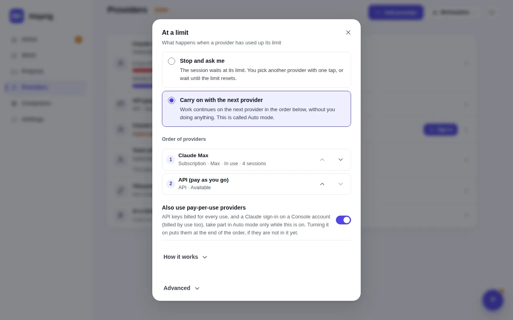
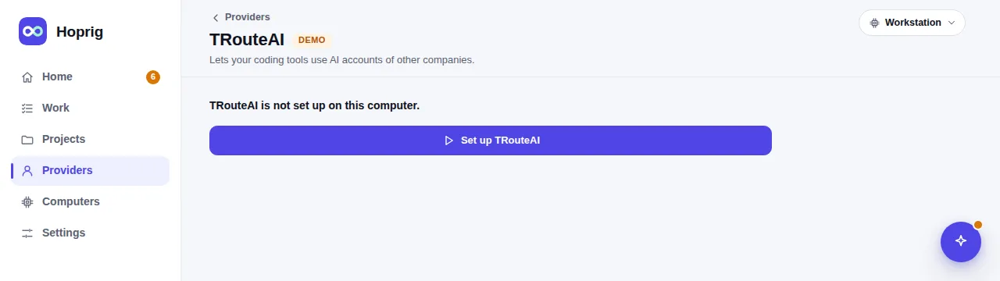

# Providers: how a stop is named

When a provider stops the coding tool's work, Hoprig names how, from what Claude Code itself wrote, and shows it on
Home, as a row of **Needs you** with the one step that recovers (see `docs/OPERATOR.md`). The names come from one closed table in
`src/providers/table.mjs`. Only Claude Code's records are read; OpenCode's are not.

## Where the providers are in the dashboard

**Providers** (in the menu) is one list: a row for each provider with its state in one line (and its limits, when it
reports them), **Add provider** at the top, a row for **TRouteAI** and a row **At a limit** that says what happens when a provider is used up.
A press on a row opens it. **At a limit** opens a sheet with the two choices, **Stop and ask me** and **Carry on with the
next provider**, the order of the providers and, under **Advanced**, the rest. **TRouteAI** opens its own page
(`#/providers/trouteai`): is it running, open it, its accounts and combos, its public address, and everything to manage it.

## What Claude Code writes

Read from Claude Code 2.1.328 against a gateway stand-in:

- The **StopFailure** hook event: `error` (one word, such as `rate_limit` or `unknown`) and `last_assistant_message`
  (the line the tool shows). When an agent inside a session stops this way, the same event carries `agent_id` and
  `agent_type`; the session itself goes on.
- The **transcript** line of the error: `isApiErrorMessage`, `apiErrorStatus` (the HTTP status), `apiErrorType`, the
  message's `stop_reason` and its text. An agent's lines are in the session's `subagents` folder.

## The table

Only the tool's own fields name a stop: the error word, the status, the type, a `refusal` stop reason. The words of
the line only tell apart stops those fields leave alike (a 400 that is an unknown model name, a picture, or the
provider's own refusal). A line with none of those fields is no stop at all: a failed test, a command that exits
with an error or the model writing "timed out" makes no item.

| Name | What the tool wrote (samples) | The step |
|---|---|---|
| a usage limit | `rate_limit`, 429 `rate_limit_error`: "Request rejected (429) · This request would exceed your account's rate limit."; `billing_error` | Continue on the next provider, or wait for the reset |
| the sign-in is gone | `authentication_failed`, 401 `authentication_error`: "Invalid API key · Fix external API key"; a 403 | Sign in on the Providers page |
| the endpoint refuses this model name | `model_not_found`, 404 `not_found_error`: "There's an issue with the selected model (relay-small)…"; `unknown`, 400: "Ambiguous model 'relay-large': it matches more than one model of this gateway" | Open the session; the mend is a combo of that name at the gateway, or a model the endpoint lists |
| the model does not take this kind of input | `unknown`, 400: "Image input is not supported for model relay-large" | Open the session |
| the provider refused the request | `invalid_request` with stop reason `refusal`: "… can't help with this. Start a new session to continue." or "…'s safeguards flagged this message" | Open the session; nothing is sent again or elsewhere |
| the endpoint did not answer | `server_error` with no status: "Request timed out…" or "Connection refused … (ECONNREFUSED)" | Restart the gateway, when the provider runs through a gateway on this computer; else open the session and continue it when the endpoint answers again |
| the provider failed past its retries | `server_error`, 500 `api_error` or 529 `overloaded_error` | Open the session |
| a provider error | anything else the tool marks as an API error | Open the session and read its words |

The hook keeps no HTTP status of its own, so the status at the start of the tool's line ("API Error: 500 …") counts as
the status: a 500 whose words say "timed out" or "can't help with this" is a server error, not no answer or a
refusal.

An agent is named by what it was doing: its description, from the small file Claude Code keeps beside the agent's
record (`subagents/agent-<id>.meta.json`), else its type. An agent's stop, a usage limit too, stays on the list for a
day. The retry automation never sends again a stop named a refused model name, an input the model does not take, or
the provider's refusal (Claude Code says `unknown` for the first two); a dropped connection is still tried again.

A chat of the App gets the same stop events on its own run record (the chat follows everything else through its own
channel, so those events write only the stop, its agents' stops and what clears them). A session that was already
running when this version came: its earlier hook wrote an agent's stop as the session's own failure, so such a failure
is said as "the session, or an agent in it"; anything that hook did not write makes no item.

Rows taken from the tool's code but not yet seen in its records: `connection_failed`, `oauth_org_not_allowed` and
`overloaded`.

The tool's line is kept cut to 160 characters and cleaned first: a gateway often adds the key, the account and the
Authorization header to its error, and no key, token or e-mail address is ever kept or shown. Only the first 600
characters of a line are read at all, so a very long error body costs nothing.

## Check this provider

On a provider's page, "Check this provider: N small requests" asks the provider's own endpoint, with its own key, for
each model name Claude Code can send through it: what each alias means today and every name the tool falls back to
when the endpoint refuses a model, each as a session really sends it: after the provider's model map where its switch
is on, as Claude Code names it where it is off (`src/providers/names.mjs` keeps them, with the tool version they were
read from). One more request carries a tiny picture for the model a picture would go to. Each
request asks for one word (max_tokens 1).

The answer lists each name as served, not served (with the endpoint's words, cleaned of keys, tokens and e-mail
addresses) or not told (a limit, an error or no answer says nothing about the name). Each name not served gets the line
that mends it, ready to copy: a combo of that name at the gateway, or a `MODELS` entry of this provider that names a
model the same round found served. For a provider that runs through TRouteAI the line has a **Make the combo** press: it opens
the options of the gateway's own combo builder, those that carry the model's name ticked, and makes the combo there
(your own press; see below). "Use this" beside a `MODELS` line puts it into that provider's `MODELS` (from the
dashboard's own page only, and only while the provider's `MODELS` are still the ones the line was made from). While the
provider's map is off for sessions, the line mends nothing for a session: the line says so, and "Use this" asks in the
same sheet whether to turn the map on too ("Put it in and turn it on", or "Only put the line in"); it is never turned on
without that press. The Operator's model-name item says the same. The last result is kept in the state folder
(`providers/checks.json`) without any key.

It runs once by itself when a gateway provider is made through the product (on Providers, or from another computer's
gateway), in the background. After that only your press sends anything: a look of the Operator, the dashboard's tick, a
page view or a change to the provider never does. A sign-in has no endpoint of its own and is never checked.

When a new Claude Code changes its aliases or fallbacks, read them again from its model data (`aliases` and each
model's `fallback_3p`) and from what it sends for `--model opus`, `sonnet`, `haiku` and `fable`, and update
`names.mjs` with the version.

## TRouteAI, the gateway that comes with Hoprig

Hoprig sets it up with one press (Providers → Add provider → Other providers, or `hoprig addons setup trouteai`): it
installs it into Hoprig's own folder, starts it with its data folder named (`--data-dir`), waits until it answers, makes
the key "Hoprig sessions (<computer>)" with the gateway's own `key create` command and saves it as the provider `api`.
A provider whose key the gateway accepts is left as it is; a copy of the gateway that npm already put on the computer
stays in use until Install is pressed. Hoprig keeps no management key: the gateway's command token (a file in its data
folder) goes only from this computer, only to a program that runs as your own user, and a key for a sign-in step is made
for that step and removed right after. If another user's program answers on its port, Set up and Start refuse and send it nothing.

On Providers its panel lists the accounts it holds (state, last test, limit windows), and you can test, turn off and on,
remove and add accounts, make and remove combos and remove the keys Hoprig made. Advanced → Service → Gateways has Restart, Log,
Update, Remove (only its copy in Hoprig's folder; the data and the provider stay) and its own dashboard password. Until
its next version lists its providers for Hoprig, adding a provider that its catalog should offer opens its own page.

## The model map for sessions (off until you turn it on)

A provider's `MODELS` rules rename models for Auto mode's router, as they always did. They reach a plain session or chat
on that provider only where you turned that on: **Use these names for every session on this provider** on the
provider's page (Model map), or `hoprig profiles map <name> on` (it asks first; `--yes` says yes). The switch is kept in
the provider's own profile (`MAPSESSIONS=on`); it is off when absent, so a provider that had `MODELS` before this
version keeps sending the names Claude Code chooses until you turn it on. Only you turn it on or off, from your own page
or your own command: not Tia, not a rule, not another computer.

With it off, the page shows what a session would be renamed to, rule by rule, and says that only Auto mode uses the
map. With it on, new sessions and chats on the provider, and the agents inside them, get the renames through Claude
Code's own `modelOverrides`, in the settings file Hoprig already writes for a session (with its hook and a project's
extra folders), or as the settings argument of a chat that has no such file. Sessions already open keep what they have.
The small model is not renamed that way by the tool; its name goes into `ANTHROPIC_DEFAULT_HAIKU_MODEL` of that session
only, under the same switch. Claude Code replaces your own `modelOverrides` with the file's, so your entries are copied
in, and for a name both map yours wins. Your Claude Code settings file is only read.

A map renames a model on the same provider's endpoint and key: it never changes the address, the key or the provider.
A session moved to another provider gets that provider's map, if its switch is on. Auto mode's router maps by itself,
with the switch on or off, so an Auto session gets no map here.

## Auto mode and providers billed by use

Auto mode (on Providers, **At a limit**, **Carry on with the next provider**) uses a
provider billed by use only while **Also use pay-per-use providers** is on. Billed by use are an API key that is billed
for every use and a Claude sign-in on a Console account: such a sign-in is named "Claude sign-in billed by use (Console
account)", never a subscription. While the switch is off, such a provider can stay in the order, but Auto mode leaves
it out and its row says so. When that leaves Auto mode nothing it may use, no session starts under Auto mode and
nothing is spent; the same holds when the providers of the order are gone or do not serve Claude Code. A start from a
terminal (`hoprig auto`), a request of a session that runs under it, a chat of the App and a run of Work then say why:
each provider that is left out, with its reason, and the way out. With a provider billed by use that is turning that
switch on, or putting a subscription into the order; else putting a provider that serves Claude Code into the order. A
chat says that Claude Code could not start, and a run of Work that it did not start. Tia does not choose Auto mode
then: she starts or moves the session on the next provider she may use, and with none she says why in the same words.
A session that already runs under Auto mode on a provider billed by use gets nothing more while the switch is off: its
message says to turn that switch on, or to start the session again under Auto mode.

## How soon a provider answers

Auto mode's router keeps, for each provider it passes requests to, how soon each streamed answer starts (a session's
own turns; a title or another answer that is not streamed is not timed) and how often the provider refused ("too many
requests" or "overloaded"), from the last 5 minutes. It sends no request of its own for
this. A provider's row on the Providers page then says "Answers in about 2 seconds", "Slow now: about 9 seconds to
start an answer" (more than 5 seconds, as the middle of its answers), or "Refusing now (too many requests)" (3 refusals
in 5 minutes); with fewer than 3 answers in 5 minutes it says nothing. While Auto mode's provider is slow or refusing, a new session
that names no provider (New session, `hoprig` with Enter, a chat of the App) starts on another provider that is free
of charge, signed in (a sign-in only once checked), not at its limit and not slow itself, the fastest measured first.
It may be one that is not in Auto mode's order, a team plan kept out of it too. Never one billed by use, also while
**Also use pay-per-use providers** is on (that switch is for limits). New session says so in one line. With no such
provider it stays on Auto mode. Auto mode's order and what it does at a limit do not change.

## What is left

The provider's page says only what was measured (the usage bars above it show each limit, how much of it is used and
when it resets); how often it stopped the work in the last day (counted from the stops the Operator's look reads, since the
dashboard started, kept in memory only); "at the pace of the last hour this window is used up in about N hours" only
from two readings of the same window at least 30 minutes apart within the last hour, with its basis ("from 12% to
30% used in 48 minutes"); and one line when more than half of the day's stops were limits ("another account would have
avoided N stops"). Without such readings or stops there is no line.
