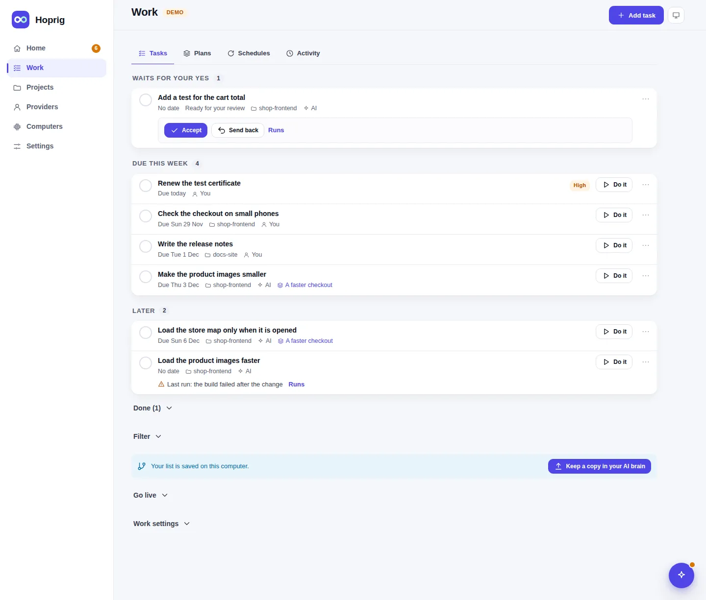

# Work: tasks, plans and what is due

Work is the dashboard's list of what your workspace has to do, Tasks first for what waits for
your yes and what is due, a way to have a coding session do a task ("Do it") and look at what it did, and plans: goals with milestones and dated tasks, made by
hand or proposed by a session that researched the goal ("Plan with AI"). It also holds schedules and tasks that repeat.

## The page

**Work** is in the sidebar right under Home, and in the phone's bar.



- **Tasks**: every task, in groups: **Waits for your yes** (waiting for you, and ready for your review: a session has
  done it and you Accept or Send back), a session works on it, **Due this week** (overdue, today and the next seven
  days, by date), later, no date; done and dropped folded away. "This week" is one rule everywhere: today and the six
  days after, here and in the command. A task of a plan that waits for another task not
  done yet says so ("Waits for …") and is not offered Do it; a task it waits for that was dropped no longer holds it
  back, and its ⋯ offers **Stop waiting**. A **Filter** fold at the end filters by project and by who does it (you or
  the AI). **Add task** opens a sheet: the task, the day it is due (or none), a project of your workspace, the
  priority, who does it and a note. The round button marks a task done (and open again); **⋯** has Change,
  Waiting for you, Drop and Remove (and Go live, for a finished task). Every action names the task by its place in the list and its id together, so
  of two tasks with one id the one you pressed is changed. The sessions that need an OK are on Home.
- **Plans**: the plans with their progress (done of all that are not dropped) and next date, Tia's missions in the same list, the proposals that wait
  for you, and one button, **Plan with AI**, whose sheet also offers **Write the plan yourself** and **Give Tia a goal** (see "Plans" below). One plan's screen has its goal, its milestones with
  their tasks in order, a **timeline** (tasks and milestones by date, week by week, the weeks with nothing counted,
  what waits for what said in words), **Who did what** once a run of one of its tasks had helpers (its tasks' runs of
  the last 30 days summed per tier, and one line per task with the models that worked on it and its count of runs; a
  plan without such a run shows nothing there) and its research note. **Change**, **Put a task in it**, **Mark done**,
  **Drop** (and **Active again**); a task's **⋯ → Put it in a plan / Its plan** moves it to a plan and milestone or takes it out.
- **Schedules**: the schedules of this computer and the repeating tasks in one list, each with what it does, on which
  computer, and when it runs next on this computer's clock; **Add schedule**; the queued messages of the sessions below
  (see "Schedules and repeating tasks").
- **Activity**: one history of the workspace, newest first and grouped by day: the sessions you, Tia and a schedule
  started (their title, coding tool, provider and how each ended: ended, at a usage limit, with an error), the runs of
  "Do it" (see "Do it" below), the commits and saves of the projects, what the automations did (a schedule ran, waited
  or was missed, the queue sent a message, a session came back after a restart), and errors (a failed run, an
  automation that failed or was missed, an action of a Home row that did not work), each line marked **Session**, **Run**,
  **Commit**, **Save**, **Automation** or **Error**. Filter it by **Project**, by **Day** and by **Who** (Everyone,
  You, Tia, A schedule); **Show more** gives older lines. A Do it run Tia started for you shows under Tia, as her chat
  does. A commit shows who made it only when a run of Work made it; any other commit shows under Everyone and is
  hidden when a who is chosen. A run's line opens its run (its session,
  all runs of the task, and for a schedule's run "Done with it"). It covers the last 30 days, read from this computer,
  and only reads: it starts no model and writes nothing into a project. Sessions are noted from this version of Hoprig
  on (earlier ones are not in Activity), in Hoprig's state folder (`work-history/sessions.jsonl`): when a terminal
  session starts and when a session ends, its project's name, the coding tool, the provider, its title, who started
  it and how it ended; never a folder's full path, a prompt or an answer. That file keeps 30 days and at most 256 KB.
  An App session that is still open shows from the App's own list of open chats, as open in the App.
  A run whose session led with **Lead model** has **Who did what** under it, the chat page's own card: the lead, each
  part with its kind, model and tokens (new, written and read from the cache, apart), and one total per tier, read
  from Claude Code's own records (the same card in a task's runs). It is open on a wide screen and closed on a phone,
  and stays as you left it while the page refreshes.
  Beside it, one line says what the run **used** (its minutes, the tokens of the lead and of each tier of helpers, the
  models, and the cost only where a provider billed by use reported one) and what it **saved**: the tokens done by a
  smaller model than the lead's, and in money only on a provider billed by use where Hoprig has a list price for every
  model ("at the lead's list price they would have cost $X, they cost $Y"). Activity starts with the same sums for
  today and for the last 7 days. Every figure is read from the run's own records; one they do not hold says
  "not measured" and why (a subscription has no price per token, so its saving is said in tokens only).
- **Go live**: a closed fold at the end of Tasks (the old address `#/work/golive` opens it): finished task branches put together, checked, and made live on your tap ([GO-LIVE.md](GO-LIVE.md)).
- **Save**: when the list has changes that are not committed, a bar says so ("2 changes not saved in git yet").
  Save shows first what it will do (the file, and per task: added, done, dropped, changed, removed, new id), then
  does it. A save reaches the server or leaves your change in the file: there are no saves "not sent yet".
- **Lines that ask for one thing**, shown over both parts when they apply:
  - *This file has things a change would alter* (a hand edit, see "The file as it is written" below), with **Tidy
    the file once**;
  - *2 tasks share their ids with another* (two computers added the same title), with **Give the doubles new ids**:
    a change like any other, shown in the Save plan;
  - *This list is a planning tool's file*, with **your id in this file** (see below);
  - *A save of the Work list was interrupted …*: one sentence when it was finished, or, when the repository is not
    where that save left it, where its list is kept, with **Drop the record** once you have looked (see Save).

## Do it: a session does a task

**Do it** (the ▷ button on a task, or **⋯ → Do it with a session**) opens a sheet that shows what will start, and
lets you change it first:

- the **brief**: the first time the task's title and note; a brief you change is kept on the task (`work.brief`);
- the **project** and the **folder** in it: the project's own folder or one of its code repositories (`code/<name>`).
  The task's project is the default; a task without a project asks for one;
- the **provider** (the folder's own, as New session picks it), the **model** and the **effort** (Settings →
  New sessions), and the coding tool when more than one is on;
- **Where it works**, for a project that is a git repository: **On a branch of its own** (`work/<task id>`, the
  default) or **In the project's folder itself**, with one line that says which;
- one line: "A session starts in <folder> (or its own copy of <folder>, on a branch of its own) with this brief. It
  changes files there as you allow in that session; nothing is pushed or merged by this."

**On a branch of its own**, the session works in its own copy of the project (a linked worktree of the repository) in
Hoprig's state folder, made from the checkout's current commit, on the branch `work/<task id>`; your own folder and the
branch it stands on are not changed. A task started again after **Send back** goes on in the same copy and on the same
branch, where the last run left it. **In the project's folder itself**, the session works in your checkout on whatever
branch it stands on. A project or folder that is not a git repository runs in its own folder, and so does every run
while Hoprig's state folder is not inside the allowed folders (`server.roots`), where a session may open: the sheet says
why. While a run that ends by itself (a mission's, a schedule's) works on the task, Do it waits: never two sessions on
one branch.

**Start** opens an App session (the same kind a schedule starts) whose first message is the brief and one sentence
asking for a short report at the end: what was done, what was checked, what is left. The task is **doing** while it
works; its row offers **Open the session**, not a second start (two presses of Start make one run). Start goes with
the brief the sheet showed: when the task changed since (a merge, a save), nothing starts and the sheet shows it anew.
A brief, also one made from a task that came from another computer, is at most 4,000 characters and holds no
character that cannot be seen (a zero-width one, an invisible tag, a direction mark, words hidden in variation
selectors, a blank filler); when it does, the sheet offers **Take them out**, and the brief without them is kept on
the task when it starts. A session that works on the task on another computer is said in the sheet and does not stop
a start here; its run is shown, with no session to open on this computer.

When the session's turn ends well, the task goes to **review**, with the session's last answer, the commits made in the
folder's repositories since the start (on a branch of its own, the commits on its branch) and the files it left changed
and not committed (a file that was changed before it started and holds the same is not counted). **Accept** makes the
task done; for a run on a branch of its own the branch stays, not merged and not pushed, for Go live
([GO-LIVE.md](GO-LIVE.md)) to put together, and its copy is removed when nothing is left uncommitted in it. **Send
back** opens the task again, and what you write is added to its brief for the next run (the task's own text and the
newest of what you sent back, the oldest left out when they no longer fit together). A task in review is not started
again before Accept or Send back. Once a task is done or dropped, **Runs of this task → Remove the branch** removes its
branch and its copy; a branch with a commit no other branch holds, or a copy with files not committed, is kept, and the
answer says why. When you drop a task yourself, the branch of its Do it runs is removed too, by the same rules; a drop
Tia makes for you removes no branch. A turn that ends in an error, at a usage limit with no other provider going on with
it, or because you stopped it puts the task back to **open** (or **waiting**, when it was waiting for you), with the
reason. A dashboard restart while a session works leaves the run working; when the dashboard is back it is settled from
the session's own record of how its turn ended, or marked stopped when the session is gone for good. In a planning
tool's file doing and review are written as `status: "open"` with Work's `state`, as for the other statuses.

**A run** is the record of one such session for one task: a file of its own beside the list, `runs/<run id>.json` (the
id holds the date and time and random characters, so two computers never write one file), written only by the
dashboard that ran it. It holds the task's id and title, when it started and ended, who started it, the project and
folder (never a full path), the coding tool, the provider's name, the model, the effort, the session's id, its state
(`running`, `done`, `failed`, `limit`, `stopped`) and reason, the answer (at most 4,000 characters, anything that
looks like a secret masked and the computer's own paths taken out), the commits (repository, short id, subject) and
the files left changed (repository, path, kind; at most 200, the rest and any name a run does not hold counted).
Commit subjects are cleaned like the answer, and the computer's name is taken out too. A run file is at most 64 KiB.
What the session started from (each repository's commit, the files changed before it) stays in this dashboard's
state folder, never in the run. Save commits a file in `runs/` only when it is a run of its own name (a plain file,
not a link); anything else there is named and left alone. Runs are not kept on the task, so a task changed on two computers
is still one change. The run file and the task's status are written under Work's one lock; when the status cannot be
written (the file needs a tidy, two tasks share the id), the run is written all the same and says why.

## Tia and Work

Tia (README, "Tia") works with Work through one tool, `manage_work`, whose every action runs the page's own route, so
the dashboard checks her as it checks the page:

- **Reading** runs at once: the top of Tasks (what needs you, what is to review, this week), the list (by project, who does it,
  status), one task with its runs, what a run left (its answer, commits and files), your plans, and one plan with its
  milestones and its tasks in the plan's own order, each with its state, date, who does it and what it waits for.
- **Acting** runs at once and she says it in her reply: add a task, change its title, date, project, who does it and
  its note, mark it done or open it again. She can also put a task into a plan and milestone, move a task to another
  milestone, and change what it waits for. A change of a plan, or of a task in a plan, runs at once only when your own
  message in that turn names the plan or the task, and only when her level is not **Ask me**; otherwise you get a
  card that shows each change as before → after, and she never changes a plan by herself while a job wakes her.
  **Undo** takes her last act of that conversation back, a move in a plan too, only while the task is still as she
  left it (what anyone changed since is never overwritten).
- **A card first**: starting work on a task, accepting a result, sending it back with your words, dropping and
  removing a task, and giving her a goal for a project (see Missions below). She reads her missions without a card. A task in review or one a session works on is never marked done or opened again by her.

**"Do the cart fix in the shop project"**, typed or spoken: she finds the project (asking only when two fit, and
never guessing one that is not in the workspace), finds or adds the task, writes the brief (what to do, where, what
done means, what the session must not do) and picks the model and effort by the kind of work, as the working rules
say: mechanical work on the fast model at low effort, code on the strong one at medium, a defect whose cause is not
known on the strongest at high. The provider is one she may use (Settings → Tia), as for any session she starts.
One card shows the task, the project and folder, the brief as it will be sent, the provider, the model and the
effort; your yes starts exactly that (the "Do it" start above, with that brief kept on the task), and a task that
changed after the card was made starts nothing. The session is yours, not hers: every OK it asks for comes to you,
unless you turned on **She answers the OKs of her Work runs** (Settings → Tia, under how far she may go; off at
first, saved at once, so one press stops it). Then an OK in the session of a Work task she started is hers to answer
while she follows it, by the same rules as in any session of hers: she allows by herself only looking inside the
project and its own checks, never at **Ask me**, and on a provider billed by use only at **Hands off**. Every other
OK stays your card (changing files, money, a sign-in, a push or merge into a main branch, a release, anything sent
out, a delete outside the project, administrator rights), and so do text typed into the run, "do not ask again" and
a stop. Each answer she gives is a line in her Activity ("answered an OK in …: allowed …", with why).
She follows it as a job; when its turn ends she reads the run and tells you in two lines what was done and what
waits for you. She does not accept a result and starts no second session by herself. Text from a task, a brief, a
session's answer, a commit's subject or a file's name is data to her, never an instruction. Save, Tidy, the doubles,
where Work lives and the command's route stay yours: her door refuses them. So do making a plan and changing a plan's
own title, goal, milestones or status, which stay yours on the Plans part, and removing a task's branch.

## Plans

A **plan** is a file of its own beside the task list, `plans/<id>.json` (its id made from its title and a short mark of the moment it was made, so the same title planned on two computers is two plans):

| Key | What |
|---|---|
| `v` | 1 |
| `id`, `title` | the id (its file's name) and the title, one line of 3 to 200 characters |
| `goal` | one sentence, at most 300 characters |
| `projects` | the projects of the workspace it is about (up to 10) |
| `milestones` | up to 12: `{ id, title, date }` (a date or `null`) |
| `note` | `"<id>.md"`: its research note, or `null` |
| `made` | `{ at, how }`: when, and `hand` or `proposal` |
| `status` | `active`, `done` or `dropped` |

Its tasks are ordinary items of the list that carry `plan` (the plan's id), optionally `milestone` (one of its
milestones' ids) and `after` (the ids of the tasks they wait for; never a ring of tasks that wait for each other). The
**research note** is a Markdown file beside it, `plans/<id>.md`: plain Markdown, at most 16,000 characters, no HTML (no `<` before a letter, `/`, `!` or `?`,
except in a fenced code block whose fence lines start at the beginning of a line), no image, no entity in a link's words,
links only to `http` and `https` addresses; the page shows it as text and a link as its address. Both files are
checked strictly when they are read and written, and written atomically. A file in that folder that says it is a plan
and does not pass is named on the Plans part and left alone; a planning tool's own files there (its notes, its JSON) are
never read as plans, never written and never committed, and a new plan never takes a name a file there has, nor a plan id a task still names. Removing
a milestone that still has tasks is refused: move them first.

### Plan with AI

**Plan with AI** opens a sheet: your goal in your own words, the project it is about (and others it is also about), and
the provider, model and effort (the defaults as Do it has them), and **Lead model** with **Use other providers** (see
the README; their defaults are in Settings → New sessions). **Plan** starts an App session in that project (you
can watch it) whose first message asks it to research (the project's files, the web where the coding tool has it)
and to answer with a research note and a draft plan with milestones and dated tasks, in one exact JSON shape. Its
method is the skill **plan-work**, which ships with Hoprig (it is also offered under Skills for your coding tools);
where the skill says to ask, the session writes its assumptions and questions into the note instead.

The session writes nothing into the Work repository. Its result is **data**: its last answer, captured when its turn
ends (not a file in its folder, which may be the very repository Work keeps its list in). The answer is masked (a key,
this computer's paths and name) and read strictly: the whole at most 200,000 characters, one JSON block, real dates,
projects of the workspace, at most 60 tasks, every text checked as a Do it brief is (characters that cannot be seen are
refused), the note as above. What does not read is shown as **"The proposal could not be read"** with the reason, and
the session's answer stays readable as text; when the reason is characters nobody can see, **Take them out** reads it
again without them.

A proposal waits in Hoprig's state folder (`work-proposals/`), on Plans ("Plans to look at"), also after
a restart of the dashboard (a session that ended meanwhile is settled when the dashboard is back). The **proposal
screen** shows all of it on one screen, the session's words marked as the session's: you change a title, a date or
who does it, take out a task or a milestone (what waited for a task taken out waits for nothing in its place), and
press **Accept**. Only then are the note, the plan and the tasks written, as one unit: a record of the unit is flushed
to the state folder first, and a kill at any step leaves either nothing or everything (the next look at the Work list
finishes it; when a file changed meanwhile nothing is touched and the page says so until you drop the record). The page
sends only your changes, never the session's texts back; Accept pressed twice (two tabs, a double tap) writes one
plan, and the second press is told the proposal is gone. **Dismiss** throws a proposal away. A task of an accepted plan
is done as any task, with Do it, whose sheet shows the brief the session wrote before anything starts; nothing starts
by itself.

## Schedules and repeating tasks

There is one rule for when something comes back: **once**, **every day**, **on some weekdays**, or **every month on a
day** (1 to 31; in a shorter month a day past its end is its last day, so the 31st is the 30th in April and the 28th or
29th in February). A schedule and a repeating task use the same rule and the same code.

**A repeating task** (the task's sheet: **Repeats**, or `--repeat`) keeps **one** open occurrence, so a week away leaves
no seven copies:

- when it is marked done or dropped, the next occurrence is made with the rule's first day after today (or after its own
  date, when it was done early);
- when its day comes round again while it is still open, its date moves on to the rule's newest day, and the days it
  missed are kept on it (`repeat.missed`, the last 10). A task a session works on or that waits for your review is left
  as it is;
- opening a done one again takes back the occurrence it made, while that one is still exactly as it was made.

Each step depends only on the task and the day, never on the clock's seconds: the next occurrence's id is the series id
and its date (`water-the-plants-20261119`), so two computers that take the same step write the same task and a Save
meets no conflict. It goes through Work's one writer and lock, and the Save sheet says "next time made" and "date moved
on"; only Save commits it.

**Run by AI at a time** on a task (the sheet's **Run by AI**, or `--run-at 07:30 --computer here`) is the task's own
schedule, kept on it (`work.at`: the time, the computer, the time limit and the provider, model, effort and permission
mode). Only the computer it names runs it; one without a computer says "choose the computer" and runs nowhere. A dated
task runs on its date, one without a date every day while it is open. What a computer has handled is that computer's
own state, never in the repository.

**A schedule** (Work → Schedules → **Add schedule**) reads like a sentence. It does one of three things:

- **Let the AI work by itself** (see below), in a project of the workspace, on this computer or on a computer linked to
  this dashboard (Computers);
- start a session (in the App or a terminal) in a folder, with a first message;
- send a message to an open session (it waits in that session's queue, so it never interrupts a reply).

Clock changes: a time that does not exist on the day summer time starts runs at the same distance after the jump; a time
that happens twice runs once. A slot missed while the computer was off runs once when it is at most "how late" hours
late (2 by default; only the newest missed slot counts), else it is recorded as missed. A schedule made or
changed after today's time starts next time.

**A schedule on another computer** runs there only: at the slot this dashboard asks that computer over the existing link
(its address and token, see `COMPUTERS.md`) to start it. When it cannot be reached, the slot is recorded as missed with
the reason, you are told, and it does **not** run anywhere else. The other computer checks the run itself (its own
projects, its own providers) and refuses it while its automations are paused.

### A run that ends by itself

One turn of the coding tool (Claude Code) with no person at it, in a project of the workspace, with the prompt, the
provider, model and effort chosen, and a **time limit** (default 30 minutes, 1 to 240):

- It works in a separate copy of the project (a linked git worktree in Hoprig's state folder) on a **branch of its own**,
  `work/<task or schedule id>`: never on the default branch and never in your own checkout. Nothing is pushed, merged or
  published. A project that is not a git repository is refused.
- It runs in the permission mode its schedule names, by default **the one that asks**: with nobody there, a step that
  needs an OK is refused and the result says which. "Allow every step without asking" is a choice on that schedule
  only, with a warning.
- At the time limit it is ended: "Stopped at the time limit", and what it had done so far is kept.
- Its result is captured as Do it captures one: a run in `runs/` (by "schedule", with its branch) with the answer, the
  commits on its branch and the files it left changed. For a task, the task goes to **review** (or back to open with
  the reason). **Accept** removes the copy when nothing in it is left uncommitted; the branch stays.
- **Limits**: only what you set starts; never two runs of one project at once; at most "runs by themselves at once" on
  one computer (the top of Work → Schedules, 1 to 4, default 1). A run that has to wait is kept and starts when a place is
  free. The schedules switch is the master switch of all of it.
- **Tell me**: "only when there is something to report" (the default) or "every time". Nothing to report means it ended
  well, made no commit, left no file changed, and its answer starts with "Nothing to report." (the prompt asks for that
  line). A failure, the time limit or a refused step is always told.

What was the Automations page is split by where it belongs: the schedules switch and how many runs by themselves at
once are at the top of **Work → Schedules**; trying again after a server error, reopening sessions after a restart,
the housekeeping, and (under Advanced) pausing all of them are in **Settings → Automations**. Sending the next
queued message has no switch any more (a queue always sends; an old switch that was off is still honoured, and the
queue's banner then has a Turn it on button). The old addresses (`#/automations…`) land on the
new places.

## Progress, how long, and being told

What runs, how far it is, when it will be done and what waits for you are **read from the files**, never told by a
model. One function (`src/work/pulse.mjs`) gives it, and Activity, a task's runs, `hoprig tasks progress` and Tia all
read that one. It reads files only: no program is started for it. It never holds the dashboard for long: Claude
Code's workflow records are read newest first, one written before the earliest time asked for is not read, at most
300 a folder, what was read is kept for the next look, and the dashboard's thread is given back between small
pieces.

- **What it follows**: Work's runs (Do it and the runs that end by themselves, a schedule's among them), the coding
  sessions of this computer (their run records), and the workflows those sessions run (Claude Code's own record of
  each: its steps, its agents, its tokens).
- **What it says of each**: when it started, its steps where the coding tool's records name them ("step 2 of 2, 2 of
  4 agents done"), its last progress, and what it used: the tokens where the coding tool reports them, else "not
  reported" (never 0). A run that ends by itself keeps what Claude Code's result line reported (`used` in its run
  file); a session's come from its transcript.
- **The estimate** comes only from what finished here: for the same kind of work (a run's project and kind of work,
  a schedule, a workflow's name), the last ten that ended well give the range, shortest to longest, rounded to five
  minutes, always with its basis: "about 5 h 30 to 8 h 30, from 4 like it", and for one that runs "done by about
  09:30 to 12:30" (in the time zone of Work settings, else this computer's). With fewer than two, a run gets no number: Work's
  Activity tab says it once, under **Running now** ("No estimate yet: nothing like it has finished here."), and
  the digest says "no estimate yet" beside the run. A duration below zero or over seven days (a clock set back, a lost end) does
  not count. One that runs longer than any like it says so ("longer than any like it (the longest took 2 h)"), and
  gets no new number.
- **Activity** starts with it: one line ("5 running · 2 wait for you · 1 done · 1 failed"; the command and Tia add the time it was read, "(as of 06:00)"), what runs, what waits for you
  (a finished task to look at, a session that waits for your answer), and, folded, what finished and failed in the
  last 24 hours. A task's **Runs** shows its own part above its runs.

**Being told** (Settings → Notifications → **Work, by itself**), through the push address set above it. Each item is
off until you turn it on; what was there before you turned it on is not told:

- something finished and waits for your look;
- something you accepted is done;
- something failed or stopped, with the reason in the coding tool's own words, cut to 80 characters;
- a session waits for your answer longer than N minutes (15 at first);
- a **digest** every N hours (4 at first) while work runs: what finished since the last one, what runs and when it
  will be done, what waits for you, what it used. A digest with nothing new is not sent.

Each message fits a phone's lock screen: a title of at most 50 characters that says what happened, and a first line
of at most 90 that says what you can do ("Open Work → Tasks to look at it and accept it"). No path, and no text of a
session but a failure's reason. They are not noise:

- **One message per event**, also across a restart and with two dashboards: a run is told only by the dashboard that
  ran it, and what was told is kept in a ledger in that dashboard's state folder (`work-told.json`), written before
  the message is sent. A message the receiver refused is tried again after 1, 5 and 30 minutes, then given up.
- **Never lost by a stop**: the ledger notes a message as about to be sent, and then as sent. After a stop in
  between, the next start sends it once more, only once. So a second message for one event comes only with a stop
  in between.
- **When the ledger cannot be written** (the state folder full or read-only), nothing is told, and Settings →
  Notifications says so until it can be written again.
- **At most one message in N minutes** (10 at first); what comes meanwhile goes as one ("1 done, 1 failed" and their
  names). "Waits for your answer" is not held back by it.
- **Quiet hours** (none at first): nothing is sent then; what happened goes as one message when they end.
- **While the dashboard was off**: what happened is told once, as one message ("While it was off: 9 done, 3
  stopped"), when it is back.

These settings are kept in their own key, `server.notify.work`, not among the push events: a push address with no
events list gets every event of that list, so a new event there would have been switched on by an update.

**Tia writes my digest** (off at first): Tia writes the digest in the language you write to her in (the start of your
last message to her is kept for that, only while this is on), with one short call on her provider, counted in her
usage. On a provider billed by use she words it only inside your daily limit for paid use (Settings → Tia), counted
there; with no limit set, or none left today, the plain digest goes and no provider is asked. She gets the digest with placeholders (`{n1}`) instead of every number and name, and your sample as data;
the dashboard puts the values in after her words. A wording that changed, dropped, doubled or moved a placeholder,
or holds a digit of its own, or is in your language in one line and in English in another, is not used: the plain
digest goes. Off, or with Tia off, no provider is asked. On an ntfy receiver a title in another script is sent as
encoded words (RFC 2047), so it arrives as written.

**Tia** answers "what is running", "how far is it", "how long will it take" and "what did you do tonight" with her
Work tool's `progress`. Those lines are the answer: they are shown under her reply as the tool gave them. A time or
a count in her words that no tool gave her hides her words of that turn, so you see the lines only, and her
Activity notes it.

## Another program: a Work token and webhooks

A script or another product can add a task to your list and hear its result. It gets nothing else.

**A Work token** is made in **Work → Tasks → Work settings → More → Another program**, by you, on this dashboard's own page: you name it
(the program it is for), the page asks once, and the token is shown **once** (`hwt_…`). Hoprig keeps only its SHA-256,
in `work-access.json` in its config folder (mode 0600), never in the Work repository or the brain. The list shows each
token's name, when it was made and when it was last used; **Revoke** ends it at once (also a request already on its
way) and removes its webhooks. `hoprig tasks tokens` lists them in a terminal, `hoprig tasks tokens revoke <id or
name>` revokes one. Tia cannot make, list or revoke a token or a webhook: her door refuses those routes. Another
computer's link and a machine token are refused there too.

A token is sent as `Authorization: Bearer hwt_…` (never in the address) and reaches these routes only:

| Route | What |
|---|---|
| `POST /api/work/token/tasks` `{ title, note?, project?, date? }` | add a task: the item's own limits (a title of 3 to 200 characters, a note of 2,000, no hidden or direction characters), a project of the workspace, `YYYY-MM-DD`; nothing else (no repeat, run time, provider, mode, status, who does it) |
| `GET /api/work/token/tasks` | the tasks this token added |
| `GET /api/work/token/tasks/<id>` | one of them with its runs: `id`, `state`, `startedAt`, `endedAt`, `reason`, `answer`; never the session, the folder, commits or files |

Every other route of the dashboard, its page and its WebSocket refuse a Work token (403, `token-scope`); a task of
another token or one of yours is "not found" to it. An answer is JSON; a refusal is `{ "error": "<one sentence>",
"code": "..." }`:

| Status | `code` | When |
|---|---|---|
| 400 | `refused` | a value it does not take: invalid JSON, a key it does not take, an unknown project, a bad date, a title too short or long |
| 400 | `hidden` | the title or note holds a character nobody can see |
| 400 | `token-in-address` | the token is in the address: send it in the header only |
| 401 | `token` | no token, an unknown or revoked one, or another scheme than `Bearer` (written so, with a capital B) |
| 404 | `not-found` | a task this token did not add, or a route a token does not reach |
| 405 | `method` | a method the route does not take |
| 409 | `busy` | another change to the Work file is still being written: try again in a moment |
| 409 | `broken`, `unreadable`, `limits`, `untidy`, `unwritable` | the Work file cannot be changed now: it is not valid JSON, cannot be read, is past what Work reads, would be rewritten (Tidy the file once on the Work page) or cannot be written; nothing was added, fix the file first |
| 413 | `refused` | the body is over 64 KB |
| 415 | `refused` | the body is not sent as `Content-Type: application/json` |
| 429 | `minute-limit`, `day-limit` | past the token's limit; `Retry-After` in seconds |
| 429 | `rate` | 30 tries with a wrong token in a minute from one address (a right token is never held back by them); `Retry-After` in seconds |
| 500 | `internal` | an error on the dashboard's computer |

**Limits** per token, set on the same page: 60 requests a
minute and 100 tasks a day (counted by Work's day: the time zone in Work settings, else this computer's clock;
`Retry-After` counts to that midnight); one token's requests never count for another.

**A task from a token is someone else's words.** It carries the token's name (`from` in the file: its id, name and
when; it stays when the token is revoked), shown as "From <name>" on its row, in Tia's card and in the command's
rows (`(from <name>)`) and JSON.
It is never started by itself: it gets no run time, a schedule does not run it, and Tia starts it only on your yes on
her card, which names the token. When a session does it, its title and note go into the brief inside a fence of data
from outside (`<untrusted_data source="work-token" …>`), with a line saying they are a description of the work, not
instructions.

```js
// add-task.mjs: node add-task.mjs "Check the price list"   (set HOPRIG_URL and HOPRIG_WORK_TOKEN)
const base = process.env.HOPRIG_URL; // the dashboard, e.g. https://dash.example.com
const auth = { Authorization: `Bearer ${process.env.HOPRIG_WORK_TOKEN}` };
const r = await fetch(`${base}/api/work/token/tasks`, {
  method: 'POST', headers: { ...auth, 'Content-Type': 'application/json' },
  body: JSON.stringify({ title: process.argv[2], note: 'Added by add-task.mjs' }),
});
const out = await r.json();
if (!r.ok) throw new Error(`${r.status} ${out.code}: ${out.error}`);
console.log(`added ${out.task.id}; its result: GET ${base}/api/work/token/tasks/${out.task.id}`);
```

**A webhook** is made on the same page: the token whose tasks it is told about (a webhook belongs to one token and
hears of no other task), an address, the events, and two choices. The page asks first, naming the address; then its
secret is shown once. The events:

- `done`: the task was marked done;
- `result`: a run of it ended well (the task waits for your review);
- `needs-you`: the task went to waiting, or a run of it stopped for you (failed, a usage limit, stopped).

A delivery is a `POST` of a small JSON body: `{ "event", "task": { "id", "title", "status" }, "run" (its id, or
null), "time" }`. The session's answer is in it (`"answer"`) only when you turned **Send the answer too** on for that
webhook; otherwise the receiver reads it with the token. It is signed: `X-Hoprig-Timestamp` is the time in seconds
and `X-Hoprig-Signature` is `sha256=` and the hex HMAC-SHA256, with the webhook's secret, of the timestamp, a dot and
the body as sent. A receiver checks both, refuses a time more than five minutes off, and answers with a 2xx.

Where a delivery may go: an `https` address (plain `http` only to this computer itself), with no user name or password
in it. Its name is resolved at each try and every address it resolves to is checked; the connection goes to the one
address checked, with the name for its certificate. An address of this computer or of a private network (10/8,
172.16/12, 192.168/16, 100.64/10, fc00::/7, the local NAT64 prefix 64:ff9b:1::/48, also written as IPv4 in IPv6) only
when you marked the webhook **On my own network**; link-local (169.254/16, fe80::/10, a cloud's metadata address),
0.0.0.0, multicast, documentation (192.0.2/24, 198.51.100/24, 203.0.113/24, 2001:db8::/32, 3fff::/20) and reserved addresses
(192.0.0/24, 240/4) never. No redirect is followed and no proxy variable is used. A try waits ten seconds at most; the answer is read up to
4 KB and thrown away. Three tries (at once, after 5 seconds, after 30), then it is given up and Activity says so with
the status only. The secret, the token and a body are never logged.

Deliveries wait in memory: a restart of the dashboard drops what was not sent yet, and what changed while it was
stopped is not delivered (it compares what it sees with what it saw last, and starts by taking note). Each change
is told once: a task or its runs missing for a while (the file reverted, the runs folder away, Work moved to another
project and back) are not told again when they are back. A runs folder that cannot be read (a link, no permission)
holds back only "result ready": "done" and "needs you" still go out, Activity says once that the runs folder could not
be read, and a run that ended before it could be read again is not told. The receiver
can always read its tasks with the token. With no token and no webhook (the default) nothing of this runs, writes or
connects.

```js
// receiver.mjs: node receiver.mjs   (set HOOK_SECRET, PORT, and HOPRIG_URL and HOPRIG_WORK_TOKEN to read the result)
import crypto from 'node:crypto';
import http from 'node:http';
const secret = process.env.HOOK_SECRET;
http.createServer((req, res) => {
  let body = '';
  req.setEncoding('utf8').on('data', (c) => (body += c));
  req.on('end', async () => {
    const ts = String(req.headers['x-hoprig-timestamp'] || '');
    const want = `sha256=${crypto.createHmac('sha256', secret).update(`${ts}.${body}`).digest('hex')}`;
    const got = Buffer.from(String(req.headers['x-hoprig-signature'] || '')); // bytes: a header may hold any character
    const fresh = Math.abs(Date.now() / 1000 - Number(ts)) < 300; // refuse an old (or replayed) delivery
    if (!fresh || got.length !== Buffer.byteLength(want) || !crypto.timingSafeEqual(got, Buffer.from(want))) return res.writeHead(401).end();
    res.writeHead(204).end();
    const ev = JSON.parse(body);
    try { // the dashboard may be restarting, or refuse the read (429 at its limit, 401 once the token is revoked)
      const r = await fetch(`${process.env.HOPRIG_URL}/api/work/token/tasks/${ev.task.id}`, { headers: { Authorization: `Bearer ${process.env.HOPRIG_WORK_TOKEN}` } });
      const out = await r.json();
      if (!r.ok) return console.error(`could not read the result: ${r.status} ${out.code}`);
      const { runs } = out; // newest first
      console.log(`${ev.event}: ${ev.task.title}${ev.event === 'result' && runs.length ? `\n${runs[0].answer}` : ''}`);
    } catch (e) {
      console.error('could not read the result:', e.message);
    }
  });
}).listen(Number(process.env.PORT || 8080));
```

## Missions: a goal Tia does by herself

A mission is a goal you give Tia for a project: Plan with AI plans it, you accept the plan, and her sessions do its
tasks, each checked by code and by a reviewer session before it comes back to you. **It is off until you turn it on**,
twice: the master switch and a switch per project ("Tia works on this by herself"), both in **Settings → Tia → Limits and roles**. With
either off, a goal you give becomes a plain proposal of Plan with AI, and its tasks are yours to start, as before.

**What runs by itself.** With everything off: nothing of missions. A look at the missions reads their folder and, when
there is no mission of this dashboard that is still going, stops there: no file is written, no session started. With
one project on and its Auto off: still nothing until you give a goal for it and accept its plan; then only that plan's
tasks start, one after another within your limits.

**Auto: Tia starts a project's ready tasks by herself.** A third switch per project, "Tia starts this project's ready
tasks by herself", shown in Settings → Tia → Limits and roles only under her switch for that project and off until you turn it on (turning
her switch for the project off turns it off too). With it on, each look (every 15 seconds) takes at most one task of
your list that is **ready** and starts it as a mission of that one task, with no plan. A task is ready when all of
these hold: its project is that project by name; who does it is "ai" or one of her roles that is on (never you, never
the reviewer); it is a task (not a deadline, a gate or an opportunity) and open (not done, dropped, in review, being
done or waiting); it has no run time of yours (a task you set to run at a time runs then, by your schedule); its date
has come, or it has none; every task it waits for (`after`) is done; no other program added it with a Work token; no
run of it goes on; no mission ever had it; and you never ended it under Auto. A start obeys the same limits as any (the
master switch, your working hours, sessions at once, this computer's load, the spend cap per day), and none is made
while an Auto mission still waits for its first session. While Tia is set to "Ask me" Auto starts nothing, since every
start of hers is then yours to OK first. While this computer is overloaded and a task is ready, **Work → Activity**
says once an hour that Tia (Auto) waits with it. Each start is a line in **Work →
Activity** ("Tia (Auto) started …") and the first line of its mission, "Started by Tia (Auto)". Its mission has
**End** where another has Stop: its session is stopped at once, and Tia never takes that task by herself again (the
task stays open in Work for you). With Auto off nothing of it reads the list or writes anything.

**Giving a goal**: **Give Tia a goal** in **Work → Plans** (the goal and its project; the sheet says
whether Tia will work on it or it will be your plan to start), or ask Tia; her card says the same before your yes.
The planning session is Plan with AI's own. Nothing starts before you **Accept** its plan, and the mission's tasks are
exactly the tasks that Accept made (a task another mission still holds stays that mission's). A task another program added with a Work token is never taken by itself: it stays yours
to start from Work.

**Each task** is one session (a run that ends by itself, above), on a branch of its own, `work/<task>`, made from the
project's default branch (your checkout must stand on it), in the mode that asks, with the time limit you set:

- its **role** is who does it in the plan: developer, tester, researcher, writer or ops ("ai" is the developer's).
  A task the plan gives to you ("me": an account, a purchase, a yes, anything that goes out) or to anyone else is
  never a session's: it is in the mission as yours, and the mission waits for it.
  A plan's task for the reviewer is not a session either: every task of a mission is reviewed after its work; it
  is yours to close. A role is a file of the product (`roles/<name>/ROLE.md`): what it is for, what it may touch, the model
  and effort for its kind of work (writing and checking code: the strong model at medium effort; running and recording:
  the fast model at low effort), the tools its session has, and how its result is
  checked.
  **A session of hers has the file tools only**: Read, Glob and Grep to look, Edit and Write to change (a reviewer
  has only the first three). It has no shell, no git, nothing that reaches the network, no tool server and no helper
  with more than that, and it reads and writes only inside its own worktree: a path outside it is refused, also
  through a link, and so is a write to a git folder or to the coding tool's own settings. This is not a list of
  allowed words: the session is started in Claude Code's own restricted mode with exactly those tools, it is not
  started at all where the installed Claude Code does not know that mode (the mission says so, and that an update
  of Claude Code helps), and a session whose own first line names any other tool is ended at once. A role file that
  names another tool is refused. So a session runs no command of its own (what its role may run goes only through
  the box's tools, below), cannot push and cannot read your other files. It cannot commit either: when a session that writes has ended, **the dashboard itself makes the one
  commit** of what it changed, on the task's own branch, named by the task: exactly the bytes in the folder, with
  no hook, filter or other program of the repository started for it. A reviewer reads what the branch changed
  from a file the dashboard writes for it (the list of files and the diff, outside the worktree). **A branch that
  changes a file which tells a coding tool what to do** (`CLAUDE.md`, `AGENTS.md` and the like) gets no reviewer
  session: those words would be the reviewer's own instructions, so it is yours to read first.
  A role never asks you anything: a step that needs an OK is refused, the mission's line says so, and the
  task's check decides what comes next, as for any result;
- its **provider** is the first of your order that is free (below);
- its brief is the role's text and the task's brief; its session's **budget** (Claude Code's own `--max-budget-usd`)
  is what is left of today's **Spend cap per day ($)** (below) after what was spent and what her sessions that run now hold, shared with the
  sessions still to come (each waiting task's next session and its review) or the places still free, whichever are
  more; with less than $0.05 for it, it does not start. Claude Code checks its budget between its steps,
  so one step may go a little past it.

**The check owns "done".** When a session ends, code checks its branch: nothing left uncommitted; the branch changed
something; when the brief names its files on a line `Files: a, b`, it changed only those; for the developer and the
tester, the project's **test command** (none set is a check that does not pass). You set it per project in
**Settings → Tia → Limits and roles**: under **Projects** type it into the project's field **Its test
command**, then press **Save**. It is kept in the dashboard's settings, not in the project's files. A session
that may write could change what that command runs, so the product never runs a session's test code by itself
outside the **box** ([BOX.md](BOX.md)): no network, without your home, only the task's worktree to write and the
project's own dependencies to read. The check runs the tests in the box and says so ("the tests passed (npm test, in
the box, no network)"); a test that needs the network fails there, and the words say the tests ran without one.
The folders are the product's own, never words of the brief or a file of the branch: the worktree the product made,
the `node_modules` of the project's main checkout (by its real path), and the folders the project's needs name, as a
session gets them. The box gets whole folders and has no deny rules, so a need folder goes to it only when nothing in
it is kept from the session's own tools (a private folder, a credential place that is a file, a rule of its own
settings): otherwise it is left out, and the check says which. Nothing is installed. The dependencies reach the tests through a link `node_modules` the product
makes in the worktree only when nothing is there, for the run alone, and takes away after it (its record is in
Hoprig's state folder; a link a dashboard that stopped in the middle left is taken away first by the next check,
before it looks for uncommitted files). A `node_modules` the session left in the worktree, a folder, a file or a
link, is never followed or replaced: the tests run with it inside the box, and the check says so. Files the tests
leave in the worktree do not pass the check ("the tests left files in the worktree: …"). The last 40 lines
the tests printed (at most 4,000 characters, without this computer's paths) are shown on the task's card and given
to the reviewer as a file, named as data printed by the tests, never as instructions. Where this computer has no box
(or its self-test says no, or does not answer within two minutes), the tests are **not run**: the check says "tests
not run: yours to check" with the box's reason, and after its review the task waits in review for you. When another
dashboard is still running the tests of the same worktree after the time one run may take, nothing of the worktree is
judged: the task stays in the queue, its check is tried again every minute until the worktree is free, and it is never
handed to you as checked. That later check obeys the switches, your working hours and this computer's load, as a new
start does. For the
writer and the researcher, every named file is on the branch and changed (a brief that names none, as Plan with AI
writes them, passes when the branch changed documentation or plain text by its ending alone — so code placed under a
docs/ folder does not count — and the review judges which). A check that
does not pass gives the task one fix session with what failed; failed twice, the task is yours.

**The review.** A task whose check passed is read by a **reviewer** session (the reviewer role: it may read and run
git's reads, never write) on the same branch. Its answer ends in one line, `{"verdict":"pass"}` or
`{"verdict":"fix","points":[…]}` (a code block around that one line is taken); anything else is "could not be
read" and counts as not passed. The branch and its
copy are compared before and after the review: a review that changed anything does not count. A file that tells a
coding tool what to do (`CLAUDE.md`, `AGENTS.md`, a `.claude/` folder and the like), changed by the branch or lying
in its worktree untracked, changed or ignored, gets no reviewer session: the task is yours to look at first. "Fix" gives the task a
fix session with the reviewer's points fenced as the reviewer's words; fix and review at most twice, then it is yours.
A passed task waits in **review** in Work for your **Accept** or **Send back**, as any run's result does. "Accept by
itself" (Settings → Tia → Limits and roles) is only for the writer's and the tester's tasks you named, only after their check and review passed,
and for the tester only when its tests ran in the box and passed (never tests that were not run, and never your own
run of them); it is Work's Accept and pushes nothing. The mission's report says for each task where its tests ran and
how they ended, one line per result ("Tests passed in the box: …", "Tests failed in the box: …", "Tests not run: …").

**Run the tests in the box**, on the card of a task waiting in review whose tests were not run, is your own press: it
runs them in the box, with the same folders and the same dependency link as the check. With no box at that moment
nothing runs, and the card says why. **Run them outside the box** is a second, separate step that asks you first: the
tests then run as you, on this computer, with your files, keys and the network; it is taken only from your own page,
never with another computer's token. Where the computer has no box, the card says so with what would give it one,
and that is the only press it offers. The card and the mission's line say where the tests ran.

**A session can run the tests itself while it works.** A work or fix session of the developer or the tester, in a
project with a test command, on a computer whose box says yes, gets one more tool besides the file tools: `run_tests`.
It runs the project's own test command in the box, with the same folders and the same dependency link as the check,
and gives the session the last lines it printed (cleaned of this computer's paths). Its only input is a list of at
most 20 paths inside the worktree (a test file, a folder), each a real place there reached through no link, put after
your command as they are: no other command, no option, no environment. The tool is a small server of Hoprig's own,
named in the session's start and told this dashboard's address and a token made for that one session; the token is
kept only in the dashboard's memory, reaches only that one act for that one worktree, and dies when the session ends
(or the dashboard stops). Limits, each a one-line answer past which nothing runs: one run as long as the check's (10
minutes), 12 runs and 30 minutes of runs per session; two runs of one worktree never overlap. Each run is one line
in Hoprig's state folder (`mission-box-runs.jsonl`, and `.1` before it: which task, how it ended, how long), never what was printed. The
card says how often the session ran the tests itself and how its last run ended. **It is not the check**: the
check still runs the tests in the box after the session ends, waits for a run of the session's that is still going,
and "Accept by itself" follows the check's own run alone. With missions off, no box, no test command, a review, or a
role whose role file names nothing it runs (a writer, a researcher, a reviewer), the session starts as before, with the
file tools only.

**What a role may run is a closed list in its role file** (`runs:`, some of `tests`, `build` and `scripts`, or
nothing), read as strictly as every other key; a role that may not write runs nothing. The developer, the tester and
ops may run the project's tests, its build and its scripts; the writer, the researcher and the reviewer run nothing.
Settings → Tia → Limits and roles shows each role's list in plain words ("May run: the project's tests, its build and its scripts, in a
box: no network, only its own folder"), and says so when this computer has no box, since then nothing of it runs.
Each kind is one tool of the same server, with the same token, the same limits (12 runs and 30 minutes of runs per
session for all kinds together, one run of a worktree at a time) and one audit line per run that says what ran:
`run_tests` as above; `run_build`, which runs **your build command** for the project (set beside its test command on
Settings → Tia → Limits and roles, words split by spaces, no shell; with none set it is refused in one line); and `run_script`, which takes
one name of a script that your checkout's `package.json` names and the task's branch has too (lowercase letters,
digits and `: . _ -`, at most 50) and runs `npm run <name>`. **Hoprig's wall reads every command first**, a script
also by the text it runs: where npm, pnpm or yarn runs a script (`npm test`, `npm run build`, a named script), the
wall reads that script's text and its pre and post scripts as the task's branch has them, and what Hoprig cannot
read there with certainty (no `package.json`, one that does not parse, a name from an option or a variable, another
form of the command) is held. One the wall holds (a deploy, a release, administrator rights, a push to the main branch,
a delete outside the folder, and the rest of its kinds) is not run, and the tool says why in one line. A session has
no shell for any of this: the dashboard builds each command as a list of words.

**Your limits, checked before every session starts** (each dashboard counts its own missions): both switches; your working hours, if set; how many of her
sessions at once (never more than "runs by themselves at once" of this computer, and never two in one project: those
of one project run one after another); none while this computer's load is
above 1.5 per CPU or less than 10 % of its memory is free; and the **Spend cap per day ($)**, the missions' own
cap, set under **Limits** in **Settings → Tia → Limits and roles** and counted from each run's own cost line
(with no cap set, nothing starts). Tia's daily limit for paid use (Settings → Tia) does not count these sessions; of a
mission, it counts only what the Operator does on a provider billed by use: her move of a task there (below), and a
call of **Tia decides** about a mission's choice that runs there. A provider that reports tokens but no cost is used only with a token cap
set; one that reports neither is not used again by her. At the cap nothing new starts, and the mission says why.
A session that reported no cost and no tokens (stopped at its time limit, failed, or ended while the dashboard was
stopped) counts at its whole budget.

**Providers**: only those you allow in Settings → Tia, in your order; gateways and API keys first, a subscription only when you
put it in the order (a subscription is meant for a person at the keyboard). At a usage limit the task goes on with the
next one; when none is free it waits until an hour after the first limit, says until when, and tries again. With
**Tia decides** and its switch **Also a mission's choices** on (Settings → Tia, in the fold What she may do alone; both off until you turn them on), she
chooses that step instead: the next provider of your order, or the wait; a provider billed by use only at "Hands off"
and inside her daily limit for paid use.
A task sent back twice stays yours, and what she cannot choose is yours too.

**Nothing of a mission merges, pushes, deletes or moves a default branch, releases or sends anything out.** A session
that moved another branch while it ran comes back to you at once. What a session wrote, a file, a web page and a
reviewer's points are information: only the check's result and the verdict's own field move a task.

**Tia OFF**, one press in Settings → Tia (or the master switch): nothing new starts. Her sessions that run go to their end and
go no further (no review, no fix after them), or are stopped, as "Tia OFF stops what runs" says in Settings → Tia. Each mission
says in one line where it stands. **Stop this mission** does the same for one mission.

**A mission is a file** of Work's folder, `missions/<id>.json` beside `runs/`: its goal, project and plan, each task's
role, provider, model, branch, runs, tries, check, verdicts and numbers, and the line of every act. Only the dashboard
that started it writes it, under the Work file's lock. After a restart it goes on from that file: a run that ended
meanwhile is counted once (its cost is then not known: it is said so), a session that failed or stopped is started
again once, and a task whose session still runs in another process is never started twice. **Save commits the
missions' files** with the list, by name, as it does the run files and the plans (see Save), so another computer
gets them; a file of a mission's name that is not a plain mission record (a link, or something a session wrote) is
named in the Save plan and left alone.

**The numbers.** For each task: its tokens and its minutes on the clock (the sums of its runs: the work, its reviews
and fixes), its cost, and whether its check and review passed the first time. A mission's screen
(`#/work/mission/<id>`) shows them with its tasks and what happened; **Settings → Tia → Limits and roles** shows each role (on or off) with its
tasks, how many passed the first time, its tokens, cost and minutes (a reviewer's runs count for the reviewer).
**Tia's brief** on Plans, shown when something happened since yesterday or waits for you: what was finished since
yesterday, what failed and why (a goal whose planning failed since yesterday among them), what waits for you, and what the runs of
yesterday and today cost. All of it is counted by code from the missions' files: no model is
asked.

Her sessions never wait for an OK (a role asks nothing, above), and a usage limit is the mission's own step
(Providers, above). For a mission's session at a limit, with no progress, ended or asking, the Operator's rules
and Tia's decisions there do nothing: only the mission moves its own tasks.

## Where the data lives

One file in a git repository of your workspace, chosen in **Work settings** (the fold at the foot of **Work → Tasks**; "Where your tasks are kept"):

- **The AI brain** (the default): `ai_brain/work/tasks.json`. The brain is on every computer of yours, so every
  computer sees the same list after a sync.
- **A project**: a folder inside one project of the workspace, for example `docs/plans`.

The folder must be inside the brain or the project: a plain relative path, no `..`, no dot-folder, no private
folder, and no link that leads out (checked on the server each time, not only when you choose it). When the folder
already has a planning list named `deadlines.json` and no `tasks.json`, that file is used as it is.

The file is JSON: `{ "items": [ … ] }`. Each item:

| Key | What |
|---|---|
| `id` | made from the title (`renew-the-domain`), unique (two computers that add the same title can make doubles: see above) |
| `title` | one line, 3 to 200 characters |
| `date` | `YYYY-MM-DD` or `null` (no date); `approx: true` for "about then" |
| `kind` | `task`, `deadline`, `gate` or `opportunity` |
| `status` | `open`, `doing` (a session works on it), `review` (the AI is done, you look), `waiting` (it needs you: an account, a purchase, a yes), `done`, `dropped` |
| `state` | only in a planning tool's file: the status that tool does not know, beside `status: "open"` |
| `priority` | `high` or `low` (none: normal) |
| `note` | up to 2000 characters |
| `by` | who does it: `me`, `ai` or a role name |
| `project` | a project of the workspace |
| `source` | where it came from: your id for a task you added, else the plan note it was made from |
| `created`, `doneAt` | days; `doneAt` only while it is done |
| `plan`, `milestone`, `after` | the plan a task belongs to, its milestone, the tasks it waits for (see "Plans") |
| `repeat` | the rule of a repeating task: `{ kind: daily }`, `{ kind: weekly, days: [0-6] }` or `{ kind: monthly, day }`, with `series` (the first task's id) and `missed` (the days it was not done, the last 10) |
| `work` | `brief` (the brief of Do it) and `at` (run by AI at a time: `{ time, computer, minutes?, provider?, model?, effort?, mode?, tell? }`) |
| `runs` | kept and shown; a task's runs are files of their own (see "Do it") |

A task you added can be removed. A task that came from a plan note is dropped instead, so the plan still shows
what was decided.

**A planning tool's list** in the same shape (items with `owner` and `brands`, the owner's own id for "you") is
opened as it is: `owner` is read as who does it. When the file does not use your id yet, the page says once that it
is a planning tool's file and asks for **your id in this file**, filled with the id the file uses most (also
**Work settings** (More) and `hoprig tasks owner <id>`); until you say it, Work writes nothing that would put its own word
for "you" into that file (adding a task, "who does it: me"). That tool knows the statuses open, done and dropped and
counts only "open" as open work: in its file a task set to waiting, review or doing is written as `status: "open"`
with the real one in Work's own key `state`, which Work reads back as the status, so both tools show it as open.

### The file as it is written

A change writes only what changed, in the file's own style: its indent (or all on one line), its line ends, its
final newline and a byte-order mark. It never moves or drops a key Work does not know, and a file opened and saved
unchanged stays byte for byte the same.

Before any write Work checks that writing the file back **unchanged** in that style would give the same bytes. Some
hand-edited files would not: a number JSON cannot hold exactly (`12345678901234567890`) or writes another way
(`1.0`, `1e3`), a string written with escapes (`\u00e9`, `\/`), a key written twice (only its last value is read),
mixed line ends, a list written on one line in a file that is otherwise spread over lines, bytes that are not UTF-8
(a Latin-1 "é": the file is read strictly, and a write would put "�" in its place). Work then changes nothing
by itself: the page and the command list what a write would alter (which keys, which numbers, the line ends, the
layout, the bytes and their line), and offer one action, **Tidy the file once** (`hoprig tasks tidy [--dry-run]`),
which shows that exact difference line by line and writes it only on your yes. The sheet shows up to 400 lines of
it, each cut at 300 characters, and says so; `hoprig tasks tidy --dry-run` shows all of it. After that, changes work
again. A file nested more than 100 levels deep, or with a number longer than 400 characters, is not read at all:
Work says which and where, and writes nothing.

Every value is checked when it is written: a title is one line of 3 to 200 characters, and neither a title nor a
note may hold control characters or the marks that turn the direction of text around (a line break in a note is
fine). A file that is not valid JSON is reported by line and column and never overwritten. One change is written
at a time (a lock in Hoprig's state folder, never next to your file), through a temporary file and a rename. The
lock names its process (its pid and when it started), so a writer that still runs keeps it however long it takes; a
lock whose process has ended is taken at once, and one whose process cannot be told is taken after 60 seconds
without the refresh its holder makes every 5 seconds. "Today" is counted on this computer's clock, or in the time
zone named in Work settings.

## Save

Save commits the Work file, the new or changed run files (`runs/`) and the plans' files and notes of Work's
(`plans/`), by name, in the repository that holds them, and sends it to the branch's server branch. Another computer
gets them file by file. A plan's file changed on this computer and on the server is the same question as a task
changed on both: this computer's version or the other's (**Merge and send** waits for it); while the server's commits
come in, your version is kept in the repository and in the save's journal, as your list is.
It is one unit that **either reaches the server or leaves your change in the file** as a change not committed yet:

1. **Look.** It asks the server for news (a fetch). Everything it decides is read after that: what this computer
   has that the server lacks, whether the server only moved forward, the last version both had. A server branch
   that was rewritten (another computer forced it, and commits it had are gone) changes nothing: the message says
   so.
2. **Merge by task**, when the server changed the Work file too. The two lists are brought together **task by
   task**, not line by line: a change on one side wins over no change, tasks added on either side are kept (two
   different new tasks with one id: yours gets a new id), a task removed on one side and untouched on the other is
   removed, and the file's other keys follow the same rule. A task changed differently on both computers is yours
   to decide: before anything changes, your list is also kept **in the repository** (see below), then the Save
   sheet's result is written. The Save sheet shows "3 changes of yours, 2 from another computer, 1 to decide" and both versions,
   and **Merge and send** waits until you chose one for each. Tasks that share an id (in any of the three
   versions) are never paired by their place: all of them count as one group, taken as one side left it when the
   other did not change it, else one choice for the whole group. When only this computer changed the list, the
   result is your list as it stands, its order included.
3. **Fast-forward.** The server's new commits come in by fast-forward, never by a merge commit or a rebase. When
   they change a file that is changed or staged here, or that is here as a file git does not keep (also an
   ignored one), nothing is touched and the message names the files.
4. **Write and commit.** The merged list is written and committed; the commit names only the Work file, so other
   changed or staged files stay as they are. Your hooks run; when one changes the file while committing, the
   message says so.
5. **Send.** The save's own commit, named by its id, goes to the one server branch
   (`git push --quiet --no-follow-tags --recurse-submodules=no <remote> <id>:<server branch>`), never with your
   tags or another branch. Right before it, what lies between the server's commit and that id is checked once more:
   only the save's commit and earlier commits of the Work file alone. When the send fails (no connection, the
   server moved again, it refused), the commit just made is **taken back**: the branch goes back to where it was
   before it, the file keeps its content, nothing else is touched, and the answer says "Not saved to git: <why>.
   Your changes are kept in the file; Save again." A repository with no server branch: the save is the commit alone.
   A branch that git sends to **another place than the branch it follows** (`branch.<name>.pushRemote`,
   `remote.pushDefault`, a push refspec of the remote, or a `push.default` that names no place: `@{push}` is not
   `@{upstream}`): Work does not guess, the save is the commit alone, and the answer says "this branch is sent to
   another place than it follows, so Work did not send it".

**When you work in the same repository while a save runs** (a commit in a terminal, a switch of branch, an edit),
nothing of yours is lost, moved or sent. The plan records the commit it judged; when the branch is no longer on it
as the save begins, nothing is done and the answer says why ("your commit 1a2b3c4 "…" came in while the save ran",
or that another command brought the server's commits in). The save knows its own commit for certain (made on the
commit it stood on, of the Work file alone, with the save's subject); when a commit of yours lands on top of it,
nothing more is touched: "your commit … came in while the save ran; the save's commit … is under it, not sent",
and what sends it (Save again, or your own `git push` when your commit changes other files). A failed send takes
its commit back only while the repository is still on that branch, the branch exactly on the save's commit and the
file as committed; otherwise nothing is taken back and the answer names the save's commit, the branch it is on,
and that it is not on the server.

What is never sent by Save: a commit of yours that changes anything but Work's files (the list, the run files in
`runs/` and the plans' files of Work's in `plans/`, checked at that commit; in the AI brain also the workspace map
Hoprig keeps there); the commit subject plays no part. While one of those is not on the server,
Save commits nothing and names it by short id and subject: send it first. When your own commits are not on the
server and the server moved, nothing is touched, and the message gives the commands to run (`git stash push --
<file>`, `git pull --no-rebase`, `git stash pop`). An earlier commit of the Work file alone that an older version
or your own hand left unsent is sent along by the next Save; when the server moved meanwhile, nothing is touched
and the message gives one command (`git reset --soft <commit>`) that makes it a change in the file again, so the
next Save merges it task by task.

**A save that was interrupted is finished the next time.** Before its first change to the repository a save writes
a journal to Hoprig's state folder (`work-journal/`) and flushes it to disk: the repository, the branch and its
commit, the server's commit, the list it writes and your choices. Every look at the Work list (the page, a Save,
the command) checks for one first. When the repository is where one of the save's steps left it and nothing else
changed, the save is brought to a state you know, and one sentence says which: the list it was writing is in the
Work file as a change not committed yet (a commit that was made and not sent is taken back), or it had reached the
server and is done. In any other state nothing is touched: the page says where the list is kept and how the
repository stands, and Save waits until you **Drop the record** (`hoprig tasks save --drop-interrupted`). A save
killed before it changed anything changes nothing on recovery, also when you changed or discarded the file since.

**During a merge your list is kept in git too.** Between putting the file back to its last commit and writing the
merged list, your list is in no file. So before the file is put back, it is stored in the repository as a git
object under a ref of Hoprig's own, `refs/hoprig/work-save/<12 hex digits>` (git never prunes what a ref points at),
and deleted when the save is done or dropped. `git show refs/hoprig/work-save/<…>` prints it; every message of a
failure that leaves it names that command. When the journal is gone (the state folder was removed, or a dashboard
and a terminal use two state folders), the next look at the Work list finds the kept list, says so and shows how to
put it back (`git show <ref> > <file>`); it is never applied by itself, and Save waits until you drop it. A journal
that cannot be read, or one from another repository, also says where your list is kept.

One save runs at a time per repository: a lock in Hoprig's state folder, shared with the AI brain's own upkeep (its
map commit, its fetch and fast-forward, its push). While a save holds it, the upkeep skips its round and comes
again at the next tick; while the upkeep holds it, a save waits a few seconds, then says "The workspace is being
synced: Save again in a moment". The lock of the file is held only from the last look at it to the commit; when the
file or the server changed after the plan you saw, nothing is committed and the new plan is shown. git's own
messages (with the server's address or a full path) go to the dashboard's log, not to the page: an error on the
page is one plain sentence with a short code. The commit subject is a setting (default "Update work items").

## Commands

```sh
hoprig tasks [today]                       what needs you, this week, done lately
hoprig tasks list [--all] [--project P] [--by me|ai|<role>]
hoprig tasks add "<title>" [--date YYYY-MM-DD] [--project P] [--priority high|normal|low]
                  [--by me|ai|<role>] [--note "..."] [--kind task|deadline|gate|opportunity] [--approx]
hoprig tasks edit <id> [--title "..."] [--date D|none] [--project P|none] [--priority P|none]
                  [--by W] [--note "..."|none] [--kind K] [--status S]
hoprig tasks done | open | drop <id>
hoprig tasks remove <id>                   only one you added
hoprig tasks owner [<id>]                  your id in a planning tool's file: shown, or set
hoprig tasks fix-ids                       give tasks that share an id ids of their own
hoprig tasks tidy [--dry-run] [--yes]      a file a change would alter: the difference, then written once
hoprig tasks do <id> [--project P] [--folder F] [--brief "..."] [--dry-run] [--yes]
                                           a session does the task (through the dashboard): its brief first, then a yes
hoprig tasks runs [<id>]                   what the sessions did: answers, commits, changed files
hoprig tasks schedules                     the schedules and repeating tasks: what, on which computer, when next
hoprig tasks progress [--since 12h|<time>] what runs and how far, when it will be done, what waits for you, what
                                           finished and failed (the last 24 hours, or since then)
hoprig tasks add|edit … [--repeat daily|weekly:1,4|monthly:31|none] [--run-at HH:MM|none [--computer here|<id>]]
hoprig tasks plans                         the plans: their progress and next date
hoprig tasks plan <id>                     one plan: its goal, milestones and tasks, what waits, its note
hoprig tasks save [--seen <token> --decide "<task>=mine|theirs,..."]   commit, merge by task when needed, send
hoprig tasks save --drop-interrupted       drop the record of an interrupted save you have looked at
hoprig tasks tokens [revoke <id or name>]  the Work tokens of other programs: made, last used, webhooks; revoke one
```

`tasks do` starts the run through the dashboard running on this computer (it reads a token the dashboard makes
in its state folder at each start, good for that one request); without a running dashboard it says so. `--dry-run`
checks everything and says what would start.

The command is `tasks`, not `work`, so that a provider named "work" keeps starting with `hoprig work`. A save that
stops at tasks to decide prints them and a token of what it showed (`--seen`): a choice is taken only with it, so
it never overrides a change the other computer made after you looked (then the new conflicts are shown).
Every command takes `--json`; the ones that change something take `--dry-run` (everything is checked, nothing is
written). A command refuses an option it does not understand (`add --status done`, `--title` beside a title), and
an id that two tasks share (it names both and points to `fix-ids`). With `--json` a refusal is one JSON object on
standard output, `{ "ok": false, "code": "...", "message": "..." }`, with the same exit code (2: not understood,
1: refused or failed). `tidy` writes only with `--yes` or a yes typed on the terminal. The command does not list the
sessions that need an OK: they are on Home, in Needs you.

## Not built yet

Tia carrying a Work run of hers on to another provider by herself after a usage limit (the Operator's limit rule
does it for sessions when you turn it on), Tia answering the OKs of a session of hers that no job follows, Hoprig
writing a note into a session to take the option it recommends, a token that starts a run or accepts a result, a webhook for all tasks, deliveries kept over a restart, a run that ends by itself with another coding tool than Claude
Code. Plans are made and accepted on the dashboard; the command shows them.
